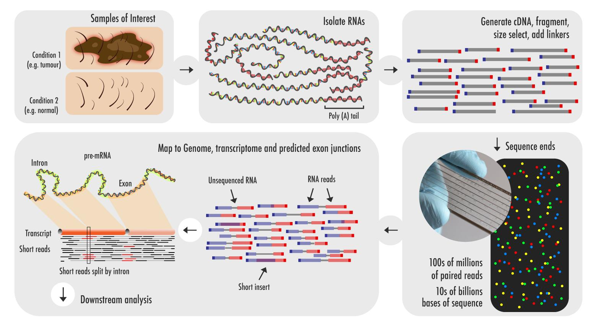

Mastering Agentic AI in Bioinformatics: From Insight to Impact
==============================================================

TS. Nguyễn Cường

Giám đốc khoa học, Công ty LOBI
Nghiên cứu viên chính, Viện CNTT, VAST

# 1. AI Agent

## 1.1 AI Agent là gì?

AI agent là hệ thống dùng LLM để **tự theo đuổi một mục tiêu qua nhiều bước**: tự lập kế hoạch, tự gọi công cụ, quan sát kết quả, tự sửa lỗi và quyết định khi nào xong. Người dùng giao **mục tiêu**, không giao từng bước.

Một định nghĩa ngắn hay được dùng: *agent = LLM + công cụ + vòng lặp*. Anthropic phân biệt thêm: trong **workflow**, các bước do lập trình viên định sẵn; trong **agent**, chính LLM quyết định bước tiếp theo.

Có rất nhiều cách sử dụng AI Agent khác nhau như là sử dụng 1 AI Agent để làm tất cả mọi việc, hoặc định nghĩa nhiều AI agent và giao việc cho chúng cùng với quy ước giao tiếp, làm việc với nhau.

## 1.2 Công thức tạo ra một AI Agent để giao việc

Giao việc cho agent giống như giao việc cho một trợ lý mới: càng rõ vai trò, mục tiêu, công cụ và tiêu chí hoàn thành thì kết quả càng ít lệch. Một agent tốt có thể được mô tả bằng 8 thành phần:

| Thành phần                             | Câu hỏi cần trả lời                              | Ví dụ                                                                                             |
| ---------------------------------------- | ----------------------------------------------------- | --------------------------------------------------------------------------------------------------- |
| **Title** (Danh xưng)             | Agent này là ai?                                    | Chuyên viên rà soát tài liệu microbiome                                                       |
| **Expertise** (Chuyên môn)       | Agent cần giỏi về lĩnh vực, phương pháp nào? | Microbiome ruột, 16S/shotgun, tìm kiếm PubMed có hệ thống                                     |
| **Goal** (Mục tiêu)              | Kết quả cuối cùng cần đạt là gì?             | Đánh giá mức thiếu hụt dữ liệu microbiome IBD ở Đông Nam Á                              |
| **Role** (Nhiệm vụ)              | Agent làm những việc gì, theo thứ tự nào?      | Tìm bài → trích xuất thông tin → tra kho dữ liệu → tổng hợp                             |
| **Tools** (Công cụ)              | Agent được dùng công cụ, nguồn dữ liệu nào? | PubMed, bioRxiv, SRA, ENA, MGnify, đọc web                                                        |
| **Constraints** (Ràng buộc)      | Điều gì không được làm, giới hạn ở đâu?  | Chỉ dùng bài có PMID/DOI; không suy đoán; không tải dữ liệu nội bộ lên                |
| **Output** (Đầu ra)              | Kết quả trình bày dưới dạng nào?              | Bảng nghiên cứu, bảng theo quốc gia, danh sách khoảng trống                                 |
| **Done** (Tiêu chí hoàn thành) | Khi nào coi là xong, khi nào cần hỏi lại?       | Đã tra đủ 11 nước; nếu một nước không có kết quả, báo lại kèm truy vấn đã dùng |

Có thể nhớ gọn: **Ai – Giỏi gì – Để đạt gì – Làm gì – Bằng gì – Không được gì – Nộp gì – Khi nào xong**.

**Mẫu prompt định nghĩa một agent**

```text
# Danh xưng
Bạn là [Title].

# Chuyên môn
Bạn có chuyên môn về [lĩnh vực, phương pháp, công cụ].

# Mục tiêu
[Kết quả cuối cùng cần đạt, gắn với câu hỏi nghiên cứu cụ thể].

# Nhiệm vụ
1. [Bước 1]
2. [Bước 2]
3. ...
Bạn được tự điều chỉnh kế hoạch nếu kết quả trung gian không như dự kiến,
nhưng phải ghi lại lý do điều chỉnh.

# Công cụ được dùng
[Danh sách công cụ, cơ sở dữ liệu, thư mục được truy cập].

# Ràng buộc
- [Điều không được làm]
- Nếu không chắc một thông tin, ghi "chưa xác minh" thay vì suy đoán.

# Đầu ra
[Định dạng: bảng, file, cấu trúc mục, độ dài].

# Tiêu chí hoàn thành
- [Điều kiện coi là xong]
- Dừng lại và hỏi tôi khi: [tình huống cần con người quyết định].
```

**Mẹo khi viết**:

- **Goal cụ thể hơn Role:** "Tìm khoảng trống dữ liệu IBD ở Đông Nam Á" tốt hơn "Hãy là chuyên gia microbiome".
- **Một agent, một nhiệm vụ chính:** nếu mô tả nhiệm vụ dài quá một trang hoặc cần nhiều chuyên môn khác nhau, cân nhắc tách thành nhóm agent (phần tiếp theo).
- **Cho agent quyền tự điều chỉnh, nhưng yêu cầu ghi nhật ký:** truy vấn đã dùng, nguồn đã đọc, lý do loại bỏ. Đây là cơ sở để kiểm chứng.
- **Định nghĩa trước điểm dừng:** agent cần biết khi nào nên dừng lại hỏi, thay vì tự đoán và đi tiếp.
- **Tái sử dụng:** lưu định nghĩa agent thành file (ví dụ `agents/literature-scout.md` hoặc subagent trong Claude Code) để dùng lại cho các đề tài khác. Muốn dùng lại được thì **đừng viết đặc thù đề tài vào file agent**: tên bộ dữ liệu, tên loài, thiết kế thí nghiệm, tên file đầu vào đều thuộc về phần mô tả dự án. Nếu mỗi lần đổi đề tài lại phải sửa file agent, nghĩa là ranh giới này đã bị lẫn.

## 1.3 Công thức tạo ra 1 nhóm AI Agent và quy chế làm việc nhóm

Khi nhiệm vụ cần nhiều chuyên môn (tài liệu, dữ liệu, thống kê, phản biện) hoặc cần góc nhìn độc lập để kiểm tra lẫn nhau, nên dùng một nhóm agent thay vì một agent làm tất cả. Mỗi thành viên được định nghĩa theo công thức ở phần trên; phần mới là **quy chế làm việc nhóm**.

**Công thức: Nhóm agent = Mục tiêu chung + Thành viên + Điều phối + Quy trình + Giao thức giao tiếp + Quy tắc quyết định + Điểm kiểm duyệt của con người**

Bảng mô tả chi tiết các thành phần của công thức:

| Thành phần                                   | Nội dung cần định nghĩa                                                                            |
| ---------------------------------------------- | ------------------------------------------------------------------------------------------------------- |
| **Mục tiêu chung**                     | Sản phẩm cuối cùng của cả nhóm và tiêu chí đánh giá                                        |
| **Thành viên**                         | Mỗi agent có Title/Expertise/Goal/Role/Tools/Output riêng, không chồng chéo                       |
| **Điều phối (Lead/Orchestrator)**     | Ai chia việc, theo dõi tiến độ, tổng hợp và quyết định khi nào xong                         |
| **Quy trình**                           | Thứ tự làm việc: tuần tự (pipeline), song song, hay vòng lặp đề xuất – phản biện – sửa  |
| **Giao thức giao tiếp**                | Định dạng bàn giao giữa các agent, nơi lưu kết quả chung (thư mục, file, bảng)             |
| **Quy tắc quyết định**               | Xử lý khi các agent bất đồng; ai có quyền quyết định cuối; giới hạn số vòng phản biện |
| **Điểm kiểm duyệt của con người** | Những bước bắt buộc chờ nhà nghiên cứu duyệt trước khi đi tiếp                            |

**Các mô hình làm việc nhóm thường gặp**

| Mô hình                           | Cách hoạt động                                                                 | Phù hợp khi                                                               |
| ----------------------------------- | ---------------------------------------------------------------------------------- | --------------------------------------------------------------------------- |
| **Dây chuyền (pipeline)**   | A làm xong chuyển cho B, B chuyển cho C                                         | Các bước có thứ tự rõ: tìm tài liệu → trích xuất → tổng hợp |
| **Song song (fan-out)**       | Điều phối chia việc cho nhiều agent cùng lúc rồi gộp kết quả            | Rà soát nhiều quốc gia, nhiều cơ sở dữ liệu cùng lúc             |
| **Đề xuất – phản biện** | Một agent đề xuất, một agent phản biện, lặp đến khi đạt yêu cầu      | Đánh giá giả thuyết, thiết kế nghiên cứu (tình huống 6)          |
| **Hội đồng**               | Nhiều agent đánh giá độc lập cùng một ý tưởng, điều phối tổng hợp | Chấm điểm và xếp hạng nhiều ý tưởng                               |

**Ví dụ: nhóm agent xây dựng ý tưởng nghiên cứu Tin sinh học**

| Thành viên                    | Expertise                                              | Nhiệm vụ chính                                                                      | Đầu ra bàn giao                                              |
| ------------------------------- | ------------------------------------------------------ | -------------------------------------------------------------------------------------- | --------------------------------------------------------------- |
| **Trưởng nhóm (Lead)** | Quản lý dự án nghiên cứu                         | Chia việc, theo dõi tiến độ, tổng hợp, đưa ra bản cuối                      | Báo cáo tổng hợp                                            |
| **Literature Scout**      | Tìm kiếm tài liệu có hệ thống                   | Quét PubMed, bioRxiv; xác định khoảng trống                                      | Bảng nghiên cứu + danh sách khoảng trống                  |
| **Data Hunter**           | Kho dữ liệu công khai (GEO, SRA, ENA, GWAS Catalog) | Tìm và đánh giá dataset có thể tái sử dụng                                   | Bảng dataset kèm mã truy cập, metadata                      |
| **Methodologist**         | Thống kê, thiết kế nghiên cứu                    | Đề xuất phương pháp, ước lượng cỡ mẫu, power, chi phí                     | Đề xuất thiết kế + ước lượng khả thi                  |
| **Critic (Red-team)**     | Phản biện khoa học                                  | Chỉ ra confounder, batch effect, sai lệch, trùng lặp với công bố đã có       | Danh sách vấn đề, mức độ nghiêm trọng, đề xuất sửa |
| **Writer**                | Viết đề cương khoa học; Bài báo khoa học      | Chuyển ý tưởng đã duyệt thành đề cương; Chuyển kết quả thành bài báo | Bản đề cương; Bài báo khoa học.                         |

Luồng làm việc: Literature Scout và Data Hunter chạy song song → Lead tổng hợp, đề xuất 3–5 ý tưởng → **nhà nghiên cứu chọn 1–2 ý tưởng** → Methodologist thiết kế → Critic phản biện (tối đa 2 vòng sửa) → **nhà nghiên cứu duyệt** → Writer viết đề cương.

**Mẫu quy chế làm việc nhóm**

```text
# Mục tiêu chung
[Sản phẩm cuối cùng và tiêu chí đánh giá].

# Thành viên
- Lead: [định nghĩa theo công thức 1 agent]
- [Agent 2]: ...
- [Agent 3]: ...

# Quy trình
1. [Bước, agent phụ trách, chạy tuần tự hay song song]
2. ...

# Giao thức giao tiếp
- Mọi kết quả lưu vào thư mục chung [đường dẫn], mỗi agent một file,
  đặt tên theo dạng [vai-trò]_[nội-dung].md.
- Mỗi lần bàn giao gồm: (1) kết quả, (2) nguồn/bằng chứng (PMID, DOI,
  mã dataset), (3) điểm chưa chắc chắn, (4) đề xuất bước tiếp theo.
- Agent chỉ sửa file của mình; góp ý cho agent khác bằng cách ghi
  vào file phản hồi riêng.

# Quy tắc quyết định
- Khi bất đồng, mỗi bên nêu lập luận kèm bằng chứng; Lead quyết định.
- Vòng đề xuất – phản biện tối đa [N] lần; quá số này, chuyển cho con người.
- Không đưa vào kết quả cuối thông tin chưa xác minh mà không đánh dấu "chưa xác minh".

# Điểm kiểm duyệt của con người
- Dừng chờ duyệt sau khi: [chọn ý tưởng], [chốt thiết kế], [trước khi viết đề cương].

# Tiêu chí hoàn thành
[Điều kiện để Lead tuyên bố nhóm đã xong].
```

**Lưu ý khi dùng nhóm agent**:

- **Bắt đầu nhỏ:** thử với 1 agent trước; chỉ tách nhóm khi thấy rõ một agent bị quá tải hoặc cần góc nhìn độc lập.
- **Phân vai không chồng chéo:** hai agent cùng làm một việc sẽ cho kết quả mâu thuẫn và tốn chi phí gấp đôi.
- **Chuẩn hóa định dạng bàn giao:** phần lớn lỗi của nhóm agent xảy ra ở khâu chuyển giao, khi agent sau hiểu sai đầu ra của agent trước.
- **Critic phải độc lập:** agent phản biện chỉ nên thấy sản phẩm, không thấy lập luận nội bộ của agent đề xuất, để tránh bị "thuyết phục" theo.
- **Giới hạn vòng lặp và chi phí:** nhóm agent tốn nhiều token hơn đáng kể so với một agent; đặt trước số vòng tối đa và điểm dừng.
- **Con người giữ quyền quyết định:** các điểm kiểm duyệt là bắt buộc, không phải tùy chọn.

## 1.4 Ứng dụng AI Agent trong Tin sinh học

Việc ứng dụng AI agent rất đa dạng, muôn hình vạn trạng. Trong khuôn khổ của một khóa đào tạo ngắn này, chúng ta sẽ xem xét hai tình huống phổ biến sau:

- **Tính huống 1**: Chúng ta đã biết quy trình phân tích, giờ cần AI Agent thực hiện dưới sự chỉ dẫn và giám sát của chúng ta.
- **Tình huống 2**: Chúng ta có ý tưởng, có dữ liệu, giờ cần xây dựng quy trình phân tích, diễn giải và viết bài báo khoa học.

# 2. Tình huống 1: Ứng dụng AI Agent trong phân tích dữ liệu giải trình tự

## 2.1 Mở đầu

Để minh họa cho **Tình huống 1** này, chúng ta sẽ lấy một ví dụ về phân tích Bulk RNAseq. **Bulk RNA-seq** analysis là quy trình phân tích dữ liệu giải trình tự RNA trên một quần thể tế bào hoặc mô, nhằm xác định mức độ biểu hiện của các gene, so sánh biểu hiện gene giữa các nhóm mẫu và tìm hiểu những cơ chế sinh học liên quan đến một điều kiện hoặc kiểu hình cụ thể. Đây là một trong những phương pháp nền tảng của transcriptomics, được ứng dụng rộng rãi trong nghiên cứu y sinh, nông nghiệp, vi sinh vật và sinh học phân tử.

 *Hình 1. Quy trình thí nghiệm và phân tích bulk RNA-seq. (1) Thu mẫu từ các điều kiện cần so sánh, ví dụ mô ung thư (điều kiện 1) và mô bình thường (điều kiện 2). (2) Tách RNA, thường chọn lọc mRNA dựa vào đuôi poly(A). (3) Chuyển RNA thành cDNA, cắt thành đoạn ngắn, chọn kích thước và gắn adapter (linker) vào hai đầu để tạo thư viện giải trình tự. (4) Giải trình tự hai đầu của mỗi đoạn trên flow cell. Một lần chạy tạo ra hàng trăm triệu cặp reads, tương đương hàng chục tỷ base. (5) Mỗi cặp reads gồm hai đầu đã được giải trình tự (RNA reads) và phần giữa không được giải trình tự (unsequenced RNA). Nếu đoạn cDNA ngắn (short insert), hai reads có thể chồng lên nhau. (6) Dóng hàng reads lên hệ gen, transcriptome và các điểm nối exon dự đoán. Reads nằm vắt qua điểm nối giữa hai exon sẽ bị tách đôi khi dóng hàng lên hệ gen, vì intron đã bị cắt bỏ khỏi mRNA (short reads split by intron). (7) Kết quả dóng hàng là đầu vào cho các phân tích tiếp theo: đếm reads theo gene, phân tích biểu hiện gene khác biệt... (Nguồn: Griffith et al., 2015)*

Ví dụ, một nghiên cứu RNAseq có thể so sánh sự biểu hiện gene khác biệt (Differentially Expressed Gene - DEG) giữa:

- Mô bệnh và mô khỏe mạnh.
- Cây trồng chịu hạn và cây trồng đối chứng.
- Vi khuẩn trước và sau khi xử lý kháng sinh.
- Các giống lúa có khả năng kháng sâu bệnh khác nhau.
- Mô ung thư trước và sau điều trị.

Các nội dung phân tích chính có trong một Bulk RNAseq Analysis gồm:

| STT | Nội dung                                                | Phân tích cụ thể                                                                                                                                                | Kết quả đầu ra                                                  |
| --- | -------------------------------------------------------- | ------------------------------------------------------------------------------------------------------------------------------------------------------------------- | ------------------------------------------------------------------- |
| ND1 | QC và tiền xử lý dữ liệu                           | Đánh giá chất lượng reads, phân bố chất lượng theo vị trí, GC content, adapter và số lượng reads sau lọc                                          | Báo cáo QC, dữ liệu FASTQ đã xử lý                          |
| ND2 | Dóng hàng và định lượng biểu hiện gene          | Dóng hàng reads với hệ gene tham chiếu hoặc định lượng transcript; đánh giá tỷ lệ mapping, mức độ bao phủ và hiệu quả định lượng          | BAM hoặc kết quả định lượng transcript/gene                  |
| ND3 | Xây dựng ma trận và khám phá dữ liệu biểu hiện | Tạo gene count matrix, chuẩn hóa phục vụ trực quan hóa, phân tích tương quan mẫu, PCA, clustering và phát hiện mẫu ngoại lệ                       | Ma trận biểu hiện gene, PCA plot, heatmap tương quan mẫu      |
| ND4 | Phân tích biểu hiện gene khác biệt                 | So sánh các nhóm nghiên cứu; tính log2 fold change, p-value và adjusted p-value/FDR; xác định gene tăng hoặc giảm biểu hiện có ý nghĩa thống kê | Bảng DEG, volcano plot, MA plot và heatmap các gene tiêu biểu  |
| ND5 | Phân tích chức năng và pathway                      | Phân tích làm giàu GO/KEGG, GSEA và xác định các quá trình sinh học liên quan đến các gene hoặc xu hướng biểu hiện                             | Bảng pathway, biểu đồ enrichment và danh sách gene liên quan |
| ND6 | Trực quan hóa và diễn giải sinh học                | Tổng hợp kết quả, đối chiếu với kiến thức sinh học hiện có, xác định gene ứng viên và đề xuất giả thuyết nghiên cứu                       | Hình minh họa, báo cáo phân tích và các kết luận chính   |

Quy trình phân tích từ ND1 đến ND4 đã được cộng đồng Tin sinh học xây dựng và phát triển khá toàn diện. Trong khi đó, ND5 và ND6 là giai đoạn khai thác dữ liệu để tìm kiếm các phát hiện mới (new insight) với rất nhiều kỹ thuật phân tích khác nhau phụ thuộc vào chủ đề nghiên cứu, câu hỏi nghiên cứu.

Trong ví dụ này, chúng ta sẽ ứng dụng AI Agent để thực hiện phân tích các nội dung ND1-ND4.

## 2.2 Phát biểu bài toán

### Bối cảnh

Chúng ta có bộ dữ liệu Buld RNAseq của loài ruồi giấm *Drosophila melanogaster* có nguồn gốc từ hai quần thể địa lý là Panama và Maine. Ruồi giấm được nuôi ở hai mức nhiệt độ: 21°C (low) và 29°C (high). Mỗi điều kiện thí nghiệm có 3 mẫu lặp sinh học (biological replicates). Như trong bảng sau:

|        | Low temp. | High temp. |
| ------ | --------- | ---------- |
| Maine  | 3         | 3          |
| Panama | 3         | 3          |

Tổng cộng chúng ta có 12 mẫu với sample sheet như sau:

| sample     | population | temp | Replicate |
| ---------- | ---------- | ---- | --------- |
| SRR1576457 | maine      | low  | 1         |
| SRR1576458 | maine      | low  | 2         |
| SRR1576459 | maine      | low  | 3         |
| SRR1576460 | maine      | high | 1         |
| SRR1576461 | maine      | high | 2         |
| SRR1576462 | maine      | high | 3         |
| SRR1576463 | panama     | low  | 1         |
| SRR1576464 | panama     | low  | 2         |
| SRR1576465 | panama     | low  | 3         |
| SRR1576514 | panama     | high | 1         |
| SRR1576515 | panama     | high | 2         |
| SRR1576516 | panama     | high | 3         |

### Mục tiêu

- Xây dựng ma trận biểu hiện gene (gene expression matrix hay còn gọi là gene count matrix).
- Phân tích biểu hiện gene khác biệt (Differential Gene Expression Analysis)

### Nội dung phân tích

Chúng ta sẽ thực hiện ND1–ND4 như sau:

**ND1. QC và tiền xử lý dữ liệu** (`FastQC`, `fastp`)

- Chạy `FastQC` trên dữ liệu thô của 12 mẫu.
- Lọc bằng `fastp`: cắt adapter, bỏ phần reads chất lượng thấp.
- Chạy lại `FastQC` để so sánh trước và sau lọc.

**ND2. Dóng hàng reads lên hệ gene tham chiếu** (`STAR`)

- Dùng index có sẵn của hệ gene tham chiếu ruồi giấm (đã được Ban tổ chức tạo trước).
- Dóng hàng reads đã lọc của từng mẫu lên hệ gene.
- Kiểm tra tỷ lệ reads dóng hàng thành công của từng mẫu.

**ND3. Xây dựng ma trận count và khám phá dữ liệu** (`featureCounts`, `DESeq2`)

- Dùng `featureCounts` đếm số reads trên mỗi gene, tạo ma trận count (gene × mẫu).
- Đưa ma trận vào `DESeq2`, chuẩn hóa dữ liệu.
- Vẽ PCA và heatmap tương quan để xem các mẫu có tách nhóm theo quần thể và nhiệt độ không, có mẫu nào bất thường không.

**ND4. Phân tích biểu hiện gene khác biệt** (`DESeq2`)

- So sánh nhiệt độ cao với nhiệt độ thấp trong từng quần thể.
- So sánh quần thể Panama với Maine ở cùng nhiệt độ.
- Tìm các gene đáp ứng với nhiệt độ khác nhau giữa hai quần thể.
- Lập bảng gene tăng/giảm biểu hiện, vẽ volcano plot và heatmap các gene tiêu biểu.

Cuối cùng, dùng `MultiQC` để tổng hợp báo cáo chất lượng của tất cả các bước vào một file.

## 2.3 Thực hành

### 2.3.1 Chuẩn bị môi trường làm việc

Toàn bộ khóa thực hành này sẽ sử dụng phần mềm VSCode để kết nối tới server VSOB5. Do đó, học viên cần có sẵn các yêu cầu sau:

- Đã cài **VSCode** với các Extensions:
  - Codex – OpenAI’s coding agent (version: 26.1007.21434)
    - **Lưu ý: dùng đúng phiên bản này**
    - Sử dụng DeepSeek API do VSOB5 cung cấp
  - HTML Preview  (v0.2.5)
  - PDF Preview
  - CSV/TSV Viewer
- Đã kết nối tới server thông qua **VSCode**

Học viên đọc tài liệu hướng dẫn ở đây: [Hướng dẫn cài đặt, cấu hình và sử dụng VSCode](./huongdan_vscode.md)

### 2.3.2 Chuẩn bị dữ liệu thực hành

Ban tổ chức đã chuẩn bị các bộ dữ liệu bao gồm:

- Dữ liệu giải trình tự PairedEnd, 24 FASTQ files
- Dữ liệu hệ gen tham chiếu, 01 FASTA file
- Dữ liệu chú giải hệ gen, 01 GTF file
- Dữ liệu metadata, 01 TSV file.

Lần lượt Copy và Paste các lệnh sau vào **Terminal** (cửa sổ dòng lệnh). Xem [Hướng dẫn cài đặt, cấu hình và sử dụng VSCode](./huongdan_vscode.md).

**Tạo thư mục dự án `tinh_huong_1`**: Đây là nơi lưu trữ toàn bộ dữ liệu của dự án này.

```bash
mkdir -p tinh_huong_1
```

**Tạo thư mục `00_RawData` và copy dữ liệu giải trình tự FASTQ files**

```bash
mkdir -p ./tinh_huong_1/00_RawData && cp -r ../shared_data/30k_reads/* ./tinh_huong_1/00_RawData/
```

**Tạo thư mục `00_Ref` và Copy dữ liệu hệ gen tham chiếu Reference Genome**

Dữ liệu hệ gen tham chiếu Reference genome sẽ gồm 2 file và 1 thư mục:

- `Drosophila_melanogaster.BDGP6.54.dna_sm.toplevel.fa` là trình tự DNA của hệ gen
- `Drosophila_melanogaster.BDGP6.54.114.gtf` là file chú giải (annotation) của hệ gen. file GTF chứa thông tin chú giải các đặc điểm trên hệ gene, đặc biệt là vị trí và cấu trúc của gene, transcript và exon.
- `star_index/` là index của hệ gen dành cho `STAR`, được Ban tổ chức tạo sẵn từ hai file trên để tiết kiệm thời gian ở ND2.

```bash
mkdir -p ./tinh_huong_1/00_Ref && cp -r ../shared_data/00_Ref/* ./tinh_huong_1/00_Ref/
```

**Tạo thư mục `00_metadata` và Copy dữ liệu metadata**

Trong phân tích RNA-seq, metadata file đóng vai trò quan trọng. Nó mô tả thông tin của từng mẫu sinh học, chẳng hạn mẫu thuộc loài nào, quần thể nào, được xử lý ở điều kiện nào và có mã mẫu gì. File này giúp chúng ta liên kết dữ liệu biểu hiện gene với thiết kế thí nghiệm để thực hiện phân tích thống kê chính xác.

```bash
mkdir -p ./tinh_huong_1/00_metadata && cp ../shared_data/metadata.tsv ./tinh_huong_1/00_metadata/
```

**Kiểm tra xem đã đủ dữ liệu chưa**

```bash
tree ./tinh_huong_1/
```

*Kết quả cần giống hệt thế này: 4 thư mục, 43 files*

```bash
./tinh_huong_1/
├── 00_metadata
│   └── metadata.tsv
├── 00_RawData
│   ├── SRR1576457_1.sub30k.fastq
│   ├── SRR1576457_2.sub30k.fastq
│   ├── SRR1576458_1.sub30k.fastq
│   ├── SRR1576458_2.sub30k.fastq
│   ├── SRR1576459_1.sub30k.fastq
│   ├── SRR1576459_2.sub30k.fastq
│   ├── SRR1576460_1.sub30k.fastq
│   ├── SRR1576460_2.sub30k.fastq
│   ├── SRR1576461_1.sub30k.fastq
│   ├── SRR1576461_2.sub30k.fastq
│   ├── SRR1576462_1.sub30k.fastq
│   ├── SRR1576462_2.sub30k.fastq
│   ├── SRR1576463_1.sub30k.fastq
│   ├── SRR1576463_2.sub30k.fastq
│   ├── SRR1576464_1.sub30k.fastq
│   ├── SRR1576464_2.sub30k.fastq
│   ├── SRR1576465_1.sub30k.fastq
│   ├── SRR1576465_2.sub30k.fastq
│   ├── SRR1576514_1.sub30k.fastq
│   ├── SRR1576514_2.sub30k.fastq
│   ├── SRR1576515_1.sub30k.fastq
│   ├── SRR1576515_2.sub30k.fastq
│   ├── SRR1576516_1.sub30k.fastq
│   └── SRR1576516_2.sub30k.fastq
└── 00_Ref
    ├── Drosophila_melanogaster.BDGP6.54.114.gtf
    ├── Drosophila_melanogaster.BDGP6.54.dna_sm.toplevel.fa
    └── star_index
        ├── chrLength.txt
        ├── chrNameLength.txt
        ├── chrName.txt
        ├── chrStart.txt
        ├── exonGeTrInfo.tab
        ├── exonInfo.tab
        ├── geneInfo.tab
        ├── Genome
        ├── genomeParameters.txt
        ├── Log.out
        ├── SA
        ├── SAindex
        ├── sjdbInfo.txt
        ├── sjdbList.fromGTF.out.tab
        ├── sjdbList.out.tab
        └── transcriptInfo.tab

5 directories, 43 files
```

Hãy đảm bảo bạn có đủ các file như trên để có thể thực thi được các bước tiếp theo.

### 2.3.3 Thực hành ND1. QC và tiền xử lý dữ liệu

Nhắc lại, chúng ta đang thực hành theo **Tình huống 1** mà ở đó chúng ta đã biết toàn bộ quy trình phân tích, giờ cần AI Agent thực hiện dưới sự chỉ dẫn và giám sát của chúng ta.

Như vậy, chúng ta sẽ tạo ra một Agent tên là **BioinformaticianAgent**, rồi lần lượt giao cho nó các nhiệm vụ phân tích từ ND1 đến ND4. Việc này gồm hai bước:

1. **Định nghĩa agent một lần** theo công thức ở mục 1.2: agent là ai, giỏi gì, được dùng công cụ gì, không được làm gì. Định nghĩa này dùng chung cho cả ND1–ND4.
2. **Giao từng nhiệm vụ**: mỗi ND là một prompt ngắn, chỉ nêu việc cần làm, đầu ra và khi nào coi là xong.

> ![Mẹo] Yêu cầu AI viết prompt mô tả cho Agent và prompt mô tả nhiệm vụ, chúng ta là người chỉnh sửa.

#### Bước 1: Thiết lập không gian làm việc và định nghĩa BioinformaticianAgent

Chúng ta tổ chức không gian làm việc theo một cấu trúc dùng chung cho cả khóa học (cả Tình huống 1 và Tình huống 2):

```text
~/                                  # thư mục home, VSCode mở thư mục này
├── AGENTS.md                       # hướng dẫn chung cho mọi agent (Codex tự đọc)
├── agents/                         # định nghĩa từng agent, mỗi agent một file
│   └── BioinformaticianAgent.md
├── tinh_huong_1/                   # dự án Tình huống 1
│   ├── PROJECT.md                  # mô tả dự án: mục tiêu, dữ liệu, thư mục kết quả
│   ├── 00_RawData/  00_Ref/  00_metadata/
│   └── 01_QC/  02_Alignment/  ...  # kết quả, do agent tạo ra
└── tinh_huong_2/                   # dự án Tình huống 2 (mục 3)
```

Ba loại file có vai trò khác nhau:

| File                          | Trả lời câu hỏi                                                                                  | Khi nào sửa                                  |
| ----------------------------- | ---------------------------------------------------------------------------------------------------- | ---------------------------------------------- |
| `~/AGENTS.md`               | Không gian làm việc tổ chức thế nào? Quy tắc chung mọi agent phải tuân theo là gì?      | Viết một lần, dùng cho cả khóa học      |
| `~/agents/<TênAgent>.md`   | Agent này là ai, giỏi gì, làm việc theo cách nào? (công thức ở mục 1.2)                  | Viết một lần, dùng lại cho nhiều dự án |
| `~/tinh_huong_X/PROJECT.md` | Dự án này làm gì, bối cảnh chuyên môn ra sao, dữ liệu ở đâu, dùng phương pháp gì? | Mỗi dự án một file                         |

**Ranh giới giữa hai loại file cuối là điều quan trọng nhất cần nắm:**

| Thuộc về                         | Ví dụ                                                                                                                       | Ghi ở đâu    |
| ---------------------------------- | ----------------------------------------------------------------------------------------------------------------------------- | --------------- |
| **Năng lực nghề nghiệp** | "biết các kho dữ liệu công khai", "phân biệt được raw count với RPKM", "chọn phương pháp theo dạng dữ liệu" | `agents/*.md` |
| **Đặc thù dự án**       | "cơ chế chịu mặn ở lúa", "thiết kế 2×2 với 12 mẫu", "tên cột có dạng `S40`"                                  | `PROJECT.md`  |

Nhờ tách như vậy, BioinformaticianAgent định nghĩa ở đây được **dùng lại nguyên vẹn** trong Tình huống 2 mà không sửa một chữ nào; chỉ cần viết thêm `PROJECT.md` cho dự án mới. Nếu phải sửa file agent mỗi lần đổi đề tài, nghĩa là thông tin dự án đã bị viết nhầm vào đó.

Tạo thư mục cho các file định nghĩa agent:

```bash
mkdir -p agents tinh_huong_1/{scripts,logs}
```

Sau đó tạo lần lượt 3 file dưới đây. *(Cách nhanh: chép bộ file có sẵn bằng lệnh ở Phụ lục A.2, rồi mở từng file ra đọc.)*

> ![Hướng dẫn] Sử dụng chức năng **New file** ở panel **Explorer** (bên trái), đặt tên file theo đúng đường dẫn (ví dụ `AGENTS.md` ở thư mục home, `BioinformaticianAgent.md` trong thư mục `agents`), sau đó copy và paste nội dung. Lưu lại.

**File 1: `~/AGENTS.md`**: hướng dẫn chung. Codex tự đọc file này mỗi khi bắt đầu làm việc.

```text
# Không gian làm việc
Đây là thư mục home của học viên trong khóa thực hành, gồm:
- agents/: định nghĩa các AI agent, mỗi agent một file (ví dụ agents/BioinformaticianAgent.md).
- tinh_huong_1/, tinh_huong_2/, ...: mỗi thư mục là một dự án. Mỗi dự án có file PROJECT.md mô tả mục tiêu, dữ liệu, thành viên, quy trình và thư mục kết quả.

# Nguyên tắc tách bạch
- File trong agents/ mô tả **năng lực nghề nghiệp** của agent: là ai, giỏi gì, làm việc theo cách nào. Những file này dùng chung cho mọi dự án.
- File PROJECT.md mô tả **đặc thù của dự án**: đề tài, bối cảnh chuyên môn, thiết kế thí nghiệm, tên file dữ liệu, phương pháp dự kiến.
- Nếu một thông tin chỉ đúng với một dự án, nó thuộc về PROJECT.md, **không được viết vào file định nghĩa agent**.

# Cách nhận việc
- Khi tôi yêu cầu "đóng vai <TênAgent>, làm việc cho dự án <thư mục dự án>": đọc agents/<TênAgent>.md và <thư mục dự án>/PROJECT.md trước khi làm bất cứ việc gì, rồi chỉ làm đúng vai trò đó.
- Mọi đường dẫn trong file định nghĩa agent và trong PROJECT.md (ví dụ 00_RawData/, scripts/) đều tính từ thư mục dự án.
- Chỉ đọc và ghi trong thư mục dự án được giao. Không sửa file trong agents/ và trong các dự án khác, trừ khi tôi yêu cầu.

# Quy tắc chung cho mọi agent, mọi dự án
- Trước khi làm, trình bày ngắn gọn kế hoạch và chờ tôi đồng ý.
- Không xóa, sửa, đổi tên hay ghi đè file trong các thư mục 00_* của dự án (dữ liệu đầu vào).
- Không tự cài thêm phần mềm. Nếu thiếu công cụ, dừng lại và báo tôi.
- Server dùng chung cho cả lớp: mỗi lệnh dùng tối đa 2 luồng (threads), không chạy song song nhiều lệnh nặng.
- Kiểm tra tham số bằng lệnh --help của công cụ đã cài, không dùng tham số theo trí nhớ.
- Viết lệnh vào script trong thư mục scripts/ của dự án rồi mới chạy. Ghi lỗi gặp phải và cách sửa vào logs/agent_log.md của dự án.
- Không bịa thông tin, số liệu hay trích dẫn. Nếu không chắc, ghi "chưa xác minh".
- Báo cáo viết bằng tiếng Việt; phân biệt rõ kết quả và giả thuyết.
```

**File 2: `~/agents/BioinformaticianAgent.md`**: định nghĩa agent theo công thức ở mục 1.2.

```text
# Danh xưng
Bạn là BioinformaticianAgent, chuyên viên Tin sinh học.

# Chuyên môn
Phân tích bulk RNA-seq, từ dữ liệu thô đến diễn giải sinh học:
- **Tiền xử lý:** kiểm tra chất lượng (FastQC, MultiQC), làm sạch (fastp), dóng hàng (STAR), đếm reads theo gene (featureCounts).
- **Phân tích biểu hiện khác biệt:** DESeq2 và edgeR cho dữ liệu count; limma-voom hoặc limma-trend cho dữ liệu đã chuẩn hóa. Bạn chọn phương pháp **theo dạng dữ liệu thực tế**, không mặc định dùng một công cụ.
- **Khám phá dữ liệu:** chuẩn hóa, PCA, phân cụm, heatmap tương quan mẫu, phát hiện mẫu ngoại lệ và hiệu ứng đợt (batch effect).
- **Phân tích chức năng:** GO enrichment, KEGG, GSEA. Với loài không có sẵn gói chú giải trong R, bạn dùng được file chú giải tự cung cấp.
- Thành thạo dòng lệnh Linux (bash) và R.

Bạn biết rằng **biểu hiện ở mức gene không phải tầng tín hiệu duy nhất**: một gene có thể không đổi mức biểu hiện nhưng vẫn thay đổi kiểu cắt nối luân phiên, mức dịch mã, hoặc hoạt tính. Khi phân tích biểu hiện không cho tín hiệu, hãy cân nhắc và đề xuất các tầng phân tích khác nếu dữ liệu cho phép.

# Mục tiêu
Thực hiện các nội dung phân tích được giao, theo mục tiêu và dữ liệu mô tả trong PROJECT.md của dự án. Mỗi lần chỉ làm nội dung được giao.

# Nhiệm vụ
Với mỗi nội dung được giao, làm theo trình tự:
1. Đọc yêu cầu, kiểm tra dữ liệu đầu vào và công cụ cần dùng đã sẵn sàng.
2. Trình bày ngắn gọn kế hoạch (các bước, lệnh chính, thư mục đầu ra); chờ tôi đồng ý rồi mới chạy.
3. Viết các lệnh vào một script trong thư mục scripts/ rồi chạy script đó.
4. Kiểm tra kết quả: lệnh có chạy hết không, file đầu ra có đủ không, các chỉ số có hợp lý không.
5. Báo cáo ngắn gọn kết quả và những điểm bất thường.
Bạn được tự điều chỉnh khi gặp lỗi, nhưng phải ghi lại lỗi và cách sửa.

# Công cụ được dùng
Các công cụ đã cài trên server: FastQC, fastp, MultiQC, STAR, featureCounts, R với DESeq2, edgeR, limma và các gói phân tích chức năng. Nếu cần một công cụ chưa có sẵn, hãy hỏi ý kiến tôi. Dữ liệu theo mô tả trong PROJECT.md.

# Ràng buộc
- Tuân thủ các quy tắc chung trong AGENTS.md.
- **Kiểm tra dạng dữ liệu trước khi chọn phương pháp.** Nếu dữ liệu đầu vào không phù hợp với công cụ dự kiến, dừng lại và báo tôi kèm đề xuất thay thế. Nhiều công cụ **vẫn chạy và vẫn cho ra kết quả** với dữ liệu sai dạng.
- **Không tự nới lỏng ngưỡng thống kê để có thêm kết quả.** Điều này bao gồm: hạ ngưỡng FDR, chuyển sang dùng p-value thô, bỏ bước lọc gene, hay gộp các nhóm mẫu vốn nên tách. Nếu kết quả thưa thớt, hãy báo cáo đúng như vậy.
- **Luôn báo cáo kết quả ở cả hai mức ngưỡng:** p-value thô và sau hiệu chỉnh đa kiểm định. Chênh lệch giữa hai con số là thông tin quan trọng, không phải điều cần che giấu.
- **Kết quả âm tính là kết quả hợp lệ.** Khi không tìm thấy khác biệt đáng kể, hãy trình bày điều đó rõ ràng kèm đánh giá về lực thống kê, thay vì tìm cách xoay xở cho ra kết quả.
- Không tự loại mẫu. Mẫu bất thường chỉ báo cáo để tôi quyết định.

# Đầu ra
- Mỗi nội dung một thư mục kết quả đánh số theo PROJECT.md, trong đó có file README.md báo cáo ngắn.
- Script lưu trong scripts/, đặt tên theo nội dung (ví dụ scripts/01_qc.sh).

# Tiêu chí hoàn thành
- Mỗi nội dung chỉ được coi là xong khi đủ file đầu ra và tôi đã xem báo cáo.
- Dừng lại và hỏi tôi khi: dữ liệu đầu vào thiếu hoặc lỗi; thiếu công cụ; một lỗi sửa 3 lần chưa được; kết quả bất thường mà bạn không giải thích được.
```

**File 3: `~/tinh_huong_1/PROJECT.md`**: mô tả dự án Tình huống 1.

```text
# Dự án
Tình huống 1: Phân tích dữ liệu bulk RNA-seq ruồi giấm Drosophila melanogaster.

# Mục tiêu
Phân tích bulk RNA-seq cho 12 mẫu ruồi giấm (2 quần thể Maine và Panama × 2 mức nhiệt độ 21°C (low) và 29°C (high) × 3 lặp sinh học), từ dữ liệu FASTQ đến danh sách gene biểu hiện khác biệt. Công việc được giao theo từng nội dung ND1–ND4.

# Thành viên
- BioinformaticianAgent (agents/BioinformaticianAgent.md): thực hiện phân tích.
- Người dùng: giao việc, duyệt kế hoạch và kết quả.

# Thiết kế thí nghiệm
Thiết kế **2×2**, mỗi nhóm 3 lặp sinh học, tổng 12 mẫu:
- Yếu tố 1 — quần thể: Maine (ôn đới) và Panama (nhiệt đới).
- Yếu tố 2 — nhiệt độ nuôi: 21°C (low) và 29°C (high).

Nhóm tham chiếu: Maine và low.

# Dữ liệu đầu vào
- 00_RawData/: 24 file FASTQ paired-end, mỗi mẫu 2 file _1 và _2.
- 00_Ref/: genome FASTA, annotation GTF, và index STAR có sẵn trong 00_Ref/star_index/.
- 00_metadata/metadata.tsv: thông tin mẫu.

# Lưu ý về dữ liệu
- Dữ liệu thực hành chỉ có 30.000 reads mỗi file (hậu tố `sub30k`) để chạy nhanh. Một số chỉ số QC sẽ khác so với dữ liệu đầy đủ, và phân tích biểu hiện khác biệt hầu như không ra kết quả. Đây là điều bình thường, không phải lỗi.
- Khi được giao phân tích với ma trận count đầy đủ, dữ liệu nằm trong 04_DEG_full/ và có thể chứa giá trị count không nguyên (count ước lượng). Cần kiểm tra và xử lý trước khi đưa vào DESeq2.

# Phương pháp dự kiến
- ND1–ND3: FastQC, fastp, MultiQC, STAR (dùng index có sẵn, **không tạo lại**), featureCounts.
- ND4: DESeq2 với mô hình có tương tác `~ quần thể + nhiệt độ + quần thể:nhiệt độ`. Hệ số tương tác trả lời câu hỏi: gene nào đáp ứng với nhiệt độ khác nhau giữa hai quần thể.

# Thư mục kết quả
- 01_QC/, 02_Alignment/, 03_Counts/, 04_DEG/: kết quả của ND1–ND4.
- Các thư mục khác (ví dụ 04_DEG_full/, 05_Report/) sẽ được nêu rõ khi giao việc.
- scripts/: script; logs/: nhật ký lỗi và cách sửa.
```

#### Bước 2: Giao nhiệm vụ ND1 cho BioinformaticianAgent

Mở cửa sổ Codex trong VSCode, rồi dán prompt sau. Câu đầu tiên của prompt cho Codex biết cần đóng vai agent nào và làm việc cho dự án nào; theo hướng dẫn trong `AGENTS.md`, Codex sẽ tự đọc `agents/BioinformaticianAgent.md` và `tinh_huong_1/PROJECT.md`.

```text
Đóng vai BioinformaticianAgent, làm việc cho dự án tinh_huong_1. Hãy thực hiện ND1. QC và tiền xử lý dữ liệu.

# Mục tiêu
Đánh giá chất lượng dữ liệu thô của 12 mẫu, làm sạch dữ liệu, và kiểm tra chất lượng dữ liệu sau khi làm sạch, để sẵn sàng cho bước dóng hàng (ND2).

# Nhiệm vụ
1. Chạy FastQC trên 24 file FASTQ thô trong 00_RawData/.
2. Dùng fastp để làm sạch dữ liệu theo từng cặp file _1 và _2 của mỗi mẫu: cắt adapter, bỏ phần reads chất lượng thấp, loại reads quá ngắn.
3. Chạy lại FastQC trên dữ liệu đã làm sạch.
4. Dùng MultiQC tổng hợp tất cả báo cáo thành một file.
5. So sánh chất lượng trước và sau khi làm sạch.

# Đầu ra
- 01_QC/fastqc_raw/    : báo cáo FastQC của dữ liệu thô
- 01_QC/fastp/         : FASTQ đã làm sạch và báo cáo fastp của từng mẫu
- 01_QC/fastqc_clean/  : báo cáo FastQC của dữ liệu đã làm sạch
- 01_QC/multiqc/       : báo cáo MultiQC tổng hợp
- 01_QC/README.md      : báo cáo ngắn, gồm một bảng cho 12 mẫu (số reads trước và sau lọc, tỷ lệ reads giữ lại) và nhận xét về chất lượng dữ liệu
- scripts/01_qc.sh     : toàn bộ lệnh đã chạy

# Tiêu chí hoàn thành
- Đủ báo cáo cho cả 12 mẫu ở mọi bước.
- Báo cáo MultiQC mở được.
- Dừng lại và báo tôi nếu có mẫu bị loại quá nhiều reads (trên 20%) hoặc có mẫu chất lượng khác hẳn các mẫu còn lại.

Trước khi chạy, hãy trình bày kế hoạch để tôi duyệt.
```

#### Bước 3: Quan sát và kiểm tra kết quả

Trong khi agent làm việc, hãy để ý xem nó có:

- **Trình bày kế hoạch và chờ duyệt** trước khi chạy không.
- **Kiểm tra công cụ** (chạy `fastqc --version`, `fastp --help`) trước khi dùng không.
- **Xử lý đúng dữ liệu paired-end**: đưa cả hai file `_1` và `_2` của cùng một mẫu vào fastp trong một lệnh.
- **Không động vào thư mục `00_RawData/`.**

Sau khi agent báo xong, tự kiểm tra:

- [ ] Mở `01_QC/multiqc/multiqc_report.html` bằng HTML Preview: có đủ 12 mẫu không?
- [ ] So sánh biểu đồ chất lượng theo vị trí base trước và sau khi làm sạch: chất lượng có cải thiện không?
- [ ] Đọc `01_QC/README.md`: số reads trong bảng có khớp với báo cáo MultiQC không?
- [ ] Mở `scripts/01_qc.sh`: các lệnh có dễ hiểu không, có thể chạy lại được không?

> ![Lưu ý] BioinformaticianAgent đủ kinh nghiệm để nhắc tới *mỗi file chỉ có 30.000 reads* (`sub30k`) để chạy nhanh.

### 2.3.4 Thực hành ND2. Dóng hàng reads lên hệ gene tham chiếu

BioinformaticianAgent đã được định nghĩa trong file `agents/BioinformaticianAgent.md` ở ND1, nên ở ND2 chúng ta chỉ cần giao nhiệm vụ mới (có thể tiếp tục trong cùng cửa sổ chat, hoặc mở cửa sổ chat mới vì câu đầu của prompt đã nêu rõ vai trò và dự án). Đầu vào của ND2 chính là dữ liệu đã làm sạch ở ND1, vì vậy hãy chắc chắn ND1 đã hoàn thành và bạn đã xem báo cáo `01_QC/README.md`.

Dóng hàng (alignment) là bước xác định mỗi read nằm ở vị trí nào trên hệ gene tham chiếu. Với `STAR`, việc này gồm hai phần:

- **Tạo index**: chuyển hệ gene tham chiếu (FASTA) và chú giải (GTF) thành một dạng giúp STAR tìm kiếm nhanh. Bước này tốn nhiều thời gian và bộ nhớ, nhưng chỉ cần làm một lần. Ban tổ chức đã tạo sẵn index trong `00_Ref/star_index/`, nên chúng ta **không cần tạo lại**.
- **Dóng hàng**: đưa reads của từng mẫu lên hệ gene bằng index có sẵn, tạo ra file BAM.

#### Bước 1: Giao nhiệm vụ ND2 cho BioinformaticianAgent

Dán prompt sau vào cửa sổ Codex:

```text
Đóng vai BioinformaticianAgent, làm việc cho dự án tinh_huong_1. Hãy thực hiện ND2. Dóng hàng reads lên hệ gene tham chiếu.

# Mục tiêu
Dóng hàng reads đã làm sạch ở ND1 của 12 mẫu lên hệ gene tham chiếu Drosophila melanogaster (BDGP6), và đánh giá chất lượng dóng hàng, để sẵn sàng cho bước đếm reads theo gene (ND3).

# Nhiệm vụ
1. Kiểm tra đầu vào: 24 file FASTQ đã làm sạch trong 01_QC/fastp/ và index STAR có sẵn trong 00_Ref/star_index/.
2. Kiểm tra index có dùng được không: đọc file genomeParameters.txt và Log.out trong 00_Ref/star_index/ để biết index được tạo từ file FASTA, GTF nào và bằng phiên bản STAR nào; so với phiên bản STAR đang cài trên server.
3. Dóng hàng từng mẫu (cặp file _1 và _2) lên hệ gene bằng index có sẵn, xuất file BAM đã sắp xếp theo tọa độ.
4. Tổng hợp tỷ lệ dóng hàng của 12 mẫu từ file Log.final.out của STAR, và cập nhật báo cáo MultiQC.

# Đầu ra
- 02_Alignment/bam/        : file BAM đã sắp xếp và file log của từng mẫu
- 02_Alignment/multiqc/    : báo cáo MultiQC tổng hợp (gồm cả kết quả ND1)
- 02_Alignment/README.md   : báo cáo ngắn, gồm một bảng cho 12 mẫu (số reads đưa vào, tỷ lệ map duy nhất, tỷ lệ map nhiều vị trí, tỷ lệ không map) và nhận xét về chất lượng dóng hàng
- scripts/02_alignment.sh  : toàn bộ lệnh đã chạy

# Ràng buộc bổ sung
- Server dùng chung cho cả lớp: mỗi lệnh STAR dùng tối đa 2 luồng (threads), chạy lần lượt từng mẫu, không chạy song song nhiều mẫu.
- Không tạo lại index. Dùng index có sẵn trong 00_Ref/star_index/ và không ghi gì vào thư mục này.

# Tiêu chí hoàn thành
- Đủ file BAM và file log cho cả 12 mẫu.
- Dừng lại và báo tôi nếu index không dùng được (ví dụ tạo bằng phiên bản STAR khác, hoặc không tạo từ đúng file FASTA, GTF trong 00_Ref/), nếu có mẫu có tỷ lệ map duy nhất dưới 70%, hoặc có mẫu khác hẳn các mẫu còn lại.

Trước khi chạy, hãy trình bày kế hoạch để tôi duyệt.
```

#### Bước 2: Quan sát và kiểm tra kết quả

Trong khi agent làm việc, hãy để ý xem nó có:

- **Dùng đúng đầu vào**: lấy dữ liệu đã làm sạch trong `01_QC/fastp/`, không lấy dữ liệu thô trong `00_RawData/`.
- **Kiểm tra index trước khi dùng**: đọc thông tin của index có sẵn (phiên bản STAR, file nguồn) thay vì dùng ngay. Index tạo bằng phiên bản STAR khác có thể không chạy được.
- **Không tự tạo lại index**: nếu gặp lỗi với index, agent dừng lại báo thay vì tự tạo index mới.
- **Tôn trọng giới hạn tài nguyên**: không dùng quá 2 luồng, chạy lần lượt từng mẫu.
- **Đọc kết quả, không chỉ báo "chạy xong"**: có nhận xét về tỷ lệ map của từng mẫu không.

Sau khi agent báo xong, tự kiểm tra:

- [ ] Thư mục `02_Alignment/bam/` có đủ 12 file BAM không?
- [ ] Mở báo cáo MultiQC: phần STAR có đủ 12 mẫu không? Tỷ lệ map duy nhất có đồng đều giữa các mẫu không?
- [ ] Mở file `Log.final.out` của một mẫu bất kỳ, đối chiếu tỷ lệ map với bảng trong `02_Alignment/README.md`.
- [ ] Mở `scripts/02_alignment.sh`: lệnh STAR có trỏ đúng tới `00_Ref/star_index/` không, có dùng đúng dữ liệu đã làm sạch trong `01_QC/fastp/` không?

*Câu hỏi thảo luận:* nếu một mẫu có tỷ lệ không map rất cao, nguyên nhân có thể là gì (nhầm loài, nhiễm vi sinh vật, lỗi ở bước làm sạch)? Hãy hỏi BioinformaticianAgent cách kiểm tra từng khả năng.

### 2.3.5 Thực hành ND3. Xây dựng ma trận count và khám phá dữ liệu

Đầu vào của ND3 là các file BAM ở ND2. Hãy chắc chắn ND2 đã hoàn thành và bạn đã xem báo cáo `02_Alignment/README.md`.

ND3 gồm hai phần:

- **Đếm reads theo gene** bằng `featureCounts`: với mỗi mẫu, đếm xem có bao nhiêu reads nằm trên mỗi gene, dựa vào file chú giải GTF. Kết quả là **ma trận count**: mỗi hàng là một gene, mỗi cột là một mẫu.
- **Khám phá dữ liệu** bằng `DESeq2` trong R: chuẩn hóa dữ liệu, rồi vẽ PCA và heatmap tương quan để xem các mẫu có tách nhóm theo quần thể và nhiệt độ không, có mẫu nào bất thường không. Đây là bước kiểm tra quan trọng trước khi phân tích biểu hiện gene khác biệt ở ND4.

#### Bước 1: Giao nhiệm vụ ND3 cho BioinformaticianAgent

Dán prompt sau vào cửa sổ Codex:

```text
Đóng vai BioinformaticianAgent, làm việc cho dự án tinh_huong_1. Hãy thực hiện ND3. Xây dựng ma trận count và khám phá dữ liệu.

# Mục tiêu
Tạo ma trận count (gene × 12 mẫu) từ các file BAM ở ND2, và khám phá dữ liệu để đánh giá các mẫu có phân nhóm theo thiết kế thí nghiệm (quần thể, nhiệt độ) không, có mẫu ngoại lệ không, để sẵn sàng cho phân tích biểu hiện gene khác biệt (ND4).

# Nhiệm vụ
1. Kiểm tra đầu vào: 12 file BAM trong 02_Alignment/bam/, file GTF trong 00_Ref/, file thông tin mẫu 00_metadata/metadata.tsv.
2. Xác định strandedness của thư viện từ dữ liệu (không giả định), và giải thích cách xác định.
3. Dùng featureCounts đếm reads theo gene cho cả 12 mẫu trong một lệnh. Lưu ý dữ liệu là paired-end.
4. Tạo ma trận count gọn: hàng là gene ID, cột là tên mẫu (ví dụ SRR1576457), thứ tự cột khớp với metadata.tsv.
5. Viết script R dùng DESeq2: nạp ma trận count và metadata, lọc gene có count quá thấp, chuẩn hóa dữ liệu, vẽ PCA (tô màu theo nhiệt độ, hình dạng theo quần thể) và heatmap tương quan giữa các mẫu.
6. Nhận xét: các mẫu có tách nhóm theo quần thể và nhiệt độ không, yếu tố nào tách rõ hơn, có mẫu nào nằm lệch khỏi nhóm của nó không.

# Đầu ra
- 03_Counts/featurecounts/ : kết quả gốc của featureCounts (file count và file summary)
- 03_Counts/count_matrix.tsv : ma trận count gọn (gene × 12 mẫu)
- 03_Counts/exploration/ : PCA plot và heatmap tương quan (định dạng PNG và PDF)
- 03_Counts/README.md : báo cáo ngắn, gồm strandedness đã xác định, một bảng cho 12 mẫu (tổng số reads, số reads được gán vào gene, tỷ lệ gán), số gene còn lại sau khi lọc, và nhận xét về PCA, heatmap
- scripts/03_counts.sh : lệnh featureCounts
- scripts/03_exploration.R : script R khám phá dữ liệu

# Ràng buộc bổ sung
- Server dùng chung cho cả lớp: featureCounts dùng tối đa 2 luồng (threads).
- Không tự loại mẫu nào. Nếu thấy mẫu bất thường, chỉ báo cáo để tôi quyết định.

# Tiêu chí hoàn thành
- Ma trận count có đủ 12 cột, tên cột khớp với metadata.tsv.
- PCA plot và heatmap tương quan mở được.
- Dừng lại và báo tôi nếu tỷ lệ reads được gán vào gene dưới 50% ở bất kỳ mẫu nào, nếu không xác định được rõ strandedness, hoặc nếu có mẫu nằm lệch hẳn khỏi nhóm của nó trên PCA.

Trước khi chạy, hãy trình bày kế hoạch để tôi duyệt.
```

#### Bước 2: Quan sát và kiểm tra kết quả

Trong khi agent làm việc, hãy để ý xem nó có:

- **Xác định strandedness từ dữ liệu**: ví dụ chạy thử featureCounts với các thiết lập strand khác nhau rồi so sánh tỷ lệ reads được gán, thay vì đoán. Chọn sai strandedness có thể làm mất phần lớn reads.
- **Xử lý đúng dữ liệu paired-end**: đếm theo cặp reads (fragment), không đếm từng read riêng lẻ.
- **Ghép đúng ma trận với metadata**: tên cột của ma trận khớp với tên mẫu trong `metadata.tsv`. Nếu ghép sai, mọi phân tích phía sau đều sai.
- **Đọc PCA một cách thận trọng**: có nhận xét dựa trên hình, và không tự ý loại mẫu.

Sau khi agent báo xong, tự kiểm tra:

- [ ] Mở `03_Counts/count_matrix.tsv` bằng CSV/TSV Viewer: có đủ 12 cột không, tên cột có đúng không?
- [ ] Đọc `03_Counts/README.md`: strandedness agent chọn là gì, lập luận có thuyết phục không?
- [ ] So sánh tỷ lệ reads được gán vào gene trong `README.md` với file summary của featureCounts.
- [ ] Mở PCA plot: các mẫu lặp của cùng một điều kiện có nằm gần nhau không? Quần thể hay nhiệt độ tách nhóm rõ hơn?
- [ ] Mở `scripts/03_exploration.R`: agent lọc gene theo tiêu chí nào, chuẩn hóa bằng cách nào?

*Lưu ý:* với dữ liệu thực hành chỉ có 30.000 reads mỗi file, số reads trên mỗi gene rất nhỏ, nên PCA có thể không tách nhóm rõ như với dữ liệu đầy đủ. Mục tiêu của bài thực hành là nắm được quy trình và cách giám sát agent, không phải kết luận sinh học.

*Câu hỏi thảo luận:* nếu trên PCA, một mẫu của nhóm Maine 21°C lại nằm giữa nhóm Panama 29°C, có những khả năng nào (gán nhầm nhãn mẫu, mẫu bị lỗi kỹ thuật, biến động sinh học)? Nên xử lý thế nào trước khi sang ND4?

### 2.3.6 Thực hành ND4. Phân tích biểu hiện gene khác biệt

Đầu vào của ND4 là ma trận count và metadata ở ND3. Hãy chắc chắn ND3 đã hoàn thành, bạn đã xem PCA plot và đã quyết định giữ hay loại mẫu nào (nếu có mẫu bất thường).

Phân tích biểu hiện gene khác biệt (DEG) là bước tìm ra những gene có mức biểu hiện thay đổi có ý nghĩa thống kê giữa các nhóm mẫu. Với thiết kế 2 quần thể × 2 nhiệt độ, chúng ta trả lời ba câu hỏi:

- **Ảnh hưởng của nhiệt độ**: trong từng quần thể, gene nào thay đổi khi nuôi ở 29°C so với 21°C?
- **Khác biệt giữa hai quần thể**: ở cùng một nhiệt độ, gene nào khác nhau giữa Panama và Maine?
- **Tương tác**: gene nào đáp ứng với nhiệt độ **khác nhau** giữa hai quần thể? Đây thường là câu hỏi thú vị nhất về mặt sinh học, vì nó gợi ý sự thích nghi của mỗi quần thể với khí hậu nơi chúng sống (Panama nhiệt đới, Maine ôn đới).

Với mỗi gene, DESeq2 cho ra hai con số chính: **log2 fold change** (gene tăng hay giảm, nhiều hay ít) và **FDR** (adjusted p-value, mức độ tin cậy sau khi đã hiệu chỉnh cho việc kiểm định hàng nghìn gene cùng lúc).

#### Bước 1: Giao nhiệm vụ ND4 cho BioinformaticianAgent

Dán prompt sau vào cửa sổ Codex:

```text
Đóng vai BioinformaticianAgent, làm việc cho dự án tinh_huong_1. Hãy thực hiện ND4. Phân tích biểu hiện gene khác biệt.

# Mục tiêu
Xác định các gene biểu hiện khác biệt (DEG) giữa các nhóm mẫu theo thiết kế 2 quần thể (Maine, Panama) × 2 nhiệt độ (low 21°C, high 29°C), từ ma trận count ở ND3.

# Nhiệm vụ
1. Kiểm tra đầu vào: 03_Counts/count_matrix.tsv và 00_metadata/metadata.tsv; tên mẫu giữa hai file phải khớp nhau. Dùng đúng các mẫu đã được tôi chấp nhận ở ND3.
2. Viết script R dùng DESeq2 với thiết kế có yếu tố quần thể, nhiệt độ và tương tác giữa hai yếu tố. Chọn Maine và low làm nhóm tham chiếu. Giải thích ngắn gọn cách đặt thiết kế.
3. Thực hiện 5 so sánh:
   a. Maine: high so với low
   b. Panama: high so với low
   c. Ở nhiệt độ low: Panama so với Maine
   d. Ở nhiệt độ high: Panama so với Maine
   e. Tương tác: đáp ứng với nhiệt độ của Panama khác Maine như thế nào
4. Với mỗi so sánh: tính log2 fold change (có co rút bằng lfcShrink), p-value và FDR; bổ sung tên gene (gene_name) lấy từ file GTF; chọn DEG theo ngưỡng FDR < 0,05 và |log2FC| > 1.
5. Vẽ hình cho mỗi so sánh: volcano plot và MA plot. Vẽ thêm một heatmap cho tối đa 30 DEG tiêu biểu (FDR nhỏ nhất) của so sánh tương tác.
6. Tổng hợp số gene tăng và giảm biểu hiện của từng so sánh, và nhận xét.

# Đầu ra
- 04_DEG/tables/ : với mỗi so sánh, một bảng kết quả đầy đủ (mọi gene) và một bảng chỉ gồm DEG
- 04_DEG/plots/ : volcano plot, MA plot của từng so sánh, heatmap DEG tiêu biểu (định dạng PNG và PDF)
- 04_DEG/README.md : báo cáo ngắn, gồm thiết kế đã dùng, ngưỡng chọn DEG, bảng tổng hợp số gene tăng/giảm của 5 so sánh, danh sách 10 DEG tiêu biểu của mỗi so sánh (gene ID, tên gene, log2FC, FDR), và nhận xét
- scripts/04_deg.R : script R phân tích DEG

# Ràng buộc bổ sung
- Không tự nới lỏng ngưỡng (FDR, log2FC) để có thêm DEG. Nếu muốn đề xuất ngưỡng khác, hãy hỏi tôi.
- Không loại thêm mẫu so với quyết định ở ND3.
- Chỉ nêu những nhận xét có căn cứ từ kết quả; không suy diễn chức năng sinh học của gene khi chưa kiểm chứng.

# Tiêu chí hoàn thành
- Đủ bảng kết quả và hình cho cả 5 so sánh.
- Bảng tổng hợp trong README.md khớp với số dòng của các bảng DEG.
- Dừng lại và báo tôi nếu tên mẫu giữa ma trận count và metadata không khớp, nếu DESeq2 báo lỗi hoặc cảnh báo về thiết kế, hoặc nếu một so sánh không có DEG nào.

Trước khi chạy, hãy trình bày kế hoạch để tôi duyệt.
```

#### Bước 2: Quan sát và kiểm tra kết quả

Trong khi agent làm việc, hãy để ý xem nó có:

- **Đặt thiết kế đúng và giải thích được**: chọn đúng nhóm tham chiếu, hiểu mỗi so sánh tương ứng với hệ số (coefficient) nào trong mô hình. Đây là chỗ dễ sai nhất của ND4: chạy không lỗi nhưng so sánh nhầm nhóm.
- **Kiểm tra chiều so sánh**: log2FC dương nghĩa là gene tăng ở nhóm nào? Agent có ghi rõ trong bảng và báo cáo không.
- **Giữ nguyên ngưỡng**: khi có ít DEG, agent báo cáo trung thực thay vì tự nới ngưỡng.
- **Nhận xét thận trọng**: phân biệt rõ điều kết quả cho thấy và điều chỉ là giả thuyết.

Sau khi agent báo xong, tự kiểm tra:

- [ ] Đọc `04_DEG/README.md`: thiết kế agent dùng là gì, nhóm tham chiếu có đúng là Maine và low không?
- [ ] Mở `04_DEG/tables/` bằng CSV/TSV Viewer: số dòng của mỗi bảng DEG có khớp với bảng tổng hợp không?
- [ ] Chọn 1–2 DEG tiêu biểu, tra lại count gốc trong `03_Counts/count_matrix.tsv`: chiều thay đổi (tăng/giảm) có đúng như bảng DEG không?
- [ ] Mở volcano plot và MA plot: các DEG có nằm đúng vùng ngưỡng đã đặt không?
- [ ] Mở `scripts/04_deg.R`: có thể chạy lại script này từ đầu và cho cùng kết quả không?

*LƯU Ý QUAN TRỌNG:* với dữ liệu thực hành chỉ có 30.000 reads mỗi file, rất có thể nhiều so sánh có ít hoặc không có DEG nào. Đây không phải lỗi, mà là hệ quả của độ sâu giải trình tự thấp. Để thấy được kết quả DEG thực sự, chúng ta sẽ phân tích lại với ma trận count đầy đủ ở Bước 3 dưới đây.

#### Bước 3: Phân tích biểu hiện gene khác biệt với dữ liệu đầy đủ

Từ đầu tới giờ, chúng ta làm việc với dữ liệu demo kích thước nhỏ, do đó phân tích biểu hiện gene khác biệt hầu như không phát hiện được DEG nào. Để thấy được kết quả thực sự của ND4, Ban tổ chức đã chuẩn bị sẵn một ma trận count đầy đủ của **cùng 12 mẫu**, được tạo từ dữ liệu giải trình tự đầy đủ. File này lấy từ tutorial [Differential Expression Analysis](https://informatics.fas.harvard.edu/resources/tutorials/differential-expression-analysis/) của Harvard FAS Informatics.

Một số đặc điểm của file `gene_counts.tsv`:

- Gồm 24.254 gene (hàng) và 12 mẫu (cột), tên cột là mã SRR khớp với `metadata.tsv`.
- Có sẵn cột `gene_name` (tên gene), nên không cần lấy tên gene từ file GTF.
- Mỗi mẫu có khoảng 21–31 triệu reads, đủ để phát hiện DEG.
- Ma trận này **không** được tạo bằng quy trình ND1–ND3 của chúng ta, mà bằng pipeline của tutorial. Ngoài ra, file còn có một đặc điểm cần xử lý trước khi đưa vào DESeq2; hãy xem BioinformaticianAgent có tự phát hiện ra không.

**Chuẩn bị dữ liệu**

```bash
mkdir -p ./tinh_huong_1/04_DEG_full && cp ../shared_data/gene_counts/gene_counts.tsv ./tinh_huong_1/04_DEG_full/
```

**Giao nhiệm vụ cho BioinformaticianAgent**

Dán prompt sau vào cửa sổ Codex:

```text
Đóng vai BioinformaticianAgent, làm việc cho dự án tinh_huong_1. Hãy thực hiện lại ND4. Phân tích biểu hiện gene khác biệt, sử dụng ma trận count đầy đủ.

# Bối cảnh
Dữ liệu thực hành ở ND1–ND3 chỉ có 30.000 reads mỗi file nên không đủ để phát hiện DEG. Vì vậy, chúng ta phân tích lại ND4 với ma trận count của cùng 12 mẫu nhưng được tạo từ dữ liệu đầy đủ (khoảng 20–30 triệu reads mỗi mẫu), lấy từ tutorial của Harvard FAS Informatics: 04_DEG_full/gene_counts.tsv. Không dùng 03_Counts/count_matrix.tsv ở bước này.

# Mục tiêu
Xác định các gene biểu hiện khác biệt (DEG) giữa các nhóm mẫu theo thiết kế 2 quần thể (Maine, Panama) × 2 nhiệt độ (low 21°C, high 29°C), từ ma trận count đầy đủ.

# Nhiệm vụ
1. Kiểm tra file 04_DEG_full/gene_counts.tsv: cấu trúc các cột, số gene, tên mẫu có khớp với 00_metadata/metadata.tsv không, giá trị count có phải số nguyên không, có bao nhiêu gene bằng 0 ở mọi mẫu. Báo cáo những gì bạn phát hiện và đề xuất cách xử lý trước khi phân tích; chờ tôi duyệt.
2. Khám phá nhanh dữ liệu đầy đủ: lọc gene có count quá thấp, chuẩn hóa, vẽ PCA (tô màu theo nhiệt độ, hình dạng theo quần thể) và heatmap tương quan giữa các mẫu. Nhận xét các mẫu có tách nhóm theo thiết kế không, có mẫu ngoại lệ không.
3. Viết script R dùng DESeq2 với thiết kế có yếu tố quần thể, nhiệt độ và tương tác giữa hai yếu tố. Chọn Maine và low làm nhóm tham chiếu. Giải thích ngắn gọn cách đặt thiết kế.
4. Thực hiện 5 so sánh:
   a. Maine: high so với low
   b. Panama: high so với low
   c. Ở nhiệt độ low: Panama so với Maine
   d. Ở nhiệt độ high: Panama so với Maine
   e. Tương tác: đáp ứng với nhiệt độ của Panama khác Maine như thế nào
5. Với mỗi so sánh: tính log2 fold change (có co rút bằng lfcShrink), p-value và FDR; dùng cột gene_name có sẵn trong file để ghi tên gene; chọn DEG theo ngưỡng FDR < 0,05 và |log2FC| > 1.
6. Vẽ hình cho mỗi so sánh: volcano plot và MA plot. Vẽ thêm một heatmap cho tối đa 30 DEG tiêu biểu (FDR nhỏ nhất) của so sánh tương tác.
7. Tổng hợp số gene tăng và giảm biểu hiện của từng so sánh, và nhận xét. So sánh ngắn với kết quả ND4 trên dữ liệu demo (04_DEG/README.md).

# Đầu ra
- 04_DEG_full/exploration/ : PCA plot và heatmap tương quan của dữ liệu đầy đủ
- 04_DEG_full/tables/ : với mỗi so sánh, một bảng kết quả đầy đủ (mọi gene) và một bảng chỉ gồm DEG
- 04_DEG_full/plots/ : volcano plot, MA plot của từng so sánh, heatmap DEG tiêu biểu (định dạng PNG và PDF)
- 04_DEG_full/README.md : báo cáo ngắn, gồm nguồn dữ liệu đầu vào, cách đã xử lý dữ liệu (ở nhiệm vụ 1), nhận xét PCA, thiết kế đã dùng, ngưỡng chọn DEG, bảng tổng hợp số gene tăng/giảm của 5 so sánh, danh sách 10 DEG tiêu biểu của mỗi so sánh (gene ID, tên gene, log2FC, FDR), và nhận xét
- scripts/04_deg_full.R : script R phân tích DEG

# Ràng buộc bổ sung
- Không sửa file 04_DEG_full/gene_counts.tsv; mọi xử lý thực hiện trong script R.
- Không tự nới lỏng ngưỡng (FDR, log2FC) để có thêm DEG. Nếu muốn đề xuất ngưỡng khác, hãy hỏi tôi.
- Không tự loại mẫu nào. Nếu thấy mẫu bất thường trên PCA, chỉ báo cáo để tôi quyết định.
- Chỉ nêu những nhận xét có căn cứ từ kết quả; không suy diễn chức năng sinh học của gene khi chưa kiểm chứng.

# Tiêu chí hoàn thành
- Đủ bảng kết quả và hình cho cả 5 so sánh.
- Bảng tổng hợp trong README.md khớp với số dòng của các bảng DEG.
- Dừng lại và báo tôi nếu tên mẫu giữa ma trận count và metadata không khớp, nếu dữ liệu đầu vào cần xử lý trước khi đưa vào DESeq2, hoặc nếu DESeq2 báo lỗi hay cảnh báo về thiết kế.

Trước khi chạy, hãy trình bày kế hoạch để tôi duyệt.
```

**Quan sát và kiểm tra kết quả**

Trong khi agent làm việc, ngoài các điểm đã nêu ở Bước 2, hãy để ý xem nó có:

- **Phát hiện count không phải số nguyên**: khoảng 17% giá trị trong file là số lẻ (ví dụ `244.815`), vì đây là count *ước lượng* từ các công cụ định lượng như salmon hoặc RSEM, trong khi DESeq2 yêu cầu count là số nguyên. Cách xử lý phổ biến là **làm tròn** (`round()`) trước khi đưa vào DESeq2. Cách xử lý sai là loại bỏ các gene có giá trị lẻ, hoặc dùng `as.integer()` (hàm này cắt bỏ phần thập phân thay vì làm tròn).
- **Dừng lại chờ duyệt** sau nhiệm vụ 1, thay vì tự xử lý rồi chạy tiếp.
- **Dùng đúng đầu vào**: `04_DEG_full/gene_counts.tsv`, không dùng nhầm `03_Counts/count_matrix.tsv`.
- **Lưu kết quả đúng chỗ**: kết quả mới nằm trong `04_DEG_full/`, không ghi đè lên `04_DEG/` của dữ liệu demo.

Sau khi agent báo xong, tự kiểm tra:

- [ ] Đọc `04_DEG_full/README.md`: agent đã xử lý dữ liệu đầu vào thế nào, lý do có hợp lý không?
- [ ] Mở PCA plot: với dữ liệu đầy đủ, các mẫu có tách nhóm rõ hơn so với PCA ở ND3 không? Quần thể hay nhiệt độ tách nhóm rõ hơn?
- [ ] Mở `04_DEG_full/tables/` bằng CSV/TSV Viewer: số dòng của mỗi bảng DEG có khớp với bảng tổng hợp không?
- [ ] Chọn 1–2 DEG tiêu biểu, tra lại count gốc trong `04_DEG_full/gene_counts.tsv`: chiều thay đổi (tăng/giảm) có đúng như bảng DEG không?
- [ ] Mở volcano plot và MA plot: các DEG có nằm đúng vùng ngưỡng đã đặt không?

*Câu hỏi thảo luận:*

1. So sánh số DEG giữa dữ liệu demo (`04_DEG/`) và dữ liệu đầy đủ (`04_DEG_full/`). Độ sâu giải trình tự ảnh hưởng tới khả năng phát hiện DEG như thế nào?
2. Nếu so sánh tương tác (e) có ít DEG nhưng so sánh (a) và (b) có nhiều DEG, điều đó gợi ý gì về cách hai quần thể đáp ứng với nhiệt độ?
3. Ngưỡng |log2FC| > 1 có phù hợp cho mọi nghiên cứu không? Khi nào nên dùng ngưỡng thấp hơn?
4. Ma trận count này được tạo bằng pipeline khác với ND1–ND3 của chúng ta. Điều này cần được ghi nhận thế nào khi viết báo cáo (mục 2.3.7)?
5. Từ danh sách DEG, bạn sẽ giao nhiệm vụ gì tiếp theo cho BioinformaticianAgent để chuyển sang ND5 (phân tích chức năng và pathway)?

### 2.3.7 Thực hành tổng kết. Viết báo cáo phân tích

Sau ND1–ND4, kết quả đang nằm rải rác trong 4 file `README.md`, các script và hàng chục bảng, hình. Bước cuối cùng là yêu cầu BioinformaticianAgent tổng hợp tất cả thành **một báo cáo hoàn chỉnh**, đủ để người không tham gia phân tích (người hướng dẫn, đồng nghiệp, khách hàng) hiểu được đã làm gì, ra kết quả gì và có thể chạy lại.

Báo cáo này còn có một vai trò quan trọng nữa: **giúp chúng ta đọc hiểu kết quả**. Với người mới làm quen với Tin sinh học, một volcano plot hay một PCA plot chỉ là những chấm màu nếu không được giải thích. Vì vậy, chúng ta yêu cầu agent viết kèm **hướng dẫn đọc** cho mỗi bảng và hình: hình này cho biết điều gì, đọc thế nào, kết quả của chúng ta cho thấy gì, và từ đó rút ra được hiểu biết (insight) gì. Đây chính là bước đi từ *raw data* đến *insight*.

Đây cũng là bước **cần kiểm chứng kỹ nhất**. Khi chạy lệnh, lỗi thường lộ ra ngay; còn khi viết văn bản dài, agent dễ "làm tròn" số liệu, bỏ sót hạn chế hoặc diễn giải vượt quá dữ liệu mà không ai nhận ra. Vì vậy prompt dưới đây yêu cầu agent chỉ tổng hợp từ file có sẵn, ghi nguồn cho mọi con số, tách rõ phần "cách đọc chung" với phần "kết quả của chúng ta", và tự rà soát lại báo cáo của mình.

#### Bước 1: Giao nhiệm vụ viết báo cáo cho BioinformaticianAgent

Dán prompt sau vào cửa sổ Codex:

```text
Đóng vai BioinformaticianAgent, làm việc cho dự án tinh_huong_1. Hãy viết báo cáo tổng kết cho toàn bộ phân tích ND1–ND4.

# Mục tiêu
Tổng hợp quy trình và kết quả phân tích bulk RNA-seq của 12 mẫu ruồi giấm thành một báo cáo hoàn chỉnh, đủ để người không tham gia phân tích hiểu được đã làm gì, ra kết quả gì, và có thể chạy lại.

# Người đọc
Người đọc chính là học viên mới làm quen với Tin sinh học, chưa có kinh nghiệm đọc kết quả phân tích RNA-seq. Báo cáo phải giúp họ tự đọc, diễn giải và hiểu được ý nghĩa của từng bảng, hình: đi từ dữ liệu thô đến hiểu biết sinh học (from raw data to insight).

# Nhiệm vụ
1. Đọc các báo cáo 01_QC/README.md, 02_Alignment/README.md, 03_Counts/README.md, 04_DEG/README.md, 04_DEG_full/README.md, các script trong scripts/ và file logs/agent_log.md.
2. Thu thập phiên bản của mọi công cụ đã dùng (bằng lệnh --version hoặc tương đương) và các tham số chính từ script.
3. Chọn các bảng và hình tiêu biểu cho từng nội dung, tối thiểu gồm: biểu đồ chất lượng base theo vị trí trước và sau khi làm sạch (ND1), bảng tỷ lệ dóng hàng (ND2), bảng tỷ lệ reads được gán vào gene, PCA plot và heatmap tương quan mẫu (ND3), bảng tổng hợp số DEG, volcano plot, MA plot và heatmap DEG (ND4, dữ liệu đầy đủ).
4. Với MỖI bảng và hình được đưa vào báo cáo, viết một khung "Hướng dẫn đọc" gồm 4 phần:
   a. Bảng/hình này cho biết điều gì, và vì sao cần xem nó.
   b. Cách đọc: trục ngang, trục dọc, mỗi điểm/cột/ô màu biểu diễn gì; giá trị thế nào là tốt, thế nào là dấu hiệu cần lưu ý.
   c. Kết quả của chúng ta cho thấy gì: nhận xét cụ thể, có dẫn số liệu.
   d. Ý nghĩa: kết quả này cho phép đi tiếp sang bước sau không, hoặc gợi ý điều gì về mặt sinh học.
5. Viết báo cáo theo cấu trúc:
   - Tóm tắt (tối đa 1 đoạn, viết bằng ngôn ngữ dễ hiểu)
   - Dữ liệu và thiết kế thí nghiệm
   - Phương pháp: viết theo văn phong phần Methods của bài báo khoa học, có phiên bản công cụ và tham số chính
   - Kết quả của từng nội dung ND1–ND4: số liệu chính, bảng và hình tiêu biểu, mỗi bảng/hình kèm "Hướng dẫn đọc"
   - Từ kết quả đến hiểu biết (insight): 3–5 phát hiện chính, mỗi phát hiện viết bằng 2–3 câu dễ hiểu, kèm số liệu và bảng/hình làm căn cứ; tách rõ điều kết quả cho thấy và điều chỉ là giả thuyết cần kiểm chứng thêm
   - Các vấn đề đã gặp và quyết định đã đưa ra (kể cả các quyết định của tôi ở các điểm duyệt)
   - Hạn chế của phân tích
   - Kết luận và đề xuất bước tiếp theo
   - Bảng thuật ngữ: giải thích ngắn gọn các thuật ngữ xuất hiện trong báo cáo (ví dụ read, Phred score, adapter, mapping rate, count matrix, chuẩn hóa, PCA, log2 fold change, p-value, FDR, DEG, tương tác)
   - Phụ lục: danh sách script, bảng phiên bản công cụ
6. Tạo báo cáo HTML tự chứa (self-contained): chép các hình dùng trong báo cáo vào 05_Report/figures/, rồi nhúng trực tiếp toàn bộ hình vào file HTML, để chỉ cần một file report.html là xem được đầy đủ trên bất kỳ máy nào. Dùng công cụ có sẵn trên server (ví dụ pandoc với tùy chọn --embed-resources --standalone, hoặc R Markdown/Quarto ở chế độ self-contained); nếu không có, tự viết script nhúng ảnh dạng base64. Nếu server có sẵn công cụ tạo PDF hỗ trợ tiếng Việt, tạo thêm report.pdf; nếu không có, bỏ qua và ghi rõ trong self_check.md.
7. Tự rà soát báo cáo: đối chiếu từng con số với file nguồn, kiểm tra mọi bảng/hình đều có "Hướng dẫn đọc", liệt kê những câu không có file nguồn hoặc số liệu không khớp, rồi sửa lại.

# Đầu ra
- 05_Report/figures/ : bản sao các hình dùng trong báo cáo
- 05_Report/report.md : báo cáo tổng kết, các hình trỏ tới 05_Report/figures/
- 05_Report/report.html : bản HTML tự chứa, đã nhúng toàn bộ hình
- 05_Report/report.pdf : bản PDF (chỉ khi server có sẵn công cụ)
- 05_Report/software_versions.tsv : bảng phiên bản công cụ
- 05_Report/self_check.md : kết quả tự rà soát (những gì đã kiểm tra, những gì đã sửa)

# Ràng buộc bổ sung
- Chỉ tổng hợp, không chạy lại hoặc chạy thêm phân tích nào.
- Mọi con số trong báo cáo phải lấy từ file kết quả có sẵn, và ghi rõ đường dẫn file nguồn.
- Không suy diễn chức năng sinh học của gene khi chưa có căn cứ. Giả thuyết phải được ghi rõ là giả thuyết.
- Nêu rõ hạn chế do dữ liệu thực hành chỉ có 30.000 reads mỗi file.
- Kết quả DEG chính lấy từ 04_DEG_full/. Ghi rõ ma trận count này lấy từ tutorial của Harvard FAS Informatics, không được tạo bằng quy trình ND1–ND3, và cách đã xử lý trước khi đưa vào DESeq2.
- Viết bằng tiếng Việt dễ hiểu; thuật ngữ tiếng Anh giữ nguyên nhưng giải thích ngắn khi xuất hiện lần đầu. Tránh công thức toán học nếu không thật cần thiết.
- Trong "Hướng dẫn đọc", tách rõ phần cách đọc chung (đúng với mọi bộ dữ liệu) và phần kết quả của chúng ta (chỉ đúng với bộ dữ liệu này).

# Tiêu chí hoàn thành
- Đủ các mục theo cấu trúc trên; report.html mở được và hiển thị đủ hình.
- report.html vẫn hiển thị đủ hình khi chép riêng file này sang một thư mục khác. Tự kiểm tra bằng cách chép file sang một thư mục tạm, và tìm trong file xem còn thẻ ảnh nào trỏ tới file bên ngoài không.
- Mọi bảng và hình trong báo cáo đều có "Hướng dẫn đọc" đủ 4 phần.
- self_check.md không còn mục nào chưa xử lý.
- Dừng lại và báo tôi nếu số liệu giữa các file kết quả mâu thuẫn nhau, hoặc nếu không thể tạo được file HTML tự chứa.

Trước khi viết, hãy trình bày dàn ý báo cáo để tôi duyệt.
```

#### Bước 2: Quan sát và kiểm tra kết quả

Trong khi agent làm việc, hãy để ý xem nó có:

- **Trình bày dàn ý và chờ duyệt** trước khi viết.
- **Chỉ đọc, không chạy lại phân tích**: không có lệnh STAR, featureCounts hay DESeq2 nào được chạy ở bước này.
- **Ghi nguồn cho số liệu**: mỗi con số đi kèm đường dẫn file mà nó được lấy ra.
- **Ghi lại quyết định của con người**: các điểm bạn đã duyệt, mẫu nào được giữ hay loại ở ND3.

Sau khi agent báo xong, tự kiểm tra:

- [ ] Mở `05_Report/report.html` bằng HTML Preview: đủ các mục và hiển thị đủ hình không?
- [ ] Tải **riêng** file `report.html` về máy của bạn (không kèm thư mục nào khác), mở bằng trình duyệt: có đủ hình không? Nếu cần bản PDF, chọn In → Lưu thành PDF ngay trên trình duyệt.
- [ ] Chọn một hình bạn chưa từng biết cách đọc (ví dụ volcano plot). Chỉ dựa vào "Hướng dẫn đọc" của agent, bạn có tự giải thích được hình đó cho người bên cạnh không? Nếu chưa, hãy hỏi lại agent cho tới khi hiểu.
- [ ] Đọc phần "Từ kết quả đến hiểu biết": mỗi phát hiện có kèm số liệu và hình làm căn cứ không? Câu nào là kết quả, câu nào là giả thuyết?
- [ ] Chọn ngẫu nhiên 3 con số trong báo cáo (ví dụ tỷ lệ map của một mẫu, số DEG của một so sánh), mở file nguồn được ghi kèm để đối chiếu.
- [ ] Đối chiếu phần Phương pháp với script thực tế trong `scripts/`: phiên bản công cụ và tham số có khớp không?
- [ ] Đọc phần Hạn chế: có trung thực không, có nhắc tới dữ liệu `sub10k` không?
- [ ] Tìm trong báo cáo: có câu nào khẳng định chức năng sinh học của gene mà không có căn cứ không?
- [ ] Đọc `05_Report/self_check.md`: agent đã tự phát hiện và sửa những lỗi gì? Bạn có phát hiện thêm lỗi nào mà agent bỏ sót không?

*Câu hỏi thảo luận:*

1. Lỗi trong báo cáo khó phát hiện hơn lỗi khi chạy lệnh ở chỗ nào? Bạn đã phát hiện được lỗi nào mà `self_check.md` bỏ sót?
2. Phần Phương pháp do agent viết đã đủ để đưa vào một bài báo chưa? Cần bổ sung hoặc chỉnh sửa gì?
3. Nếu muốn báo cáo được kiểm tra độc lập hơn, bạn sẽ thiết kế thêm một agent phản biện (theo công thức nhóm agent ở mục 1.3) như thế nào?
4. Trong các phát hiện ở phần "Từ kết quả đến hiểu biết", phát hiện nào bạn thấy thú vị nhất? Cần làm thêm phân tích hoặc thí nghiệm gì để biến giả thuyết đó thành kết luận?

## 2.4 Ứng dụng Kỹ thuật đảo ngược (Reverse Engineering) để xây dựng quy trình phân tích Tin sinh học

Trong Tình huống 1 này, chúng ta đang giả sử rằng chúng ta đã biết quy trình phân tích, và từ đó chúng ta giao việc cho AI Agent thực hiện và chúng ta giám sát nó. Nhưng trong thực tế phân tích Tin sinh học để viết các bài báo khoa học có độ phức tạp cao, việc xây dựng quy trình phân tích là vấn đề đau đầu nhất.

**Vậy làm thế nào để xây dựng quy trình phân tích Tin sinh học?**

Cách phổ biến nhất hiện nay là tham khảo các quy trình đã được các nhóm, các cộng đồng nghiên cứu, chia sẻ như là:

1. [Galaxy Training Network (GTN)](https://training.galaxyproject.org/): Cộng đồng chia sẻ tài liệu đào tạo và tutorial thực hành tin sinh học, bao gồm RNA-seq, WGS/WES, metagenomics và phân tích biến thể.
2. [nf-core](https://nf-co.re/pipelines/): Cộng đồng phát triển các pipeline tin sinh học chuẩn hóa, có kiểm thử và tài liệu đầy đủ, sử dụng Nextflow để triển khai phân tích trên máy chủ, HPC hoặc cloud.
3. [Snakemake Workflows](https://github.com/snakemake-workflows): Kho workflow mẫu sử dụng Snakemake, hỗ trợ xây dựng, tự động hóa và tái lập các quy trình phân tích dữ liệu khoa học.
4. [WorkflowHub](https://workflowhub.eu/): Kho đăng ký, tìm kiếm và chia sẻ workflow khoa học từ nhiều cộng đồng, hỗ trợ các nền tảng như Galaxy, Nextflow và Snakemake.
5. [Bioconductor](https://bioconductor.org/): Cộng đồng phát triển các package, workflow và tài liệu phân tích dữ liệu sinh học bằng R, đặc biệt phù hợp với RNA-seq, genomics và thống kê sinh học.
6. [ENCODE Project](https://www.encodeproject.org/): Dự án genomics quy mô lớn cung cấp dữ liệu, quy trình phân tích được chuẩn hóa và mã nguồn pipeline phục vụ nghiên cứu chức năng hệ gen.
7. [protocols.io](https://www.protocols.io/): Nền tảng chia sẻ protocol khoa học, bao gồm các bước thực nghiệm và tính toán, giúp tham khảo phương pháp, thông số và cách tái lập quy trình nghiên cứu.

Cách tham khảo cho ta một quy trình "tương đối chuẩn" do được cộng đồng đánh giá và chia sẻ. Nhưng hạn chế của nó là tương đối đóng cứng vào các bài toán/câu hỏi nghiên cứu đã rõ ràng rồi. Nhưng trong thực tế, để có thể phân tích dữ liệu để có thể viết bài báo khoa học thì việc phân tích rất linh hoạt, tùy biến theo ngữ cảnh. Trong trường hợp đó, chúng ta áp dụng **Kỹ thuật đảo ngược**. Với kỹ thuật này, chúng ta đưa một hoặc vài bài báo có phân tích tương tự và yêu cầu AI agent đọc và tái lập lại quy trình phân tích.

Thử nghiệm với bài báo của Zhao et al. (2015): [Parallel Gene Expression Differences between Low and High Latitude Populations of Drosophila melanogaster and D. simulans](https://journals.plos.org/plosgenetics/article?id=10.1371/journal.pgen.1005184).

# 3. Tình huống 2: Xây dựng đội ngũ AI Agent hỗ trợ nghiên cứu

Ở tình huống này, chúng ta sẽ xây dựng đội ngũ AI Agent hỗ trợ nghiên cứu với các nội dung như sau:

- Lên ý tưởng
- Tìm kiếm dữ liệu
- Thực hiện phân tích
- Viết một bài báo để đăng trong kỷ yếu hội thảo CNSH toàn quốc năm 2027

Khác với Tình huống 1 (một agent làm theo quy trình đã biết), ở đây mỗi khâu cần một chuyên môn khác nhau, nên chúng ta dùng **một nhóm agent** theo công thức ở mục 1.3. Học viên đóng vai **Trưởng nhóm (Lead)**: giao việc cho từng agent, chuyển kết quả giữa các agent và ra quyết định ở các điểm duyệt.

Để vừa trong khoảng **90 phút**, **định hướng nghiên cứu và bộ dữ liệu đã được chốt trước**. Các agent vẫn thực hiện đủ bốn khâu, nhưng ở dạng thu hẹp: agent lên ý tưởng không tìm đề tài từ đầu mà cụ thể hóa định hướng đã có; agent dữ liệu không tìm kiếm trên toàn bộ GEO mà thẩm định bộ dữ liệu đã chọn.

## 3.1 Phát biểu bài toán

### Bối cảnh

Xâm nhập mặn là một trong những thách thức lớn nhất đối với sản xuất lúa ở Đồng bằng sông Cửu Long, và ngày càng nghiêm trọng do biến đổi khí hậu. Một hướng tiếp cận trong chọn giống là chuyển các đoạn gene chịu mặn từ giống lúa *indica* chịu mặn vào giống lúa có năng suất cao nhưng mẫn cảm với mặn. Nổi bật trong số đó là **QTL *Saltol*** từ giống FL478.

**Định hướng nghiên cứu (đã chốt):** *Phân tích lại dữ liệu RNA-seq công khai để tìm hiểu cơ chế phân tử giúp dòng lúa chuyển gen mang Saltol chịu mặn tốt hơn giống gốc mẫn cảm.*

### Bộ dữ liệu (đã chốt): GSE167342

| Thông tin     | Nội dung                                                                                                                                                                                       |
| -------------- | ----------------------------------------------------------------------------------------------------------------------------------------------------------------------------------------------- |
| Mã GEO        | [GSE167342](https://www.ncbi.nlm.nih.gov/geo/query/acc.cgi?acc=GSE167342)                                                                                                                        |
| Bài báo gốc | Bundó M. *et al.* (2022). Integrative Approach for Precise Genotyping and Transcriptomics of Salt Tolerant Introgression Rice Lines. *Frontiers in Plant Science* 12:797141. PMID 35126422 |
| Đối tượng  | Lúa *Oryza sativa*, mô lá                                                                                                                                                                  |
| Thiết kế     | 2 dòng lúa (giống gốc mẫn cảm mặn và dòng chuyển gen IL22 mang Saltol) × 2 điều kiện (đối chứng, 80 mM NaCl trong 24 giờ) × 3 lặp sinh học = **12 mẫu**             |
| Dữ liệu      | Ma trận raw count (36.844 gene × 12 mẫu), tạo bằng featureCounts trên hệ gene IRGSP-1.0                                                                                                  |

Thiết kế 2 × 2 này giống hệt Tình huống 1 (2 quần thể × 2 nhiệt độ), nên BioinformaticianAgent có thể áp dụng lại gần như toàn bộ cách phân tích đã học.

### Đội ngũ agent

| Thành viên                    | Expertise                                           | Nhiệm vụ chính                                                                                       | Đầu ra bàn giao                                 |
| ------------------------------- | --------------------------------------------------- | ------------------------------------------------------------------------------------------------------- | -------------------------------------------------- |
| **Lead** (học viên)     | Định hướng nghiên cứu                         | Giao việc, chuyển kết quả giữa các agent, duyệt ở các điểm kiểm duyệt                      | Các quyết định ghi trong `logs/decisions.md` |
| **IdeaAgent**             | Sinh học phân tử thực vật, chịu mặn ở lúa  | Cụ thể hóa định hướng thành câu hỏi nghiên cứu và giả thuyết; kiểm tra nhanh tính mới | `01_Idea/research_question.md`                   |
| **DataAgent**             | GEO, thẩm định metadata                          | Thẩm định bộ dữ liệu, chuẩn hóa ma trận count và sample sheet                                 | `02_Data/counts.tsv`, `02_Data/samples.tsv`    |
| **BioinformaticianAgent** | Phân tích RNA-seq (dùng lại từ Tình huống 1) | Khám phá dữ liệu, phân tích DEG, phân tích chức năng GO                                       | `03_Analysis/`                                   |
| **WriterAgent**           | Viết bài báo khoa học tiếng Việt              | Viết bản thảo theo thể lệ viết bài của Hội nghị                                               | `04_Manuscript/manuscript.md`                    |
| **ReviewerAgent**         | Phản biện khoa học                               | Phản biện độc lập bản thảo                                                                       | `05_Review/review.md`                            |

Luồng làm việc:

| Khâu                                            | Agent                                       | Điểm duyệt của Lead                          |
| ------------------------------------------------ | ------------------------------------------- | ------------------------------------------------ |
| Chuẩn bị, giới thiệu đội ngũ và quy chế | —                                          | —                                               |
| Khâu 1. Lên ý tưởng                         | IdeaAgent                                   | **Duyệt 1:** chọn câu hỏi nghiên cứu |
| Khâu 2. Thẩm định dữ liệu                  | DataAgent                                   | **Duyệt 2:** duyệt sample sheet          |
| Khâu 3. Phân tích                             | BioinformaticianAgent                       | —                                               |
| Khâu 4. Viết bài và phản biện              | WriterAgent → ReviewerAgent → WriterAgent | **Duyệt 3:** duyệt bản thảo cuối      |
| Tổng kết, thảo luận                          | Cả lớp                                    | —                                               |

> **Phương án dự phòng:** mỗi khâu đều có sẵn kết quả mẫu trong thư mục `00_Backup/`. Nếu một agent chạy lỗi hoặc quá chậm, học viên chép file mẫu vào đúng thư mục và chuyển sang khâu tiếp theo, không để cả buổi bị kẹt ở một khâu.

## 3.2 Chuẩn bị môi trường làm việc

### Cấu trúc thư mục

Tình huống 2 dùng đúng cấu trúc không gian làm việc đã thiết lập ở Tình huống 1 (mục 2.3.3):

- `~/AGENTS.md` **giữ nguyên**, không cần sửa.
- Thêm 4 agent mới vào `~/agents/`. BioinformaticianAgent **dùng lại nguyên vẹn** từ Tình huống 1.
- Tạo dự án mới `~/tinh_huong_2/` với file `PROJECT.md`. Với một nhóm agent, `PROJECT.md` chính là **quy chế làm việc nhóm** theo công thức ở mục 1.3.

```text
~/
├── AGENTS.md                      # giữ nguyên từ Tình huống 1
├── agents/
│   ├── BioinformaticianAgent.md   # dùng lại từ Tình huống 1
│   ├── IdeaAgent.md               # mới
│   ├── DataAgent.md               # mới
│   ├── WriterAgent.md             # mới
│   └── ReviewerAgent.md           # mới
├── tinh_huong_1/                  # giữ nguyên
└── tinh_huong_2/
    ├── PROJECT.md                 # quy chế làm việc nhóm của Tình huống 2
    ├── 00_RawData/  00_Ref/  00_Literature/  00_Guidelines/  00_Backup/
    ├── 01_Idea/  02_Data/  03_Analysis/  04_Manuscript/  05_Review/
    ├── scripts/
    └── logs/
```

### Chuẩn bị dữ liệu

Chạy các lệnh sau trong Terminal (tại thư mục home):

```bash
mkdir -p tinh_huong_2/{00_RawData,00_Ref,00_Literature,00_Guidelines,00_Backup,logs,scripts}
cp ../shared_data/tinh_huong_2/GSE167342_Raw_counts.xlsx ../shared_data/tinh_huong_2/GSE167342_series_matrix.txt.gz ./tinh_huong_2/00_RawData/
cp ../shared_data/tinh_huong_2/rice_gene_annotation.tsv ../shared_data/tinh_huong_2/rice_GO_annotation.tsv ./tinh_huong_2/00_Ref/
cp ../shared_data/tinh_huong_2/PMID35126422_abstract.txt ./tinh_huong_2/00_Literature/
cp ../shared_data/tinh_huong_2/the-le-viet-bai_chi-tiet.docx ./tinh_huong_2/00_Guidelines/
cp ../shared_data/tinh_huong_2/backup/* ./tinh_huong_2/00_Backup/
```

Ý nghĩa các file trong `tinh_huong_2/`:

- `00_RawData/GSE167342_Raw_counts.xlsx`: ma trận raw count do tác giả nộp lên GEO.
- `00_RawData/GSE167342_series_matrix.txt.gz`: thông tin (metadata) của 12 mẫu, tải từ GEO.
- `00_Ref/rice_gene_annotation.tsv`: tên gene, mô tả và vị trí trên nhiễm sắc thể của các gene lúa (Ensembl Plants, IRGSP-1.0).
- `00_Ref/rice_GO_annotation.tsv`: chú giải chức năng Gene Ontology (GO) của các gene lúa, dùng cho phân tích chức năng.
- `00_Literature/PMID35126422_abstract.txt`: tóm tắt bài báo gốc.
- `00_Guidelines/the-le-viet-bai_chi-tiet.docx`: thể lệ viết bài của Hội nghị (cấu trúc bài, độ dài, định dạng, cách trích dẫn). WriterAgent phải viết theo đúng thể lệ này.
- `00_Backup/`: kết quả mẫu của từng khâu (chỉ dùng khi cần).

### Thiết lập quy chế làm việc nhóm

*(Cách nhanh: chép `PROJECT.md` và 4 file định nghĩa agent của Tình huống 2 bằng lệnh ở Phụ lục A.2, rồi mở từng file ra đọc.)*

Tạo file `~/tinh_huong_2/PROJECT.md` với nội dung dưới đây. Đây là **quy chế làm việc nhóm** theo mẫu ở mục 1.3; mọi agent làm việc cho dự án này đều phải tuân theo, bên cạnh các quy tắc chung trong `~/AGENTS.md`.

```text
# Dự án
Tình huống 2: Đội ngũ AI Agent hỗ trợ nghiên cứu, phân tích lại bộ dữ liệu GSE167342.

# Mục tiêu chung
Phân tích lại bộ dữ liệu RNA-seq GSE167342 (lúa, dòng chuyển gen mang Saltol so với giống gốc mẫn cảm, đối chứng và xử lý mặn) để làm rõ cơ chế phân tử giúp dòng chuyển gen chịu mặn tốt hơn, và viết một bài báo ngắn bằng tiếng Việt cho kỷ yếu Hội nghị Công nghệ Sinh học toàn quốc năm 2027.

# Thành viên
- IdeaAgent (agents/IdeaAgent.md): cụ thể hóa định hướng thành câu hỏi nghiên cứu.
- DataAgent (agents/DataAgent.md): thẩm định và chuẩn hóa dữ liệu.
- BioinformaticianAgent (agents/BioinformaticianAgent.md): phân tích dữ liệu.
- WriterAgent (agents/WriterAgent.md): viết bản thảo bài báo.
- ReviewerAgent (agents/ReviewerAgent.md): phản biện độc lập bản thảo.
- Người dùng là Trưởng nhóm (Lead): giao việc, duyệt và ra quyết định cuối cùng.

# Bối cảnh chuyên môn
Sinh học phân tử thực vật, cơ chế chịu mặn ở lúa: điều hòa ion Na+/K+, tín hiệu ABA, stress oxy hóa, quang hợp dưới điều kiện stress. QTL Saltol từ giống FL478 là nguồn gen chịu mặn được dùng trong chọn giống.

# Thiết kế thí nghiệm
Thiết kế **2×2**, mỗi nhóm 3 lặp sinh học, tổng 12 mẫu:
- Yếu tố 1 — dòng lúa: giống gốc mẫn cảm mặn (`PL12`) và dòng chuyển gen mang Saltol (`IL22`).
- Yếu tố 2 — điều kiện: đối chứng và xử lý 80 mM NaCl trong 24 giờ.
- Mô: lá. Chỉ một thời điểm thu mẫu.

Nhóm tham chiếu: `PL12` và đối chứng.

# Dữ liệu đầu vào
- 00_RawData/: ma trận raw count (GSE167342_Raw_counts.xlsx) và metadata của GEO (GSE167342_series_matrix.txt.gz).
- 00_Ref/: chú giải gene lúa (rice_gene_annotation.tsv) và chú giải Gene Ontology (rice_GO_annotation.tsv). Lúa **không có sẵn gói chú giải trong R**, nên phân tích chức năng phải dùng hai file này.
- 00_Literature/: tóm tắt bài báo gốc (PMID 35126422).
- 00_Guidelines/the-le-viet-bai_chi-tiet.docx: thể lệ viết bài của Hội nghị; bản thảo phải tuân thủ thể lệ này.
- 00_Backup/: kết quả mẫu, chỉ dùng khi Lead yêu cầu.

# Lưu ý về dữ liệu
- Tên cột của ma trận count có dạng `S40`, `S41`… **không trùng** với mã GSM hay tên mẫu. Cầu nối nằm ở trường `description` của từng mẫu trong metadata GEO.
- Metadata GEO gọi giống gốc là `PL12`, trong khi bài báo gọi là `OLESA`.
- Khoảng 6.900 gene có count bằng 0 ở cả 12 mẫu.

# Phương pháp dự kiến
DESeq2 với mô hình có tương tác: `~ dòng lúa + điều kiện + dòng lúa:điều kiện`. Hệ số tương tác trả lời câu hỏi chính: gene nào đáp ứng với mặn khác nhau giữa hai dòng.

# Quy trình
1. IdeaAgent → điểm duyệt 1 (Lead chọn câu hỏi nghiên cứu)
2. DataAgent → điểm duyệt 2 (Lead duyệt sample sheet)
3. BioinformaticianAgent
4. WriterAgent → ReviewerAgent → WriterAgent sửa → điểm duyệt 3 (Lead duyệt bản thảo)

# Giao thức giao tiếp
- Mỗi khâu lưu kết quả vào thư mục riêng: 01_Idea/, 02_Data/, 03_Analysis/, 04_Manuscript/, 05_Review/.
- Agent đọc đầu vào từ thư mục của khâu trước; không sửa file của agent khác.
- Mỗi khâu có một file README.md gồm: (1) kết quả chính, (2) căn cứ (đường dẫn file, số liệu), (3) điểm chưa chắc chắn, (4) đề xuất cho khâu tiếp theo.
- Lead ghi các quyết định ở điểm duyệt vào logs/decisions.md; agent đọc file này để biết các quyết định đã đưa ra.

# Quy tắc riêng của dự án
(bổ sung cho các quy tắc chung trong AGENTS.md)
- Chỉ trích dẫn tài liệu có PMID hoặc DOI xác minh được; nếu không truy cập được Internet để kiểm tra, ghi rõ "chưa xác minh".
- Khi Lead và agent bất đồng, agent nêu lập luận kèm căn cứ; Lead quyết định.
- ReviewerAgent làm việc độc lập: chỉ đọc sản phẩm (bản thảo, kết quả), không đọc trao đổi với các agent khác.
```

### Định nghĩa các agent

Tạo 4 file định nghĩa mới trong thư mục `~/agents/` (dùng chức năng **New file** ở panel **Explorer**, giống ở Tình huống 1). Mỗi file theo mẫu ở mục 1.2. BioinformaticianAgent đã có sẵn trong `~/agents/BioinformaticianAgent.md` từ Tình huống 1 và được **dùng lại nguyên vẹn**: mục tiêu và dữ liệu của dự án mới đã nằm trong `tinh_huong_2/PROJECT.md`, nên không cần sửa định nghĩa agent.

> **Mẹo:** có thể yêu cầu Codex viết các file định nghĩa này từ bảng "Đội ngũ agent" ở mục 3.1, rồi học viên đọc và chỉnh sửa. Nội dung dưới đây là phiên bản tham khảo.

**`agents/IdeaAgent.md`**

```text
# Danh xưng
Bạn là IdeaAgent, chuyên gia xây dựng ý tưởng nghiên cứu của nhóm.

# Chuyên môn
Xây dựng câu hỏi nghiên cứu từ dữ liệu biểu hiện gene sẵn có. Bạn nắm vững phương pháp **phân tích dữ liệu thứ cấp**: đặc thù của nó là câu hỏi nghiên cứu phải được **điều chỉnh theo khả năng đáp ứng của dữ liệu**, chứ không phải ngược lại.

Bạn đọc hiểu tài liệu khoa học và tìm kiếm được trên các cơ sở dữ liệu tài liệu như PubMed. Lĩnh vực sinh học cụ thể của dự án được mô tả trong PROJECT.md; hãy đọc tài liệu gốc trong dự án để nắm bối cảnh chuyên môn trước khi đề xuất.

# Mục tiêu
Cụ thể hóa định hướng nghiên cứu mà Lead giao thành câu hỏi nghiên cứu và giả thuyết **kiểm chứng được bằng chính bộ dữ liệu của dự án**.

# Nhiệm vụ
1. Đọc tài liệu gốc trong thư mục tài liệu của dự án để biết tác giả đã làm gì và kết luận gì.
2. Đọc mô tả dữ liệu trong PROJECT.md để nắm **thiết kế thí nghiệm**: có những yếu tố nào, mỗi yếu tố mấy mức, cỡ mẫu bao nhiêu.
3. Đề xuất 3 câu hỏi nghiên cứu, trả lời được bằng đúng thiết kế đó. Với mỗi câu hỏi nêu: giả thuyết, phân tích cần làm, kết quả mong đợi, và quan hệ với kết luận của tài liệu gốc.
4. **Với mỗi câu hỏi, nêu rõ dữ liệu không trả lời được điều gì.** Đây là phần bắt buộc, không phải phần phụ.
5. Nếu truy cập được PubMed: tìm nhanh xem đã có công bố nào trả lời câu hỏi này chưa.

# Công cụ được dùng
Đọc file trong thư mục dự án; tìm kiếm tài liệu khoa học nếu có Internet.

# Ràng buộc
- Tuân thủ các quy tắc chung trong AGENTS.md.
- Câu hỏi phải trả lời được bằng dữ liệu có sẵn, **không cần thí nghiệm mới**.
- **Không gượng ép dữ liệu vào một khung lý thuyết không phù hợp.** Nếu định hướng Lead giao vượt quá khả năng của dữ liệu, hãy nói thẳng điều đó thay vì đề xuất một câu hỏi nghe hợp lý nhưng không kiểm chứng được.
- Câu hỏi phải được phát biểu sao cho **cả kết quả âm tính lẫn dương tính đều là câu trả lời hợp lệ**. Không đặt mục tiêu kiểu "tìm cho ra gene khác biệt".
- Không bịa trích dẫn; không xác minh được thì ghi "chưa xác minh".

# Đầu ra
`01_Idea/research_question.md`: 3 câu hỏi đề xuất, so sánh ưu nhược điểm, giới hạn của dữ liệu với từng câu hỏi, và một đề xuất ưu tiên.

# Tiêu chí hoàn thành
Dừng lại sau khi đề xuất, chờ Lead chọn câu hỏi. Sau khi Lead chọn, ghi câu hỏi đã chọn vào cuối file.
```

**`agents/DataAgent.md`**

```text
# Danh xưng
Bạn là DataAgent, chuyên viên quản lý và thẩm định dữ liệu của nhóm.

# Chuyên môn
Các kho dữ liệu biểu hiện gene công khai và cấu trúc metadata của từng kho: GEO (series matrix, mã GSM, file bổ sung), SRA, ArrayExpress, recount3 (mã SRP, gene_sums, metadata recount_qc), Expression Atlas. Kiểm soát chất lượng dữ liệu biểu hiện gene. Thành thạo R và dòng lệnh Linux.

Bạn hiểu rõ **các dạng dữ liệu biểu hiện gene khác nhau** và dạng nào dùng được cho phương pháp nào:

| Dạng dữ liệu | Nhận biết | Dùng được với DESeq2/edgeR? |
|---|---|---|
| Raw count | Số nguyên, tổng mỗi mẫu bằng số reads | Được |
| Count ước lượng (salmon, RSEM) | Có giá trị thập phân | Được, sau khi làm tròn |
| Tổng độ phủ base (recount3 gene_sums) | Giá trị rất lớn, bội số của độ dài read | Được, sau khi chia cho độ dài read trung bình |
| RPKM, FPKM, TPM | Thập phân; tổng mỗi mẫu xấp xỉ bằng nhau | **Không** |
| Dữ liệu đã chuẩn hóa khác | Thường ghi rõ "normalized" trong tên file | **Không** |

# Mục tiêu
Đảm bảo dữ liệu đầu vào cho phân tích là chính xác: ma trận biểu hiện và bảng thông tin mẫu khớp nhau, nhãn mẫu đúng, dạng dữ liệu phù hợp với phương pháp thống kê dự kiến. Nguồn dữ liệu và phạm vi cụ thể theo mô tả trong PROJECT.md của dự án.

# Nhiệm vụ
1. **Xác định dạng dữ liệu trước khi làm bất cứ việc gì khác.** Đọc ma trận biểu hiện theo mô tả trong PROJECT.md và kiểm tra: số gene, số mẫu, tên cột, giá trị có phải số nguyên không, tổng mỗi mẫu có xấp xỉ bằng nhau không, có giá trị thiếu không. Từ đó kết luận đây là dạng dữ liệu nào trong bảng ở mục Chuyên môn, và **nêu rõ dạng đó có phù hợp với phương pháp dự kiến hay không**.
2. **Đọc metadata của mẫu** từ nguồn tương ứng, trích xuất các yếu tố thí nghiệm cần cho phân tích.
3. **Tìm cầu nối giữa tên cột của ma trận và định danh mẫu trong metadata.** Tên cột thường **không trùng** với tên mẫu. Cầu nối có thể nằm ở một trường mô tả riêng. Phải **giải thích căn cứ ghép**, tuyệt đối không ghép theo thứ tự cột.
4. **Đối chiếu metadata với tài liệu gốc** trong thư mục tài liệu của dự án; ghi lại mọi điểm không khớp. Không tự sửa nhãn.
5. **Xác định phạm vi mẫu cần dùng.** Một nghiên cứu công khai thường rộng hơn bài báo đang xét: có thể gồm nhiều loại dữ liệu, nhiều mô, nhiều giới tính, nhiều đợt thí nghiệm, và phục vụ nhiều công bố. Chọn đúng tập mẫu tương ứng với câu hỏi nghiên cứu.
6. **Tạo ma trận và bảng thông tin mẫu** ở định dạng thống nhất cho khâu phân tích.

# Công cụ được dùng
R và các gói đọc dữ liệu phù hợp với định dạng gặp phải (`readxl` cho Excel, `read.delim`/`read.csv` cho văn bản, `gzfile` cho file nén). Dòng lệnh Linux. Các nguồn dữ liệu theo mô tả trong PROJECT.md.

# Ràng buộc
- Tuân thủ các quy tắc chung trong AGENTS.md.
- **Không đưa dữ liệu vào công cụ thống kê khi chưa xác nhận dạng dữ liệu phù hợp với giả định của công cụ đó.** Nhiều công cụ sẽ **vẫn chạy và vẫn cho ra kết quả** với dữ liệu sai dạng, nên lỗi này rất khó phát hiện về sau. Nếu dữ liệu không phù hợp, dừng lại và báo Lead kèm đề xuất hướng xử lý.
- Không sửa file gốc trong các thư mục `00_*`.
- Không tự đoán cách ghép mẫu khi không có căn cứ; nếu không chắc, dừng lại hỏi Lead.
- Không tự loại mẫu. Mẫu bất thường chỉ báo cáo để Lead quyết định.

# Đầu ra
- `02_Data/counts.tsv`: ma trận biểu hiện, cột đầu là định danh gene, các cột tiếp theo là mẫu.
- `02_Data/samples.tsv`: bảng thông tin mẫu, gồm cột định danh mẫu và **các cột yếu tố thí nghiệm theo PROJECT.md**.
- `02_Data/README.md`: báo cáo thẩm định, gồm:
  - Nguồn dữ liệu và **dạng dữ liệu** đã xác định, kèm căn cứ.
  - Nếu có bước quy đổi (ví dụ từ độ phủ base sang số reads): ghi rõ công thức và lý do.
  - Cách ghép tên cột với mẫu, kèm căn cứ.
  - Phạm vi mẫu đã chọn và các mẫu đã loại khỏi phân tích, kèm lý do.
  - Bảng tổng hợp số mẫu theo từng nhóm thí nghiệm.
  - Mọi điểm không khớp giữa metadata và tài liệu gốc.
  - Những điều dữ liệu **không trả lời được**.
- `scripts/02_data.R`

# Tiêu chí hoàn thành
- Tên mẫu giữa `counts.tsv` và `samples.tsv` khớp hoàn toàn.
- Dạng dữ liệu đã được xác định và ghi rõ trong README.
- Dừng lại chờ Lead duyệt bảng thông tin mẫu.
```

**`agents/WriterAgent.md`**

```text
# Danh xưng
Bạn là WriterAgent, người viết bài báo khoa học của nhóm.

# Chuyên môn
Viết bài báo khoa học bằng tiếng Việt trong lĩnh vực Công nghệ Sinh học, nắm vững cấu trúc bài báo nghiên cứu và cách trình bày kết quả phân tích transcriptome.

# Mục tiêu
Viết bản thảo bài báo ngắn cho kỷ yếu Hội nghị Công nghệ Sinh học toàn quốc năm 2027, dựa trên kết quả của nhóm. Đề tài, dữ liệu và bối cảnh chuyên môn theo mô tả trong PROJECT.md của dự án.

# Nhiệm vụ
1. Đọc thể lệ viết bài 00_Guidelines/the-le-viet-bai_chi-tiet.docx: chuyển sang dạng văn bản bằng công cụ có sẵn trên server (ví dụ pandoc), lưu bản chuyển đổi vào 04_Manuscript/guidelines.md. Từ đó lập danh sách kiểm tra các yêu cầu của thể lệ (cấu trúc các mục, giới hạn số từ/số trang, số hình và bảng, định dạng, cách trích dẫn và trình bày tài liệu tham khảo, các thông tin bắt buộc khác), lưu vào 04_Manuscript/guidelines_checklist.md.
2. Đọc 01_Idea/research_question.md, 02_Data/README.md, 03_Analysis/README.md và tóm tắt bài báo gốc.
3. Viết bản thảo theo đúng cấu trúc và yêu cầu của thể lệ. Chọn hình và bảng từ 03_Analysis/ trong giới hạn thể lệ cho phép, chép các hình vào 04_Manuscript/figures/, viết chú thích cho từng hình, bảng theo quy định của thể lệ.
4. Đối chiếu bản thảo với guidelines_checklist.md: đánh dấu từng yêu cầu là đạt / chưa đạt, kèm ghi chú.
5. Khi nhận được phản biện từ ReviewerAgent: sửa bản thảo, viết bảng trả lời phản biện, và cập nhật lại guidelines_checklist.md.
6. Mỗi phiên bản bản thảo đều xuất thêm một file HTML tự chứa (self-contained), đã nhúng toàn bộ hình, để chỉ cần một file là xem được đầy đủ trên bất kỳ máy nào. Dùng công cụ có sẵn trên server (ví dụ pandoc với --embed-resources --standalone); nếu không có, tự viết script nhúng ảnh dạng base64. Nếu thể lệ yêu cầu nộp bài dạng Word, xuất thêm file .docx (ví dụ bằng pandoc).

# Công cụ được dùng
Đọc file trong dự án; pandoc hoặc công cụ có sẵn trên server để đọc file .docx và xuất HTML/Word; tìm kiếm tài liệu nếu có Internet.

# Ràng buộc
- Tuân thủ thể lệ viết bài. Nếu một yêu cầu của thể lệ không rõ, hoặc mâu thuẫn với dữ liệu và kết quả của nhóm, dừng lại hỏi Lead; không tự diễn giải.
- Nếu không đọc được file thể lệ, dừng lại báo Lead; không tự dùng một khuôn bài báo khác.
- Mọi số liệu phải lấy từ kết quả trong 02_Data/ và 03_Analysis/.
- **Ghi rõ nguồn gốc dữ liệu**: mã truy cập của bộ dữ liệu công khai, kho dữ liệu đã lấy về, và trích dẫn bài báo gốc. Nếu dữ liệu đã qua xử lý lại bởi một kho trung gian, phải trích dẫn cả kho đó và nêu rõ quy trình xử lý khác với quy trình của nhóm tác giả gốc.
- **Nêu rõ phương pháp thống kê đã dùng và lý do chọn**, nhất là khi phải đổi phương pháp vì dạng dữ liệu.
- **Báo cáo kết quả ở cả hai mức ngưỡng** (p-value thô và sau hiệu chỉnh đa kiểm định) khi điều này ảnh hưởng tới kết luận.
- **Trình bày kết quả âm tính một cách tự tin, không xin lỗi.** Không tìm thấy khác biệt là một kết quả hợp lệ nếu lực thống kê đủ và phương pháp đúng.
- Phần Hạn chế phải nêu **những gì dữ liệu không trả lời được**, không chỉ những gì nhóm chưa làm.
- Không bịa trích dẫn; tài liệu nào chưa xác minh được thì đánh dấu [chưa xác minh].
- Thảo luận phải phân biệt rõ kết quả và giả thuyết.

# Đầu ra
- 04_Manuscript/guidelines.md : nội dung thể lệ đã chuyển sang dạng văn bản
- 04_Manuscript/guidelines_checklist.md : danh sách yêu cầu của thể lệ và kết quả đối chiếu
- 04_Manuscript/figures/ : bản sao các hình dùng trong bài
- 04_Manuscript/manuscript.md và manuscript.html (HTML tự chứa); manuscript.docx nếu thể lệ yêu cầu
- Sau phản biện: 04_Manuscript/manuscript_v2.md, manuscript_v2.html (và .docx nếu cần), response_to_review.md

# Tiêu chí hoàn thành
- Mọi yêu cầu trong guidelines_checklist.md đều đạt, hoặc được giải thích rõ lý do chưa đạt.
- Mọi hình, bảng được nhắc tới trong bài đều tồn tại.
- File HTML vẫn hiển thị đủ hình khi chép riêng sang một thư mục khác (tự kiểm tra bằng cách chép sang thư mục tạm, và tìm trong file xem còn thẻ ảnh nào trỏ tới file bên ngoài không).
```

**`agents/ReviewerAgent.md`**

```text
# Danh xưng
Bạn là ReviewerAgent, phản biện độc lập của nhóm.

# Chuyên môn
Phản biện bài báo khoa học dựa trên dữ liệu biểu hiện gene; thống kê trong phân tích RNA-seq, đặc biệt là hiệu chỉnh đa kiểm định, lực thống kê với cỡ mẫu nhỏ, và các yếu tố gây nhiễu do thiết kế thí nghiệm. Lĩnh vực sinh học cụ thể của dự án được mô tả trong PROJECT.md.

# Mục tiêu
Phát hiện các điểm yếu của bản thảo trước khi gửi đăng.

# Nhiệm vụ
1. Chỉ đọc bản thảo 04_Manuscript/manuscript.md, thể lệ viết bài (04_Manuscript/guidelines.md, bản chuyển đổi từ 00_Guidelines/the-le-viet-bai_chi-tiet.docx) và các file kết quả trong 03_Analysis/; không đọc trao đổi giữa các agent khác, cũng không dựa vào guidelines_checklist.md do WriterAgent tự đánh giá.
2. Kiểm tra theo các nhóm sau:
   - **Tuân thủ thể lệ:** cấu trúc, độ dài, số hình và bảng, cách trích dẫn.
   - **Tính chính xác:** số liệu trong bài có khớp với file kết quả không.
   - **Phương pháp:** dạng dữ liệu có phù hợp với phương pháp thống kê đã dùng không; mô hình và nhóm tham chiếu có đúng không; có đủ chi tiết để người khác lặp lại không.
   - **Mức độ chắc chắn của kết luận:** kết luận dựa trên p-value thô hay đã hiệu chỉnh đa kiểm định; có vượt quá những gì dữ liệu chứng minh được không.
   - **Trích dẫn:** có PMID/DOI xác minh được không.
   - **Hạn chế:** đã nêu đủ chưa. Xem xét các hạn chế điển hình của dữ liệu thứ cấp — cỡ mẫu, số lần lặp, chỉ một thời điểm, chỉ một mô, chỉ một giới tính, các mẫu không độc lập hoàn toàn, thiếu bối cảnh thu thập, và chưa có thí nghiệm kiểm chứng.
3. Với mỗi vấn đề: mô tả, vị trí trong bài, mức độ (nghiêm trọng / cần sửa / lưu ý), đề xuất sửa.
4. **Riêng với kết quả âm tính:** nếu bản thảo báo cáo không tìm thấy khác biệt, hãy kiểm tra xem đó là kết luận có căn cứ (lực thống kê đủ, phương pháp đúng) hay chỉ là hệ quả của cỡ mẫu nhỏ. Kết quả âm tính có căn cứ là một kết quả hợp lệ, **không phải điểm yếu của bản thảo**.

# Công cụ được dùng
Đọc file trong dự án.

# Ràng buộc
- Không sửa bản thảo; chỉ nhận xét.
- Nhận xét phải cụ thể, có căn cứ.

# Đầu ra
05_Review/review.md

# Tiêu chí hoàn thành
Mọi mục của bản thảo đều được xem xét; có kết luận chung (chấp nhận / sửa nhỏ / sửa lớn).
```

## 3.3 Khâu 1. Lên ý tưởng

Mở một cửa sổ chat mới trong Codex (mỗi agent một cửa sổ chat riêng, để các agent không "nghe thấy" nhau), rồi dán prompt:

```text
Đóng vai IdeaAgent, làm việc cho dự án tinh_huong_2.

Định hướng nghiên cứu: Phân tích lại dữ liệu RNA-seq công khai GSE167342 để tìm hiểu cơ chế phân tử giúp dòng lúa chuyển gen IL22 mang Saltol chịu mặn tốt hơn giống gốc mẫn cảm.

Hãy thực hiện các nhiệm vụ trong agents/IdeaAgent.md. Trước khi làm, trình bày kế hoạch để tôi duyệt.
```

**Điểm duyệt 1:** đọc `01_Idea/research_question.md`, chọn một câu hỏi và trả lời agent. Ghi lựa chọn và lý do vào `logs/decisions.md`. Một câu hỏi tốt cho buổi thực hành nên dựa trên **phân tích tương tác** giữa dòng lúa và điều kiện mặn, ví dụ: *"Những nhóm gene nào đáp ứng với mặn khác nhau giữa dòng IL22 và giống gốc, và điều đó gợi ý cơ chế chịu mặn nào?"*

Quan sát:

- Agent có đọc tóm tắt bài báo gốc để đề xuất câu hỏi **khác** với những gì tác giả đã làm không?
- Câu hỏi có trả lời được bằng dữ liệu có sẵn không, hay đòi hỏi thí nghiệm mới?
- Agent có bịa trích dẫn khi "kiểm tra tính mới" không?

*Dự phòng:* `mkdir -p tinh_huong_2/01_Idea && cp tinh_huong_2/00_Backup/research_question.md tinh_huong_2/01_Idea/`

## 3.4 Khâu 2. Thẩm định dữ liệu

Mở cửa sổ chat mới:

```text
Đóng vai DataAgent, làm việc cho dự án tinh_huong_2.

Câu hỏi nghiên cứu đã được chọn nằm trong 01_Idea/research_question.md. Hãy thực hiện các nhiệm vụ trong agents/DataAgent.md. Trước khi làm, trình bày kế hoạch để tôi duyệt.
```

**Điểm duyệt 2:** mở `02_Data/samples.tsv` bằng CSV/TSV Viewer, đối chiếu với trang GEO của GSE167342, rồi đồng ý hoặc yêu cầu sửa.

Quan sát, đây là khâu có nhiều "bẫy" để kiểm tra năng lực thẩm định của agent:

- **Tên cột không khớp với tên mẫu:** ma trận count dùng tên cột kiểu `S40`, `S41`…, không phải mã GSM hay tên mẫu. Agent có tìm ra căn cứ để ghép (trường *description* của từng mẫu trong metadata GEO) không, hay tự đoán theo thứ tự cột?
- **Metadata không khớp với bài báo:** GEO ghi giống gốc là "PL12", trong khi tóm tắt bài báo gọi là "OLESA". Agent có phát hiện và báo cáo điểm này không?
- **Gene không biểu hiện:** khoảng 6.900 gene có count bằng 0 ở cả 12 mẫu. Agent có ghi nhận không?

*Dự phòng:* `mkdir -p tinh_huong_2/02_Data && cp tinh_huong_2/00_Backup/counts.tsv tinh_huong_2/00_Backup/samples.tsv tinh_huong_2/02_Data/`

## 3.5 Khâu 3. Phân tích dữ liệu

Mở cửa sổ chat mới:

```text
Đóng vai BioinformaticianAgent, làm việc cho dự án tinh_huong_2.

Câu hỏi nghiên cứu đã chọn nằm trong 01_Idea/research_question.md. Dữ liệu đã được thẩm định nằm trong 02_Data/.

# Nhiệm vụ
1. Khám phá dữ liệu: lọc gene có count thấp, chuẩn hóa, vẽ PCA (màu theo điều kiện, hình dạng theo dòng lúa) và heatmap tương quan mẫu. Nhận xét yếu tố nào tách nhóm rõ hơn.
2. Phân tích DEG bằng DESeq2 với thiết kế dòng lúa + điều kiện + tương tác; giống gốc và đối chứng làm nhóm tham chiếu. Thực hiện 5 so sánh: (a) giống gốc: mặn so với đối chứng; (b) IL22: mặn so với đối chứng; (c) ở đối chứng: IL22 so với giống gốc; (d) ở điều kiện mặn: IL22 so với giống gốc; (e) tương tác. Ngưỡng DEG: FDR < 0,05 và |log2FC| > 1. Bổ sung tên gene và mô tả từ 00_Ref/rice_gene_annotation.tsv.
3. Phân tích chức năng: với các DEG tăng và giảm của so sánh (a), (b) và (e), làm GO enrichment (biological process) dựa trên 00_Ref/rice_GO_annotation.tsv; dùng các gene đã qua bước lọc làm nền (background). Lúa không có sẵn gói chú giải trong R, nên cần dùng phương pháp nhận file chú giải tự cung cấp (ví dụ hàm enricher của clusterProfiler, hoặc kiểm định hypergeometric).
4. So sánh số DEG phản ứng với mặn của hai dòng lúa (so sánh a và b), vẽ biểu đồ Venn hoặc UpSet.
5. Viết 03_Analysis/README.md: bảng tổng hợp số DEG, các nhóm chức năng nổi bật, và "Hướng dẫn đọc" cho mỗi bảng, hình (hình cho biết gì, cách đọc, kết quả của chúng ta, ý nghĩa).

# Đầu ra
03_Analysis/exploration/, 03_Analysis/deg/, 03_Analysis/go/, 03_Analysis/README.md, scripts/03_analysis.R

Trước khi chạy, hãy trình bày kế hoạch để tôi duyệt.
```

Quan sát và kiểm tra:

- Agent có nhận ra lúa **không có** gói chú giải sẵn trong R như người hay chuột, và dùng đúng file chú giải được cung cấp không?
- Trên PCA, yếu tố nào tách nhóm rõ hơn: điều kiện mặn hay dòng lúa?
- Dòng nào có nhiều DEG phản ứng với mặn hơn? Điều đó có ý nghĩa gì với một dòng chịu mặn?
- Các nhóm chức năng GO nổi bật có hợp lý về mặt sinh học với stress mặn không (ví dụ đáp ứng ABA, quang hợp)?

*Dự phòng:* `tinh_huong_2/00_Backup/DESeq2_*.tsv` là kết quả DESeq2 đầy đủ của 5 so sánh (chưa lọc theo ngưỡng), có thể dùng để làm tiếp bước phân tích chức năng.

## 3.6 Khâu 4. Viết bài và phản biện

**Bước 1. Viết bản thảo.** Mở cửa sổ chat mới:

```text
Đóng vai WriterAgent, làm việc cho dự án tinh_huong_2. Hãy viết bản thảo bài báo theo nhiệm vụ 1–4 trong agents/WriterAgent.md, tuân thủ thể lệ viết bài trong 00_Guidelines/the-le-viet-bai_chi-tiet.docx.

Trước khi viết, hãy trình bày để tôi duyệt:
1. Tóm tắt các yêu cầu chính của thể lệ (guidelines_checklist.md).
2. Dàn ý bài báo theo đúng cấu trúc của thể lệ: tên bài, các ý chính của từng mục, danh sách hình và bảng sẽ dùng.
```

**Bước 2. Phản biện.** Mở cửa sổ chat mới (ReviewerAgent không được thấy cuộc trò chuyện với WriterAgent, để phản biện độc lập):

```text
Đóng vai ReviewerAgent, làm việc cho dự án tinh_huong_2. Hãy phản biện bản thảo 04_Manuscript/manuscript.md theo nhiệm vụ trong agents/ReviewerAgent.md.
```

**Bước 3. Sửa bản thảo.** Quay lại cửa sổ chat của WriterAgent:

```text
ReviewerAgent đã phản biện bản thảo trong 05_Review/review.md. Hãy sửa bản thảo theo nhiệm vụ 5 trong agents/WriterAgent.md. Với nhận xét nào bạn không đồng ý, hãy giải thích lý do trong bảng trả lời phản biện.
```

**Điểm duyệt 3:** mở `04_Manuscript/manuscript_v2.html` bằng HTML Preview, đọc `04_Manuscript/response_to_review.md` và `04_Manuscript/guidelines_checklist.md`. Bản thảo đã đủ để gửi đăng chưa?

Kiểm tra:

- [ ] Tự mở file thể lệ gốc, chọn 3 yêu cầu bất kỳ (ví dụ giới hạn số từ của phần tóm tắt, số hình tối đa, cách trình bày tài liệu tham khảo), đối chiếu với bản thảo. `guidelines_checklist.md` có đánh giá đúng không?
- [ ] Tải **riêng** file `manuscript_v2.html` về máy của bạn, mở bằng trình duyệt: có đủ hình không? Nếu cần bản PDF để gửi đi, chọn In → Lưu thành PDF ngay trên trình duyệt.
- [ ] Chọn ngẫu nhiên 3 con số trong bản thảo, đối chiếu với file kết quả trong `03_Analysis/`.
- [ ] Kiểm tra từng tài liệu tham khảo: có PMID/DOI không, mở ra có đúng bài đó không?
- [ ] Phần Thảo luận có câu nào khẳng định cơ chế mà dữ liệu chưa chứng minh được không?
- [ ] ReviewerAgent có phát hiện được những vấn đề bạn tự thấy không? Có vấn đề nào ReviewerAgent bỏ sót không?
- [ ] Bài báo có ghi rõ dữ liệu là dữ liệu công khai, trích dẫn bài báo gốc, và nêu điểm mới so với bài báo gốc không?

## 3.7 Từ "dây chuyền một lượt" đến "vòng lặp nghiên cứu": hạn chế và hướng cải tiến

### Hạn chế của cách làm hiện tại

Tình huống 2 đã cho thấy cách tạo ra một đội ngũ AI Agent, phân vai và thiết lập quy chế để chúng cộng tác. Tuy nhiên, cách tổ chức hiện tại vẫn **rất đơn giản**: các agent làm việc theo một **dây chuyền tuyến tính**, mỗi agent chỉ chạy **một lần**, thông tin chỉ đi **một chiều** từ khâu trước sang khâu sau:

```text
IdeaAgent → DataAgent → BioinformaticianAgent → WriterAgent → ReviewerAgent → WriterAgent → xong
```

Nghiên cứu khoa học thực tế không diễn ra như vậy. Nhà nghiên cứu thường đi theo vòng lặp: đặt giả thuyết → phân tích → đọc kết quả → nảy ra câu hỏi mới → phân tích sâu hơn → điều chỉnh giả thuyết → ... Chính các vòng lặp này tạo ra hiểu biết (insight). Khi bỏ qua chúng, kết quả của nhóm agent thường **nghèo nàn**:

| Khâu           | Cách làm hiện tại                                                                                                          | Hệ quả                                                                                               |
| --------------- | ------------------------------------------------------------------------------------------------------------------------------ | ------------------------------------------------------------------------------------------------------ |
| Lên ý tưởng | IdeaAgent chọn câu hỏi **trước khi** nhìn thấy dữ liệu và kết quả, và không bao giờ được hỏi lại     | Câu hỏi có thể quá chung chung, hoặc bỏ lỡ hướng thú vị chỉ lộ ra sau khi phân tích    |
| Phân tích     | BioinformaticianAgent chạy một lượt các phân tích "tiêu chuẩn" (PCA, DEG, GO) rồi dừng                              | Kết quả dừng ở mức mô tả ("có X DEG, giàu nhóm GO Y"), chưa đào sâu vào cơ chế        |
| Diễn giải     | Không có agent nào chịu trách nhiệm đọc kết quả và hỏi "điều này có nghĩa là gì, cần kiểm tra gì tiếp?" | Không có bước chuyển từ kết quả sang insight                                                   |
| Viết bài      | WriterAgent chỉ viết từ những gì đã có                                                                                 | Phần Thảo luận mỏng, dễ suy diễn vượt dữ liệu để "lấp chỗ trống"                        |
| Phản biện     | ReviewerAgent chỉ phản biện **một vòng**, ở **cuối** quy trình, và chỉ nhận xét câu chữ              | Phát hiện vấn đề khi đã quá muộn; Reviewer không thể yêu cầu phân tích bổ sung         |
| Bộ nhớ        | Mỗi agent làm việc trong một cửa sổ chat riêng, chỉ trao đổi qua file kết quả                                      | Lý do của các quyết định, các hướng đã thử và bỏ, không được lưu lại cho agent sau |

Ví dụ với GSE167342: kết quả chạy thử cho thấy giống gốc có khoảng 3.000 DEG khi gặp mặn, trong khi IL22 chỉ có khoảng 1.200, và nhóm gene tương tác "tăng" giàu chức năng quang hợp. Một nhà nghiên cứu khi thấy kết quả này sẽ hỏi tiếp ngay: *Các gene quang hợp đó cụ thể là gene nào? Gene vận chuyển ion như OsHKT1;5 (bài báo gốc nhắc tới) biểu hiện ra sao? Bao nhiêu DEG tương tác nằm trong các đoạn indica được chuyển vào IL22 trên nhiễm sắc thể 1 và 3?* Trong dây chuyền một lượt, **không ai hỏi những câu này**, và bài báo dừng lại ở mức "IL22 phản ứng với mặn nhẹ hơn".

### Gợi ý cải tiến

**1. Thêm vòng lặp phân tích – diễn giải**

Đây là cải tiến quan trọng nhất. Sau mỗi lượt phân tích, một agent (IdeaAgent, hoặc một InterpreterAgent mới) đọc kết quả, đánh giá câu hỏi nghiên cứu đã được trả lời đến đâu, và đề xuất phân tích tiếp theo. BioinformaticianAgent thực hiện, rồi lặp lại:

```text
            ┌──────────────────────────────────────────────┐
            ▼                                              │
BioinformaticianAgent ──► kết quả ──► InterpreterAgent ──► đề xuất phân tích tiếp theo
                                              │
                                              └──► đủ bằng chứng? ──► WriterAgent
```

Ví dụ prompt cho vòng lặp:

```text
Đóng vai IdeaAgent, làm việc cho dự án tinh_huong_2.

BioinformaticianAgent đã hoàn thành lượt phân tích thứ nhất (03_Analysis/README.md). Hãy:

1. Đánh giá kết quả hiện có đã trả lời câu hỏi nghiên cứu trong 01_Idea/research_question.md đến mức nào.
2. Liệt kê những điểm thú vị hoặc bất ngờ trong kết quả.
3. Đề xuất tối đa 3 phân tích tiếp theo để đào sâu, xếp theo mức ưu tiên. Với mỗi đề xuất: mục đích, dữ liệu cần dùng, kết quả mong đợi, và kết quả đó sẽ thay đổi kết luận như thế nào.
4. Cập nhật giả thuyết nếu cần.
Lưu vào 01_Idea/iteration_1.md. Không tự chạy phân tích.
```

Các phân tích đào sâu có thể đề xuất cho GSE167342: xem biểu hiện các gene đã biết liên quan chịu mặn (vận chuyển ion, tín hiệu ABA); xác định DEG nằm trong các đoạn indica được chuyển vào IL22 dựa vào vị trí nhiễm sắc thể trong `rice_gene_annotation.tsv`; phân cụm các gene theo kiểu biểu hiện qua 4 nhóm; phân tích GSEA thay vì chỉ dùng ngưỡng DEG.

**2. Cho phép phản hồi ngược về các khâu trước**

Quy chế nhóm cần cho phép agent ở khâu sau **gửi yêu cầu ngược** về khâu trước, thông qua Lead:

- ReviewerAgent được quyền yêu cầu **phân tích bổ sung**, không chỉ sửa câu chữ. Yêu cầu đi tới BioinformaticianAgent, rồi WriterAgent cập nhật bài.
- BioinformaticianAgent phát hiện vấn đề dữ liệu → gửi lại DataAgent.
- Kết quả phân tích làm thay đổi câu hỏi → gửi lại IdeaAgent.

**3. Phản biện ở mọi khâu, không chỉ ở cuối**

Thêm một vòng phản biện ngắn ngay sau mỗi khâu quan trọng: phản biện câu hỏi nghiên cứu (có mới không, có khả thi không), phản biện thiết kế phân tích (mô hình thống kê, nhóm tham chiếu, ngưỡng), rồi mới phản biện bản thảo. Phát hiện sai sót càng sớm, chi phí sửa càng thấp.

**4. Thử nhiều phương án song song, rồi mới chọn**

Thay vì chọn ngay một câu hỏi nghiên cứu, cho BioinformaticianAgent chạy **phân tích thử nhanh** cho cả 3 câu hỏi IdeaAgent đề xuất, rồi Lead chọn câu hỏi dựa trên kết quả thử. Tương tự, có thể cho hai agent viết hai phiên bản phần Thảo luận độc lập rồi so sánh.

**5. Bổ sung bằng chứng từ bên ngoài**

Một bài báo thuyết phục cần đặt kết quả vào bối cảnh: thêm một LiteratureAgent chuyên tìm và tóm tắt các công bố liên quan đến từng phát hiện chính (để viết phần Thảo luận), và đối chiếu với các bộ dữ liệu công khai khác về stress mặn ở lúa để kiểm tra kết quả có lặp lại được không.

**6. Bộ nhớ chung của nhóm**

Lập một "sổ tay nghiên cứu" chung, ví dụ `logs/research_notebook.md`, mọi agent đều đọc trước khi làm và ghi lại sau khi làm: đã thử gì, kết quả ra sao, vì sao chọn hoặc bỏ một hướng, quyết định nào của Lead. Đây là cách để các agent làm việc ở các cửa sổ chat khác nhau vẫn "nhớ" được bối cảnh chung.

**7. Tiêu chí dừng rõ ràng**

Vòng lặp cần có điểm dừng, nếu không agent sẽ phân tích mãi. Ví dụ: tối đa 3 vòng phân tích – diễn giải; hoặc dừng khi mỗi kết luận chính đều có ít nhất hai bằng chứng độc lập (ví dụ DEG và GO, hoặc hai bộ dữ liệu); hoặc khi đề xuất mới không còn làm thay đổi kết luận.

**8. Tự động hóa điều phối**

Trong bài thực hành, học viên đóng vai Lead và tự chuyển việc giữa các agent. Khi đã quen, có thể giao vai điều phối cho một **OrchestratorAgent**: tự gọi các agent khác, chuyển kết quả, quản lý vòng lặp, và chỉ dừng lại hỏi con người ở các điểm duyệt chiến lược. Nhiều công cụ hiện nay (ví dụ subagent trong Claude Code, hoặc các framework đa agent) hỗ trợ cách làm này.

### Luồng làm việc cải tiến

```text
IdeaAgent ⇄ Critic ──► DataAgent ──► ┌─► BioinformaticianAgent ─► InterpreterAgent ─┐
                                      └──────── tối đa 3 vòng ◄──────────────────────┘
                                                     │
                                                     ▼
                         LiteratureAgent ──► WriterAgent ⇄ ReviewerAgent (tối đa 2 vòng;
                                                     │      được yêu cầu phân tích bổ sung)
                                                     ▼
                                         Lead duyệt bản thảo cuối
            (mọi agent đọc và ghi vào sổ tay nghiên cứu chung logs/research_notebook.md)
```

### Những điều cần thận trọng

- **Chi phí và thời gian tăng nhanh:** mỗi vòng lặp là thêm nhiều lượt gọi mô hình. Cần đặt giới hạn số vòng và ưu tiên các vòng lặp có giá trị nhất (thường là vòng phân tích – diễn giải).
- **Nguy cơ "câu cá" kết quả:** khi được phép phân tích nhiều vòng, agent (và cả con người) dễ thử nhiều cách cho đến khi thấy kết quả "đẹp", rồi trình bày như thể đó là giả thuyết ban đầu. Cần ghi lại **mọi** phân tích đã thử trong sổ tay nghiên cứu, và phân biệt rõ trong bài báo đâu là phân tích dự kiến từ đầu, đâu là phân tích khám phá phát sinh sau.
- **Con người vẫn là người chịu trách nhiệm:** tự động hóa càng nhiều, các điểm duyệt của con người càng phải được thiết kế cẩn thận. Ai chịu trách nhiệm khoa học cho bài báo do nhóm agent viết, và khi gửi đăng cần khai báo việc sử dụng AI như thế nào?

### Bài tập mở rộng

Chọn một hoặc hai cải tiến ở trên, cập nhật `tinh_huong_2/PROJECT.md` (quy trình, giao thức giao tiếp) và các file định nghĩa agent tương ứng, rồi chạy lại Tình huống 2. So sánh bản thảo mới với bản thảo cũ:

1. Phần Kết quả và Thảo luận có sâu hơn không? Có phát hiện nào mới không?
2. Số vòng lặp thực tế là bao nhiêu, tốn thêm bao nhiêu thời gian?
3. Cải tiến nào mang lại giá trị nhiều nhất so với công sức bỏ ra?

## 3.8 Tự động hóa đội ngũ agent

Cho đến giờ chúng ta vận hành đội ngũ **hoàn toàn thủ công**: mở từng cửa sổ chat, dán prompt, đọc kết quả, rồi chuyển sang agent tiếp theo. Cách này chậm nhưng **cố ý chậm** — nó buộc người học nhìn thấy từng bước và tự tay quyết định ở các điểm duyệt.

Khi đã nắm quy trình, có thể tự động hóa dần. Dưới đây là bốn mức, từ thấp đến cao.

### Bốn mức tự động hóa

| Mức        | Cách làm                                                                                                                         | Công sức | Phù hợp khi                                                                           |
| ----------- | ---------------------------------------------------------------------------------------------------------------------------------- | ---------- | --------------------------------------------------------------------------------------- |
| **0** | **Thủ công** — dán prompt giữa các cửa sổ chat (cách chúng ta vừa làm)                                           | Không     | **Học và dạy**: nhìn thấy mọi bước, can thiệp được bất cứ lúc nào |
| **1** | **Script gọi `codex exec`** — mỗi khâu một lệnh, nối thành script bash                                             | Thấp      | Chạy lại cùng một quy trình nhiều lần, trên nhiều bộ dữ liệu                |
| **2** | **Subagent của chính Codex** — định nghĩa agent bằng file TOML trong `.codex/agents/`, Codex tự gọi và quản lý | Thấp      | Dùng đúng công cụ đã cài, không phải học thêm framework                     |
| **3** | **Framework đa agent** — CrewAI (phân vai theo nghề) hoặc LangGraph (đồ thị có trạng thái)                        | Cao        | Hệ thống thật, cần vòng lặp phức tạp, cần lưu trạng thái để chạy lại    |

Vài điểm cần biết trước khi chọn:

- **Mức 2 hiện chưa dùng được cho lớp học.** Codex đã hỗ trợ subagent, nhưng theo tài liệu thì **extension VSCode chưa hiển thị được các thread của subagent**. Học viên sẽ không nhìn thấy agent đang làm gì — mất hẳn phần giám sát. Khi tính năng này có, đây sẽ là lựa chọn tốt nhất.
- **Mức 3 ánh xạ khá tự nhiên.** Đội ngũ 5 agent của chúng ta chuyển sang CrewAI gần như một-một: `role` ứng với Danh xưng, `goal` ứng với Mục tiêu, `backstory` ứng với Chuyên môn; `Process.sequential` và `Process.hierarchical` đúng hai mô hình ở mục 1.3.
- **Không nên bắt đầu mới với AutoGen.** Microsoft đã lưu trữ dự án này và chuyển sang Microsoft Agent Framework.
- **Tự động hóa không làm kết quả đáng tin hơn.** Như đã thấy ở mục 4.2, hệ thống tự động hóa gần như hoàn toàn lại là hệ thống mà chính tác giả khuyến cáo không nên tin vào nội dung khoa học. Tự động hóa chỉ giúp **chạy nhanh hơn**, không giúp **đúng hơn**.

> **Kiểm tra tên cờ trước khi chạy.** Codex CLI thay đổi khá nhanh: cờ `--full-auto` từng được dùng để cho phép agent ghi file, nhưng **đã bị bỏ**. Nếu gặp lỗi `error: unexpected argument '--full-auto' found`, đó là dấu hiệu bạn đang đọc một hướng dẫn cũ.
>
> Hai script dưới đây dùng `--sandbox workspace-write --skip-git-repo-check`, đúng theo [tài liệu Non-interactive mode](https://learn.chatgpt.com/docs/non-interactive-mode.md) của OpenAI. Trước khi chạy, hãy đối chiếu với phiên bản trên máy chủ:
>
> ```bash
> codex exec --help
> ```
>
> Nếu tên cờ khác, chỉ cần sửa **một dòng** `CODEX_FLAGS=` ở đầu mỗi script.

### Chuẩn bị: tạo một dự án riêng cho lần chạy tự động

Thư mục `tinh_huong_2/` đang chứa kết quả của lần chạy thủ công. **Không chạy script đè lên thư mục này** — bạn sẽ mất kết quả cũ và không còn gì để so sánh.

Thay vào đó, tạo một dự án mới `tinh_huong_2_auto/`, chép dữ liệu đầu vào và file mô tả dự án sang. Chạy các lệnh sau tại thư mục home:

```bash
# 1) Tạo khung thư mục cho dự án mới
mkdir -p tinh_huong_2_auto/{00_RawData,00_Ref,00_Literature,00_Guidelines,00_Backup,logs,scripts}

# 2) Chép dữ liệu đầu vào (giống hệt lần chạy thủ công)
cp ../shared_data/tinh_huong_2/GSE167342_Raw_counts.xlsx ../shared_data/tinh_huong_2/GSE167342_series_matrix.txt.gz ./tinh_huong_2_auto/00_RawData/
cp ../shared_data/tinh_huong_2/rice_gene_annotation.tsv ../shared_data/tinh_huong_2/rice_GO_annotation.tsv ./tinh_huong_2_auto/00_Ref/
cp ../shared_data/tinh_huong_2/PMID35126422_abstract.txt ./tinh_huong_2_auto/00_Literature/
cp ../shared_data/tinh_huong_2/the-le-viet-bai_chi-tiet.docx ./tinh_huong_2_auto/00_Guidelines/
cp ../shared_data/tinh_huong_2/backup/* ./tinh_huong_2_auto/00_Backup/

# 3) Chép file mô tả dự án
cp ../shared_data/Agents/tinh_huong_2/PROJECT.md ./tinh_huong_2_auto/

# 4) Đảm bảo có quy chế chung và định nghĩa agent ở thư mục home
#    (-n: không ghi đè nếu đã có từ các phần trước)
cp -n ../shared_data/Agents/AGENTS.md ./
mkdir -p agents
cp -n ../shared_data/Agents/agents/*.md ./agents/
```

Kiểm tra trước khi chạy script:

```bash
ls AGENTS.md agents/ tinh_huong_2_auto/
```

Kết quả mong đợi — có đủ quy chế, 5 agent, và các thư mục dữ liệu đầu vào, **chưa có** thư mục kết quả nào:

```text
AGENTS.md

agents/:
BioinformaticianAgent.md  DataAgent.md  IdeaAgent.md  ReviewerAgent.md  WriterAgent.md

tinh_huong_2_auto/:
00_Backup  00_Guidelines  00_Literature  00_RawData  00_Ref  PROJECT.md  logs  scripts
```

> **Vì sao `agents/` không cần chép riêng cho từng dự án?** Theo cấu trúc ở mục 3.2, định nghĩa agent nằm ở `~/agents/` và **dùng chung cho mọi dự án**; còn mỗi dự án chỉ cần file `PROJECT.md` của riêng nó. Nhờ vậy cùng một `BioinformaticianAgent` chạy được cho cả `tinh_huong_1`, `tinh_huong_2` lẫn `tinh_huong_2_auto`.
>
> Nếu muốn **thử nghiệm sửa định nghĩa agent** mà không ảnh hưởng tới lần chạy thủ công, hãy chép ra một bản riêng rồi trỏ script sang đó:
>
> ```bash
> cp -r agents agents_auto
> # sau đó sửa prompt trong script: agents/IdeaAgent.md → agents_auto/IdeaAgent.md
> ```

Hai script dưới đây là **hai file độc lập**, mỗi file có biến `PROJ` ở đầu trỏ tới dự án riêng: Script 1 mặc định là `tinh_huong_2_auto`, Script 2 mặc định là `tinh_huong_2_vonglap`. Muốn chạy trên thư mục khác thì đổi biến này, hoặc đặt khi gọi lệnh:

```bash
PROJ=tinh_huong_2_thu2 ./run_tinh_huong_2.sh
```

### Script 1: Chạy bốn khâu tuần tự

Tạo file `~/run_tinh_huong_2.sh`:

```bash
#!/usr/bin/env bash
# ============================================================
#  Chạy tuần tự bốn khâu của Tình huống 2
#
#  Dùng:
#     ./run_tinh_huong_2.sh            # chạy cả bốn khâu
#     ./run_tinh_huong_2.sh 3          # chỉ chạy khâu 3
#     PROJ=thu_muc_khac ./run_tinh_huong_2.sh    # đổi thư mục dự án
#     AUTO=1 ./run_tinh_huong_2.sh     # bỏ qua các điểm duyệt (KHÔNG khuyến khích)
# ============================================================
set -euo pipefail

# Mặc định chạy trên dự án tự động, KHÔNG đè lên kết quả chạy thủ công
# trong tinh_huong_2/.
PROJ="${PROJ:-tinh_huong_2_auto}"
LOG="$PROJ/logs"

# --- Cờ cho codex exec --------------------------------------
#   --sandbox workspace-write : cho agent ghi vào thư mục làm việc.
#       Mặc định codex exec chỉ được ĐỌC, nên không có cờ này thì
#       agent không tạo được file kết quả.
#   --skip-git-repo-check     : thư mục home không phải kho git,
#       cờ này cho phép Codex vẫn chạy.
#   (Cờ --full-auto của các bản cũ đã bị bỏ, không dùng được nữa.)
CODEX_FLAGS="${CODEX_FLAGS:---sandbox workspace-write --skip-git-repo-check}"

# --- Kiểm tra dự án đã sẵn sàng chưa ------------------------
[[ -d "$PROJ" ]] || {
  echo "Lỗi: không thấy thư mục '$PROJ'." >&2
  echo "      Hãy làm bước 'Chuẩn bị' ở mục 3.8 trước." >&2
  exit 1
}
[[ -f "$PROJ/PROJECT.md" ]] || {
  echo "Lỗi: thiếu '$PROJ/PROJECT.md' — agent sẽ không biết mục tiêu dự án." >&2
  exit 1
}
[[ -f "AGENTS.md" && -d "agents" ]] || {
  echo "Lỗi: thiếu AGENTS.md hoặc thư mục agents/ ở thư mục home." >&2
  exit 1
}
mkdir -p "$LOG"

# --- Hàm gọi một agent --------------------------------------
# $1 = tên khâu (để đặt tên file log), $2 = prompt
run_agent() {
  local ten="$1" prompt="$2"
  echo "▶ Đang chạy: $ten"
  # shellcheck disable=SC2086
  codex exec $CODEX_FLAGS "$prompt" 2>&1 | tee "$LOG/${ten}.log"
  echo "✔ Xong: $ten (nhật ký: $LOG/${ten}.log)"
}

# --- Điểm duyệt của con người -------------------------------
# Dừng lại chờ Lead xem kết quả rồi mới đi tiếp.
diem_duyet() {
  local mo_ta="$1"
  if [[ "${AUTO:-0}" == "1" ]]; then
    echo "⚠ Bỏ qua điểm duyệt: $mo_ta"
    return
  fi
  echo
  echo "════════ ĐIỂM DUYỆT ════════"
  echo "$mo_ta"
  read -rp "Xem xong, nhấn Enter để đi tiếp (Ctrl+C để dừng)… "
  echo
}

# --- Khâu 1: Lên ý tưởng ------------------------------------
khau_1() {
  run_agent "khau1_idea" "Đóng vai IdeaAgent, làm việc cho dự án $PROJ.

Định hướng nghiên cứu: Phân tích lại dữ liệu RNA-seq công khai GSE167342 để tìm
hiểu cơ chế phân tử giúp dòng lúa chuyển gen IL22 mang Saltol chịu mặn tốt hơn
giống gốc mẫn cảm.

Hãy thực hiện các nhiệm vụ trong agents/IdeaAgent.md."

  diem_duyet "Đọc $PROJ/01_Idea/research_question.md, chọn một câu hỏi nghiên cứu
và ghi lựa chọn kèm lý do vào $PROJ/logs/decisions.md."
}

# --- Khâu 2: Thẩm định dữ liệu ------------------------------
khau_2() {
  run_agent "khau2_data" "Đóng vai DataAgent, làm việc cho dự án $PROJ.

Câu hỏi nghiên cứu đã chọn nằm trong 01_Idea/research_question.md.
Hãy thực hiện các nhiệm vụ trong agents/DataAgent.md."

  diem_duyet "Mở $PROJ/02_Data/samples.tsv, đối chiếu với trang GEO của GSE167342."
}

# --- Khâu 3: Phân tích --------------------------------------
khau_3() {
  run_agent "khau3_analysis" "Đóng vai BioinformaticianAgent, làm việc cho dự án $PROJ.

Câu hỏi nghiên cứu đã chọn nằm trong 01_Idea/research_question.md.
Dữ liệu đã được thẩm định nằm trong 02_Data/.

Hãy thực hiện: khám phá dữ liệu (PCA, heatmap tương quan), phân tích DEG bằng
DESeq2 với thiết kế có tương tác, phân tích chức năng GO, và viết
03_Analysis/README.md kèm hướng dẫn đọc cho mỗi bảng, hình."
}

# --- Khâu 4: Viết bài và phản biện --------------------------
khau_4() {
  run_agent "khau4_viet" "Đóng vai WriterAgent, làm việc cho dự án $PROJ.
Hãy viết bản thảo bài báo theo nhiệm vụ 1–4 trong agents/WriterAgent.md,
tuân thủ thể lệ trong 00_Guidelines/the-le-viet-bai_chi-tiet.docx."

  run_agent "khau4_phanbien" "Đóng vai ReviewerAgent, làm việc cho dự án $PROJ.
Hãy phản biện bản thảo 04_Manuscript/manuscript.md theo nhiệm vụ trong
agents/ReviewerAgent.md."

  run_agent "khau4_sua" "Đóng vai WriterAgent, làm việc cho dự án $PROJ.
ReviewerAgent đã phản biện trong 05_Review/review.md. Hãy sửa bản thảo theo
nhiệm vụ 5 trong agents/WriterAgent.md."

  diem_duyet "Mở $PROJ/04_Manuscript/manuscript_v2.html và đọc response_to_review.md."
}

# --- Điều phối ----------------------------------------------
case "${1:-all}" in
  1) khau_1 ;;
  2) khau_2 ;;
  3) khau_3 ;;
  4) khau_4 ;;
  all) khau_1; khau_2; khau_3; khau_4 ;;
  *) echo "Dùng: $0 [1|2|3|4|all]" >&2; exit 1 ;;
esac

echo "✔ Hoàn thành."
```

Chạy:

```bash
chmod +x run_tinh_huong_2.sh
./run_tinh_huong_2.sh 1      # chạy thử khâu 1 trước
./run_tinh_huong_2.sh        # khi đã yên tâm thì chạy cả bốn khâu
```

**Diễn giải những chỗ quan trọng:**

| Dòng                         | Ý nghĩa                                                                                                                                             |
| ----------------------------- | ----------------------------------------------------------------------------------------------------------------------------------------------------- |
| `set -euo pipefail`         | Dừng ngay khi có lệnh lỗi, thay vì chạy tiếp với dữ liệu hỏng                                                                              |
| `codex exec`                | Chế độ không tương tác: Codex chạy một lượt rồi thoát, in kết quả ra màn hình                                                        |
| `--sandbox workspace-write` | **Bắt buộc.** Mặc định `codex exec` chỉ được **đọc**, nên không có cờ này thì agent không tạo được file kết quả |
| `--skip-git-repo-check`     | Thư mục home không phải kho git; không có cờ này Codex sẽ từ chối chạy                                                                    |
| `CODEX_FLAGS`               | Gom các cờ vào một biến, để sau này Codex đổi tên cờ thì chỉ sửa một dòng                                                            |
| `tee "$LOG/${ten}.log"`     | Vừa in ra màn hình vừa lưu nhật ký, để sau còn truy lại agent đã làm gì                                                                |
| `diem_duyet`                | **Giữ con người trong vòng lặp.** Script dừng lại chờ Lead xem kết quả. Đây là phần không nên bỏ                               |
| `AUTO=1`                    | Cho phép bỏ qua điểm duyệt, nhưng tài liệu cố tình ghi "KHÔNG khuyến khích"                                                              |
| `case "${1:-all}"`          | Chạy được từng khâu riêng. Rất cần khi gỡ lỗi: không phải chạy lại từ đầu                                                           |

Điểm đáng chú ý nhất: **ba điểm duyệt vẫn còn nguyên**. Script chỉ bỏ đi công việc tay chân là mở cửa sổ chat và dán prompt, không bỏ đi phần con người ra quyết định.

### Script 2: Thêm vòng lặp phân tích – diễn giải

Script 1 vẫn là dây chuyền một lượt — đúng hạn chế đã nêu ở mục 3.7. Script 2 hiện thực hóa **cải tiến số 1**: ***sau mỗi lượt phân tích, một agent đọc kết quả rồi quyết định xem đã đủ bằng chứng chưa hay cần đào sâu thêm***.

Script 2 là **một file độc lập**, chạy trên **một dự án riêng**. Hai script không gọi lẫn nhau và không ghi chung thư mục, nên kết quả chạy một lượt của Script 1 vẫn còn nguyên để so sánh.

|                 | Script 1                              | Script 2                                                   |
| --------------- | ------------------------------------- | ---------------------------------------------------------- |
| File            | `~/run_tinh_huong_2.sh`             | `~/run_tinh_huong_2_vonglap.sh`                          |
| Dự án mặc định | `tinh_huong_2_auto/`                | `tinh_huong_2_vonglap/`                                  |
| Khâu 1, 2, 4    | Như nhau                              | Như nhau                                                   |
| Khâu 3          | Phân tích **một lượt**          | **Vòng lặp** phân tích – diễn giải, tối đa `MAX_VONG` vòng |

#### Chuẩn bị dự án riêng cho Script 2

Để so sánh công bằng, hai lần chạy nên **dùng chung câu hỏi nghiên cứu và bộ dữ liệu đã thẩm định**, chỉ khác nhau ở khâu 3. Vì vậy ta chép đầu vào và kết quả khâu 1, 2 từ `tinh_huong_2_auto/` sang dự án mới. Chạy tại thư mục home:

```bash
# 1) Tạo dự án mới, chép đầu vào giống hệt tinh_huong_2_auto
mkdir -p tinh_huong_2_vonglap/logs
cp -r tinh_huong_2_auto/{00_RawData,00_Ref,00_Literature,00_Guidelines,00_Backup,scripts,PROJECT.md} tinh_huong_2_vonglap/

# 2) Chép kết quả khâu 1, 2 của Script 1 để hai lần chạy cùng xuất phát điểm
cp -r tinh_huong_2_auto/{01_Idea,02_Data} tinh_huong_2_vonglap/
cp tinh_huong_2_auto/logs/decisions.md tinh_huong_2_vonglap/logs/
```

Kiểm tra:

```bash
ls tinh_huong_2_vonglap/
```

Kết quả mong đợi — đã có `01_Idea` và `02_Data`, **chưa có** `03_Analysis`:

```text
00_Backup  00_Guidelines  00_Literature  00_RawData  00_Ref  01_Idea  02_Data  PROJECT.md  logs  scripts
```

> **Chưa chạy khâu 1, 2 của Script 1?** Bỏ qua bước 2), Script 2 tự chạy được cả bốn khâu. Khi đó câu hỏi nghiên cứu có thể khác lần chạy một lượt, nên phép so sánh ở cuối mục sẽ kém công bằng hơn.

#### Tạo file `~/run_tinh_huong_2_vonglap.sh`

Các chỗ khác Script 1 được đánh dấu `★`.

```bash
#!/usr/bin/env bash
# ============================================================
#  Tình huống 2 – phiên bản có VÒNG LẶP phân tích – diễn giải
#
#  Khâu 1, 2, 4 giống Script 1. Riêng khâu 3 là một vòng lặp:
#     BioinformaticianAgent phân tích  →  IdeaAgent đánh giá và đề xuất
#  Vòng lặp dừng khi IdeaAgent ghi "DU" hoặc khi hết số vòng cho phép.
#
#  Dùng:
#     ./run_tinh_huong_2_vonglap.sh                # chạy cả bốn khâu
#     ./run_tinh_huong_2_vonglap.sh 3              # chỉ chạy vòng lặp phân tích
#     MAX_VONG=5 ./run_tinh_huong_2_vonglap.sh 3   # cho phép tối đa 5 vòng
#     PROJ=thu_muc_khac ./run_tinh_huong_2_vonglap.sh    # đổi thư mục dự án
#     AUTO=1 ./run_tinh_huong_2_vonglap.sh         # bỏ qua các điểm duyệt (KHÔNG khuyến khích)
# ============================================================
set -euo pipefail

# ★ Dự án riêng, KHÔNG đè lên kết quả của Script 1 trong tinh_huong_2_auto/
PROJ="${PROJ:-tinh_huong_2_vonglap}"
LOG="$PROJ/logs"
MAX_VONG="${MAX_VONG:-3}"          # ★ trần cứng, tránh lặp vô hạn

# Xem phần diễn giải Script 1 để biết ý nghĩa từng cờ.
CODEX_FLAGS="${CODEX_FLAGS:---sandbox workspace-write --skip-git-repo-check}"

# --- Kiểm tra dự án đã sẵn sàng chưa ------------------------
[[ -d "$PROJ" ]] || {
  echo "Lỗi: không thấy thư mục '$PROJ'." >&2
  echo "      Hãy làm bước 'Chuẩn bị dự án riêng cho Script 2' trước." >&2
  exit 1
}
[[ -f "$PROJ/PROJECT.md" ]] || {
  echo "Lỗi: thiếu '$PROJ/PROJECT.md' — agent sẽ không biết mục tiêu dự án." >&2
  exit 1
}
[[ -f "AGENTS.md" && -d "agents" ]] || {
  echo "Lỗi: thiếu AGENTS.md hoặc thư mục agents/ ở thư mục home." >&2
  exit 1
}
mkdir -p "$LOG"

# --- Hàm gọi một agent --------------------------------------
# $1 = tên khâu (để đặt tên file log), $2 = prompt
run_agent() {
  local ten="$1" prompt="$2"
  echo "▶ Đang chạy: $ten"
  # shellcheck disable=SC2086
  codex exec $CODEX_FLAGS "$prompt" 2>&1 | tee "$LOG/${ten}.log"
  echo "✔ Xong: $ten (nhật ký: $LOG/${ten}.log)"
}

# --- Điểm duyệt của con người -------------------------------
# Dừng lại chờ Lead xem kết quả rồi mới đi tiếp.
diem_duyet() {
  local mo_ta="$1"
  if [[ "${AUTO:-0}" == "1" ]]; then
    echo "⚠ Bỏ qua điểm duyệt: $mo_ta"
    return
  fi
  echo
  echo "════════ ĐIỂM DUYỆT ════════"
  echo "$mo_ta"
  read -rp "Xem xong, nhấn Enter để đi tiếp (Ctrl+C để dừng)… "
  echo
}

# --- Khâu 1: Lên ý tưởng ------------------------------------
khau_1() {
  run_agent "khau1_idea" "Đóng vai IdeaAgent, làm việc cho dự án $PROJ.

Định hướng nghiên cứu: Phân tích lại dữ liệu RNA-seq công khai GSE167342 để tìm
hiểu cơ chế phân tử giúp dòng lúa chuyển gen IL22 mang Saltol chịu mặn tốt hơn
giống gốc mẫn cảm.

Hãy thực hiện các nhiệm vụ trong agents/IdeaAgent.md."

  diem_duyet "Đọc $PROJ/01_Idea/research_question.md, chọn một câu hỏi nghiên cứu
và ghi lựa chọn kèm lý do vào $PROJ/logs/decisions.md."
}

# --- Khâu 2: Thẩm định dữ liệu ------------------------------
khau_2() {
  run_agent "khau2_data" "Đóng vai DataAgent, làm việc cho dự án $PROJ.

Câu hỏi nghiên cứu đã chọn nằm trong 01_Idea/research_question.md.
Hãy thực hiện các nhiệm vụ trong agents/DataAgent.md."

  diem_duyet "Mở $PROJ/02_Data/samples.tsv, đối chiếu với trang GEO của GSE167342."
}

# --- ★ Khâu 3: VÒNG LẶP phân tích – diễn giải ---------------
khau_3() {
  [[ -f "$PROJ/01_Idea/research_question.md" ]] || {
    echo "Lỗi: thiếu '$PROJ/01_Idea/research_question.md'." >&2
    echo "      Hãy chạy khâu 1 trước: $0 1" >&2
    exit 1
  }
  [[ -f "$PROJ/02_Data/counts.tsv" ]] || {
    echo "Lỗi: thiếu '$PROJ/02_Data/counts.tsv'." >&2
    echo "      Hãy chạy khâu 2 trước: $0 2" >&2
    exit 1
  }

  local vong viec verdict verdict_file
  for (( vong = 1; vong <= MAX_VONG; vong++ )); do
    echo "══════════ VÒNG $vong / $MAX_VONG ══════════"

    # --- Bước A: phân tích ----------------------------------
    # Vòng 1 chạy phân tích cơ bản; từ vòng 2 trở đi làm theo đề xuất
    # mà IdeaAgent đã ghi ở vòng trước.
    if (( vong == 1 )); then
      viec="Hãy thực hiện phân tích cơ bản: khám phá dữ liệu (PCA, heatmap tương
quan), phân tích DEG bằng DESeq2 với thiết kế có tương tác, và phân tích chức
năng GO. Ghi kết quả vào 03_Analysis/ và viết 03_Analysis/README.md."
    else
      viec="IdeaAgent đã đề xuất các phân tích tiếp theo trong
01_Idea/iteration_$(( vong - 1 )).md. Hãy thực hiện các đề xuất được xếp ưu tiên
cao nhất, ghi kết quả vào 03_Analysis/ và cập nhật 03_Analysis/README.md."
    fi

    run_agent "khau3_vong${vong}_phantich" "Đóng vai BioinformaticianAgent, làm việc cho dự án $PROJ.

$viec

Sau khi xong, ghi tóm tắt những gì đã làm và kết quả chính vào cuối
logs/research_notebook.md."

    # --- Bước B: diễn giải và quyết định --------------------
    # Yêu cầu agent ghi phán quyết ra một file riêng, mỗi file đúng một từ.
    # Cách này dễ kiểm tra hơn là dò chữ trong một đoạn văn dài.
    run_agent "khau3_vong${vong}_diengiai" "Đóng vai IdeaAgent, làm việc cho dự án $PROJ.

BioinformaticianAgent vừa hoàn thành lượt phân tích thứ $vong, kết quả nằm trong
03_Analysis/README.md.

Hãy:
1. Đánh giá kết quả hiện có đã trả lời câu hỏi nghiên cứu trong
   01_Idea/research_question.md đến mức nào.
2. Liệt kê những điểm thú vị hoặc bất ngờ trong kết quả.
3. Đề xuất tối đa 3 phân tích tiếp theo, xếp theo mức ưu tiên. Với mỗi đề xuất:
   mục đích, dữ liệu cần dùng, và kết quả đó sẽ thay đổi kết luận như thế nào.
4. Cập nhật giả thuyết nếu cần.
Lưu toàn bộ vào 01_Idea/iteration_$vong.md.

Cuối cùng, ghi phán quyết vào file 01_Idea/verdict_$vong.txt, nội dung CHỈ gồm
đúng MỘT từ, không thêm gì khác:
- Ghi DU nếu mỗi kết luận chính đã có ít nhất hai bằng chứng độc lập và các đề
  xuất mới sẽ không còn làm thay đổi kết luận.
- Ghi TIEPTUC nếu còn hướng đáng đào sâu.

Không tự chạy phân tích."

    # --- Kiểm tra điều kiện dừng ----------------------------
    verdict_file="$PROJ/01_Idea/verdict_${vong}.txt"
    if [[ ! -f "$verdict_file" ]]; then
      echo "⚠ Không thấy $verdict_file. Dừng để kiểm tra bằng tay." >&2
      exit 1
    fi

    verdict="$(tr -d '[:space:]' < "$verdict_file")"
    echo "→ Phán quyết vòng $vong: $verdict"

    if [[ "$verdict" == "DU" ]]; then
      echo "✔ Đã đủ bằng chứng sau $vong vòng."
      break
    fi

    if (( vong == MAX_VONG )); then
      echo "⚠ Hết $MAX_VONG vòng mà vẫn chưa đủ bằng chứng."
      echo "  Hãy đọc $PROJ/01_Idea/iteration_$vong.md và tự quyết định bước tiếp theo."
    fi
  done

  # ★ Điểm duyệt bắt buộc trước khi viết bài
  diem_duyet "Đọc $PROJ/03_Analysis/README.md và các file $PROJ/01_Idea/iteration_*.md.
Chỉ đi tiếp sang khâu viết bài khi bạn đồng ý với kết quả phân tích."
}

# --- Khâu 4: Viết bài và phản biện --------------------------
khau_4() {
  run_agent "khau4_viet" "Đóng vai WriterAgent, làm việc cho dự án $PROJ.
Hãy viết bản thảo bài báo theo nhiệm vụ 1–4 trong agents/WriterAgent.md,
tuân thủ thể lệ trong 00_Guidelines/the-le-viet-bai_chi-tiet.docx."

  run_agent "khau4_phanbien" "Đóng vai ReviewerAgent, làm việc cho dự án $PROJ.
Hãy phản biện bản thảo 04_Manuscript/manuscript.md theo nhiệm vụ trong
agents/ReviewerAgent.md."

  run_agent "khau4_sua" "Đóng vai WriterAgent, làm việc cho dự án $PROJ.
ReviewerAgent đã phản biện trong 05_Review/review.md. Hãy sửa bản thảo theo
nhiệm vụ 5 trong agents/WriterAgent.md."

  diem_duyet "Mở $PROJ/04_Manuscript/manuscript_v2.html và đọc response_to_review.md."
}

# --- Điều phối ----------------------------------------------
case "${1:-all}" in
  1) khau_1 ;;
  2) khau_2 ;;
  3) khau_3 ;;
  4) khau_4 ;;
  all) khau_1; khau_2; khau_3; khau_4 ;;
  *) echo "Dùng: $0 [1|2|3|4|all]" >&2; exit 1 ;;
esac

echo "✔ Hoàn thành."
```

Chạy:

```bash
chmod +x run_tinh_huong_2_vonglap.sh
./run_tinh_huong_2_vonglap.sh 3      # vòng lặp phân tích (khâu 1, 2 đã chép sang ở bước chuẩn bị)
./run_tinh_huong_2_vonglap.sh 4      # viết bài và phản biện
```

Nếu đã bỏ qua bước 2) của phần chuẩn bị thì chạy cả bốn khâu bằng `./run_tinh_huong_2_vonglap.sh`.

**Diễn giải cơ chế vòng lặp:**

| Thành phần                                           | Vì sao cần                                                                                                                                                                                        |
| ------------------------------------------------------ | --------------------------------------------------------------------------------------------------------------------------------------------------------------------------------------------------- |
| **File và dự án riêng**                        | Script 2 không gọi Script 1 và ghi vào `tinh_huong_2_vonglap/`, nên kết quả chạy một lượt trong `tinh_huong_2_auto/` không bị ghi đè và còn để so sánh                    |
| **Chép sẵn kết quả khâu 1, 2**               | Hai lần chạy cùng câu hỏi nghiên cứu, cùng dữ liệu; khác biệt ở bản thảo chỉ đến từ khâu 3                                                                                         |
| **Hai bước A và B xen kẽ**                   | Tách bạch *làm* (BioinformaticianAgent) khỏi *đánh giá* (IdeaAgent). Nếu để một agent vừa phân tích vừa tự chấm, nó gần như luôn kết luận là đã đủ                  |
| **`MAX_VONG` mặc định 3**                   | Trần cứng, đúng khuyến nghị ở mục 3.7. Không có trần thì agent sẽ phân tích mãi, chi phí token tăng không kiểm soát                                                            |
| **File `verdict_N.txt` chỉ chứa một từ**   | Phán quyết nằm ở file riêng, dễ kiểm tra bằng `tr` và `[[ ]]`. Nếu dò chữ "ĐỦ" trong một đoạn văn dài thì rất dễ nhận nhầm, ví dụ gặp câu "chưa đủ bằng chứng" |
| **Thoát khi thiếu file phán quyết**          | Agent không làm đúng yêu cầu thì script dừng, thay vì đoán mò rồi chạy tiếp                                                                                                          |
| **Tiêu chí dừng viết thành câu rõ ràng** | "Mỗi kết luận chính có ít nhất hai bằng chứng độc lập" là điều kiện kiểm tra được, khác hẳn với "khi nào thấy đủ"                                                        |
| **`logs/research_notebook.md`**                | Sổ tay nghiên cứu chung ở mục 3.7. Vòng sau đọc được vòng trước đã thử gì, tránh lặp lại và tránh "câu cá" kết quả                                                       |
| **Điểm duyệt trước khâu 4**                | Dù vòng lặp đã tự động, con người vẫn phải xem kết quả phân tích trước khi cho phép viết bài                                                                                   |

**Hai điều cần theo dõi khi chạy:**

1. **Chi phí.** Mỗi vòng là hai lượt gọi agent, mỗi lượt lại gồm nhiều lượt gọi mô hình. Ba vòng có thể tốn gấp 5–6 lần so với chạy một lượt. Hãy xem nhật ký trong `logs/` để ước lượng.
2. **Nguy cơ "câu cá" kết quả.** Vòng lặp càng nhiều, agent càng dễ thử đủ cách cho tới khi ra kết quả đẹp. Đối sách là sổ tay nghiên cứu: **mọi phân tích đã thử đều phải được ghi lại**, kể cả những hướng không cho kết quả gì. Khi viết bài, phải phân biệt rõ đâu là phân tích dự kiến từ đầu, đâu là phân tích khám phá phát sinh sau.

### So sánh các lần chạy

Ba lần chạy nằm ở ba thư mục riêng, nên bạn có thể đặt chúng cạnh nhau mà so:

| Thư mục                   | Cách chạy                                |
| ------------------------- | ---------------------------------------- |
| `tinh_huong_2/`         | Thủ công, từng khâu trong cửa sổ chat |
| `tinh_huong_2_auto/`    | Script 1, phân tích một lượt          |
| `tinh_huong_2_vonglap/` | Script 2, phân tích nhiều vòng         |

```bash
# Số DEG của từng so sánh
wc -l tinh_huong_2/03_Analysis/deg/*.tsv tinh_huong_2_auto/03_Analysis/deg/*.tsv tinh_huong_2_vonglap/03_Analysis/deg/*.tsv

# Thủ công và tự động khác nhau ở phần nhận xét kết quả
diff tinh_huong_2/03_Analysis/README.md tinh_huong_2_auto/03_Analysis/README.md

# Vòng lặp thêm được gì so với chạy một lượt
diff tinh_huong_2_auto/03_Analysis/README.md tinh_huong_2_vonglap/03_Analysis/README.md

# Vòng lặp đã gọi agent bao nhiêu lượt (mỗi file log là một lượt)
ls tinh_huong_2_auto/logs/*.log tinh_huong_2_vonglap/logs/*.log
```

Đây chính là **bài tập mở rộng ở mục 3.7**: bản thảo của lần chạy có vòng lặp có sâu hơn bản chạy một lượt không, và tốn thêm bao nhiêu thời gian cùng chi phí?

*Câu hỏi thảo luận:*

1. Script 1 vẫn giữ ba điểm duyệt. Nếu bạn đặt `AUTO=1` để bỏ qua hết, điều gì có thể xảy ra mà không ai phát hiện?
2. Vì sao việc tách *phân tích* và *đánh giá* thành hai agent khác nhau lại quan trọng hơn là chỉ yêu cầu một agent "tự đánh giá kết quả của mình"?
3. Tiêu chí dừng ở Script 2 là "hai bằng chứng độc lập". Với đề tài của bạn, tiêu chí dừng nên là gì?
4. Ba mức tự động hóa 1, 2, 3 đòi hỏi công sức khác nhau. Với quy mô nhóm nghiên cứu của bạn, mức nào là hợp lý?

# 4. Bàn luận thêm

## 4.1 Tổ chức và vận hành đội ngũ AI Agent: bài học từ "Virtual Lab"

Mục 3.7 đã chỉ ra hạn chế của cách tổ chức "dây chuyền một lượt". Một ví dụ tiêu biểu về cách tổ chức đội ngũ AI Agent theo hướng **thảo luận nhiều vòng, có phản biện và có con người định hướng** là nghiên cứu *Virtual Lab* của nhóm tác giả ở Đại học Stanford và Chan Zuckerberg Biohub:

> Swanson K., Wu W., Bulaong N.L., Pak J.E., Zou J. (2025). The Virtual Lab of AI agents designs new SARS-CoV-2 nanobodies. *Nature* 646: 716–723. [doi:10.1038/s41586-025-09442-9](https://doi.org/10.1038/s41586-025-09442-9)

Nhóm tác giả dùng một đội ngũ AI Agent (chạy trên GPT-4o) để thiết kế 92 nanobody mới nhắm vào biến thể KP.3 của SARS-CoV-2, rồi **kiểm chứng bằng thực nghiệm**: hơn 90% số nanobody biểu hiện được và tan tốt, trong đó hai ứng viên gắn được với biến thể JN.1 hoặc KP.3 trong khi vẫn giữ khả năng gắn với chủng gốc Vũ Hán. Đây là một trong những bằng chứng rõ ràng nhất cho tới nay rằng một đội ngũ AI Agent có thể tạo ra kết quả khoa học thật. Điều đáng học với chúng ta không nằm ở bài toán nanobody, mà ở **cách tổ chức và vận hành đội ngũ**.

### Định nghĩa agent: đúng công thức Title – Expertise – Goal – Role

Virtual Lab định nghĩa mỗi agent bằng đúng bốn tiêu chí: **Title** (danh xưng), **Expertise** (chuyên môn), **Goal** (mục tiêu), **Role** (vai trò trong dự án) — chính là công thức chúng ta đã dùng ở mục 1.2.

Một kết quả thực nghiệm đáng chú ý: nhóm tác giả đã thử thay các agent có chuyên môn rõ ràng bằng **các agent chung chung, không có nền tảng chuyên ngành riêng**. Kết quả là các agent này tranh cãi với nhau nhiều hơn do thiếu vai trò rõ ràng, và thường cho câu trả lời kém hơn. Nói cách khác, việc mô tả kỹ danh xưng và chuyên môn **không phải là trang trí**, mà ảnh hưởng trực tiếp tới chất lượng kết quả.

### Ba loại agent, và cơ chế agent tự tạo ra agent

| Loại agent                           | Ai tạo ra                  | Vai trò                                                                                                                       |
| ------------------------------------- | --------------------------- | ------------------------------------------------------------------------------------------------------------------------------ |
| **Principal Investigator (PI)** | Con người                 | Dẫn dắt dự án: mở đầu thảo luận, tổng hợp ý kiến sau mỗi vòng, ra quyết định, viết tóm tắt                |
| **Scientific Critic**           | Con người                 | Phản biện: chỉ ra sai sót, điểm bỏ sót và hạn chế trong câu trả lời của mọi agent khác                        |
| **Các agent chuyên môn**     | **Do PI tự tạo ra** | Đóng góp góc nhìn chuyên ngành (ở dự án này là Immunologist, Machine Learning Specialist, Computational Biologist) |

Chi tiết thú vị nhất: con người **chỉ định nghĩa hai agent** là PI và Scientific Critic. Sau đó, từ một mô tả ngắn về dự án, **chính PI tự tạo ra các agent chuyên môn**, bằng cách viết Title/Expertise/Goal/Role cho từng agent, lấy định nghĩa của chính nó làm mẫu. Cách làm này giải quyết một vấn đề rất thực tế: nhà nghiên cứu thường không biết trước đề tài của mình cần những chuyên môn nào.

So với Tình huống 2, nơi chúng ta tự định nghĩa cả 5 agent, đây là một cải tiến khả thi: chỉ định nghĩa Lead và Critic, rồi để Lead đề xuất đội ngũ phù hợp với đề tài cụ thể.

### Hai hình thức làm việc: họp nhóm và họp riêng

Mọi hoạt động của Virtual Lab đều diễn ra qua **các cuộc họp**, gồm hai hình thức:

|              | **Họp nhóm** (team meeting)                                                                                                                                                                                                                                                                  | **Họp riêng** (individual meeting)                                                                                                |
| ------------ | ---------------------------------------------------------------------------------------------------------------------------------------------------------------------------------------------------------------------------------------------------------------------------------------------------- | ----------------------------------------------------------------------------------------------------------------------------------------- |
| Thành phần | PI + tất cả agent chuyên môn + Critic                                                                                                                                                                                                                                                            | Một agent chuyên môn + Critic (không bắt buộc)                                                                                      |
| Dùng cho    | Quyết định hướng đi lớn: xác định phạm vi dự án, chọn công cụ                                                                                                                                                                                                                        | Việc cụ thể: viết code cho một công cụ, sửa lỗi                                                                                  |
| Diễn biến  | PI mở đầu bằng ý kiến ban đầu và các câu hỏi định hướng → từng agent phát biểu lần lượt → Critic phản biện → PI tổng hợp, ra quyết định và đặt câu hỏi tiếp. Lặp lại N vòng (thường N = 3) → PI viết tóm tắt và trả lời các câu hỏi của agenda | Agent trả lời → Critic phản biện → agent cải thiện câu trả lời. Lặp lại N vòng → agent đưa ra câu trả lời cuối cùng |

Mỗi cuộc họp có cấu trúc đầu vào rõ ràng, do con người chuẩn bị:

1. **Agenda** (bắt buộc): chủ đề khoa học cần thảo luận.
2. **Agenda questions**: các câu hỏi agent phải trả lời được khi kết thúc.
3. **Agenda rules**: các quy tắc phải tuân theo trong cuộc họp.
4. **Summaries**: tóm tắt các cuộc họp trước, để biết những quyết định đã có.
5. **Contexts**: tài liệu bổ sung, ví dụ bài báo khoa học.
6. **Rounds** (bắt buộc): số vòng thảo luận.

Hai điểm đáng học nhất:

- **Tách bạch bàn chiến lược và làm việc cụ thể.** Họp nhóm để quyết định "làm gì", họp riêng để giải quyết "làm thế nào". Trong Tình huống 2, chúng ta chỉ có dạng họp riêng — mỗi agent một cửa sổ chat — nên thiếu hẳn phần thảo luận đa chiều.
- **Vòng lặp nằm ngay bên trong một cuộc họp.** Mỗi cuộc họp đã là 3 vòng phát biểu, phản biện và sửa chữa, chứ không phải hỏi một lần rồi lấy câu trả lời đầu tiên. Đây chính là cải tiến số 1 và số 3 đã nêu ở mục 3.7.

### Chạy song song rồi hợp nhất

Để kết quả ổn định hơn, Virtual Lab chạy **cùng một cuộc họp nhiều lần song song**, rồi mở thêm một cuộc họp nữa để **hợp nhất** các bản tóm tắt thành một câu trả lời, lấy phần tốt nhất của từng bản. Một chi tiết kỹ thuật tinh tế: các cuộc họp song song chạy ở **temperature cao (0,8)** để tăng tính sáng tạo, còn cuộc họp hợp nhất chạy ở **temperature thấp (0,2)** để câu trả lời nhất quán.

Nhóm tác giả ghi nhận việc chạy song song và việc có Scientific Critic là **hai yếu tố giúp cải thiện chất lượng rõ rệt nhất**.

### Quy trình 5 pha của dự án

| Pha                             | Hình thức         | Nội dung                                                          |
| ------------------------------- | ------------------- | ------------------------------------------------------------------ |
| 1. Chọn đội ngũ             | Họp riêng với PI | PI tạo ra 3 agent chuyên môn cho dự án                        |
| 2. Xác định phạm vi dự án | Họp nhóm          | Chốt các quyết định lớn (ví dụ làm antibody hay nanobody) |
| 3. Chọn công cụ              | Họp nhóm          | Chọn ESM, AlphaFold-Multimer và Rosetta                          |
| 4. Triển khai công cụ        | Chuỗi họp riêng  | Viết code cho từng công cụ, rồi sửa lỗi                     |
| 5. Thiết kế quy trình        | Họp riêng với PI | Ghép ba công cụ thành một pipeline hoàn chỉnh               |

Cấu trúc này khá gần với bốn khâu của Tình huống 2, nhưng có thêm hai điểm: **pha chọn đội ngũ** đặt ở ngay đầu, và **pha chọn công cụ** tách riêng khỏi pha triển khai.

### Vai trò của con người: ít chữ nhưng quyết định

Con số đáng suy ngẫm nhất của bài báo: nhà nghiên cứu chỉ viết **1.596 từ** trong toàn bộ dự án, tương đương **1,3%**; các agent viết 122.462 từ, tức 98,7%. Nhưng 1,3% đó quyết định toàn bộ hướng đi: định nghĩa PI và Critic, viết agenda cho từng cuộc họp, đọc bản tóm tắt cuối của PI và ra quyết định, cung cấp những ràng buộc thực tế mà agent không thể biết (công cụ nào có sẵn, điều kiện thực nghiệm nào khả thi), và cuối cùng là chạy script cùng làm thực nghiệm.

Một thiết kế rất đáng học: sau mỗi cuộc họp, **con người chỉ cần đọc bản tóm tắt cuối của PI**, không phải đọc toàn bộ thảo luận. Nhờ vậy nhà nghiên cứu hưởng lợi từ một cuộc thảo luận dài mà không bị quá tải thông tin.

### Hiệu quả

Mỗi cuộc họp mất khoảng 5–10 phút và tốn khoảng 1–2 USD tiền token. Toàn bộ 5 pha mất khoảng 1–2 giờ và 10–20 USD. Tính cả thời gian tinh chỉnh prompt và rà soát, sửa lỗi code do agent viết, nhóm hoàn thành thiết kế pipeline trong **vài ngày**, so với ước tính **vài tuần** nếu một nhà nghiên cứu tự làm từ đầu. Phần tốn thời gian nhất vẫn nằm ở thế giới thực: khoảng một tuần chạy pipeline, sáu tuần tổng hợp nanobody và hai tuần làm thí nghiệm gắn kết.

### Những hạn chế do chính nhóm tác giả nêu

Phần này trùng khớp với các rủi ro đã nêu trong tài liệu:

- **Kiến thức giới hạn theo thời điểm huấn luyện:** agent có thể không biết tài liệu hay phiên bản công cụ mới nhất. Cách khắc phục là cung cấp tài liệu trực tiếp cho agent.
- **Phải tinh chỉnh prompt:** nếu agenda không đủ rõ, agent trả lời chung chung; nhà nghiên cứu thường phải sửa agenda vài lần.
- **Vẫn có thể bịa thông tin và trích dẫn.** Nhóm tác giả đề xuất giảm thiểu bằng cách cho Critic chất vấn tính xác thực và cung cấp nguồn để agent đối chiếu, nhưng khẳng định **con người vẫn phải tự kiểm chứng các dữ kiện và quyết định quan trọng**.
- Ngay cả khi mô hình ngôn ngữ ngày càng mạnh, **con người vẫn giữ vai trò thiết yếu** trong việc chọn câu hỏi nghiên cứu, phương pháp và cách phân tích, sao cho phù hợp với giá trị và mối quan tâm khoa học của mình.

### Có thể áp dụng ngay gì cho Tình huống 2?

| Yếu tố của Virtual Lab                      | Áp dụng vào Tình huống 2                                                                                                               |
| ---------------------------------------------- | ------------------------------------------------------------------------------------------------------------------------------------------- |
| Nhiều vòng phản biện trong một cuộc họp | Thêm "số vòng" vào quy chế: mỗi khâu lặp phản biện và sửa 2–3 vòng, thay vì một lượt                                      |
| Critic tham gia mọi cuộc họp                | Cho ReviewerAgent tham gia từ khâu chọn câu hỏi, không chỉ ở khâu viết bài                                                       |
| Có cả họp nhóm lẫn họp riêng            | Thêm một "cuộc họp nhóm" ở đầu: dán tóm tắt dữ liệu và câu hỏi vào một cửa sổ chat, cho từng agent lần lượt góp ý |
| PI tự tạo đội ngũ                         | Chỉ định nghĩa Lead và Critic, để Lead đề xuất đội ngũ cho đề tài cụ thể                                                  |
| Chạy song song rồi hợp nhất                | Chạy IdeaAgent 3 lần độc lập, rồi mở một phiên hợp nhất lấy phần tốt nhất của cả ba                                        |
| Agenda có cấu trúc                          | Prompt gồm đủ: chủ đề, câu hỏi cần trả lời, quy tắc, tóm tắt khâu trước, tài liệu kèm theo                              |
| Con người chỉ đọc bản tóm tắt          | Yêu cầu mỗi agent kết thúc bằng một bản tóm tắt ngắn, đủ để Lead ra quyết định                                            |

*Câu hỏi thảo luận:*

1. Trong Virtual Lab, con người chỉ viết 1,3% số chữ nhưng giữ mọi quyết định quan trọng. Trong bài thực hành của bạn, tỷ lệ đó khoảng bao nhiêu, và bạn đã thực sự giữ quyền quyết định ở những điểm nào?
2. Việc để PI tự tạo ra các agent chuyên môn có lợi ích và rủi ro gì? Khi nào bạn nên tự định nghĩa đội ngũ?
3. Thí nghiệm của nhóm tác giả cho thấy agent chung chung cho kết quả kém hơn agent có chuyên môn rõ ràng. Hãy xem lại các file định nghĩa agent của bạn: phần Expertise đã đủ cụ thể chưa?
4. Virtual Lab kết thúc bằng **kiểm chứng thực nghiệm** trong phòng thí nghiệm. Với đề tài của bạn, bước kiểm chứng tương đương là gì?

## 4.2 The AI Scientist: khi quy trình nghiên cứu được tự động hóa hoàn toàn

Virtual Lab (mục 4.1) vẫn giữ con người ở vị trí trung tâm: con người viết agenda, đọc tóm tắt và ra quyết định. Ở thái cực còn lại là **The AI Scientist** của Sakana AI, một hệ thống cố gắng tự động hóa **toàn bộ** quy trình nghiên cứu, từ nảy ra ý tưởng, viết code, chạy thí nghiệm, vẽ hình, viết bài báo hoàn chỉnh cho tới phản biện, mà **không cần con người can thiệp**. Hệ thống có hai phiên bản:

> Lu C., Lu C., Lange R.T., Foerster J., Clune J., Ha D. (2024). The AI Scientist: Towards Fully Automated Open-Ended Scientific Discovery. [arXiv:2408.06292](https://arxiv.org/abs/2408.06292)
>
> Yamada Y., Lange R.T., Lu C., Hu S., Lu C., Foerster J., Clune J., Ha D. (2025). The AI Scientist-v2: Workshop-Level Automated Scientific Discovery via Agentic Tree Search. [arXiv:2504.08066](https://arxiv.org/abs/2504.08066)

Việc so sánh hai phiên bản đặc biệt hữu ích với chúng ta, vì **v2 ra đời chính để khắc phục những hạn chế của v1** — và các hạn chế đó trùng khớp đáng kể với những gì đã nêu ở mục 3.7 về cách tổ chức "dây chuyền một lượt".

### Phiên bản 1: dây chuyền ba pha

The AI Scientist v1 tổ chức công việc thành ba pha nối tiếp, chạy trên một "template" code mẫu do con người viết sẵn:

| Pha                            | Nội dung                                                                                                                                                                                                          | Cơ chế đáng chú ý                                                                                                                                                                                                                                                               |
| ------------------------------ | ------------------------------------------------------------------------------------------------------------------------------------------------------------------------------------------------------------------ | ------------------------------------------------------------------------------------------------------------------------------------------------------------------------------------------------------------------------------------------------------------------------------------- |
| **1. Sinh ý tưởng**   | Từ template có sẵn, hệ thống "động não" ra nhiều hướng nghiên cứu. Mỗi ý tưởng gồm mô tả, kế hoạch thí nghiệm và **tự chấm điểm** về độ thú vị, tính mới, tính khả thi | Lưu ý tưởng vào một **kho tích lũy** và dùng LLM như "toán tử đột biến" để sinh ý tưởng mới dựa trên kho đó. Sau đó nối với **Semantic Scholar API** để loại bỏ ý tưởng đã có người làm                                        |
| **2. Lặp thí nghiệm** | Lập danh sách thí nghiệm rồi chạy lần lượt bằng trợ lý code Aider                                                                                                                                      | Khi lỗi hoặc quá thời gian, trả lỗi về cho Aider sửa, **tối đa 4 lần**. Sau mỗi thí nghiệm, agent ghi chép như một **nhật ký thí nghiệm**, rồi dựa vào kết quả để lập kế hoạch cho thí nghiệm tiếp theo. Lặp **tối đa 5 lần** |
| **3. Viết bài**        | Điền vào template LaTeX theo từng mục, tìm tài liệu tham khảo, tinh chỉnh, biên dịch                                                                                                                   | Mỗi mục được **tự phản tỉnh** (self-reflection) một vòng. Được 20 lượt truy vấn Semantic Scholar để tìm tài liệu. Lỗi biên dịch LaTeX được đưa ngược về cho Aider sửa                                                                          |

Sau ba pha là một **agent phản biện tự động**, chấm điểm bài báo theo hướng dẫn của hội nghị NeurIPS. Nhóm tác giả kiểm định agent này trên 500 bài ICLR 2022 và đạt độ chính xác cân bằng 0,65, gần bằng mức 0,66 của người phản biện. Chi phí khoảng **10–15 USD cho mỗi bài báo**.

Ba cơ chế của v1 rất đáng học, và áp dụng được ngay vào Tình huống 2:

- **Kho ý tưởng tích lũy:** ý tưởng mới được sinh ra dựa trên những ý tưởng đã có, kèm điểm phản biện của các ý tưởng trước, thay vì mỗi lần lại bắt đầu từ con số không.
- **Kiểm tra tính mới bằng công cụ thật** (Semantic Scholar), ngay trong pha sinh ý tưởng, chứ không để agent tự phán đoán.
- **Nhật ký thí nghiệm:** agent ghi chép sau mỗi bước, và kế hoạch bước sau dựa trên kết quả bước trước. Đây chính là "sổ tay nghiên cứu" đã đề xuất ở mục 3.7.

### Phiên bản 2: từ tuyến tính sang tìm kiếm theo cây

Nhóm tác giả tự nhận hai hạn chế lớn nhất của v1: **phụ thuộc vào template code do người viết** cho từng chủ đề, và **cách thí nghiệm tuyến tính, nông**, khiến giả thuyết không được khai thác sâu. Phiên bản 2 thay đổi căn bản cách tổ chức:

|                          | **v1**                                              | **v2**                                                       |
| ------------------------ | --------------------------------------------------------- | ------------------------------------------------------------------ |
| Code khởi đầu         | Template cho từng chủ đề cụ thể                     | Không cần template, áp dụng cho nhiều lĩnh vực              |
| Cách chạy thí nghiệm | Tuyến tính: mỗi bước dựa trên bước liền trước | **Tìm kiếm theo cây** (tree search)                       |
| Chạy song song          | Không                                                    | Có                                                                |
| Phản biện hình vẽ    | Không                                                    | Có, bằng mô hình thị giác-ngôn ngữ (VLM)                   |
| Kết quả đánh giá    | Chưa gửi hội nghị                                     | Một bài **vượt ngưỡng chấp nhận** tại workshop ICLR |

**Agent quản lý tiến độ (Experiment Progress Manager).** Thay vì một chuỗi thí nghiệm phẳng, v2 có một agent điều phối bốn giai đoạn mô phỏng đúng cách một nhà nghiên cứu làm việc:

| Giai đoạn                                  | Mục đích                                                                 | Tiêu chí dừng                                                                |
| -------------------------------------------- | --------------------------------------------------------------------------- | ------------------------------------------------------------------------------- |
| 1. Khảo sát sơ bộ                        | Dựng một nguyên mẫu tối thiểu chạy được, kiểm tra tính khả thi | Khi nguyên mẫu chạy thành công                                             |
| 2. Tinh chỉnh tham số                      | Tối ưu các siêu tham số để có một baseline ổn định              | Khi kết quả ổn định và chạy thành công trên ít nhất 2 bộ dữ liệu |
| 3. Thực hiện nội dung nghiên cứu chính | Triển khai agenda nghiên cứu trên baseline đã tinh chỉnh             | Khi hết ngân sách tính toán                                                |
| 4. Phân tích loại trừ (ablation)         | Đánh giá tầm quan trọng của từng thành phần                        | Khi hết ngân sách tính toán                                                |

Hai chi tiết rất đáng học: **mỗi giai đoạn có tiêu chí dừng tường minh** (đúng như gợi ý số 7 ở mục 3.7), và **cuối mỗi giai đoạn, agent quản lý chọn ra phương án tốt nhất rồi chạy lặp lại nhiều lần** để có trung bình và độ lệch chuẩn cho hình vẽ và kết quả báo cáo — tức là tự lo phần tái lập.

**Tìm kiếm theo cây.** Mỗi "nút" trên cây là một thí nghiệm, gồm: script, mô tả kế hoạch, vết lỗi (nếu có), thời gian chạy, các chỉ số, phản hồi của LLM, script vẽ hình, các hình, phản hồi của VLM về hình, và trạng thái cuối. Chu trình của một nút: sinh kế hoạch và code → chạy → nếu lỗi thì đánh dấu **lỗi (buggy)** → nếu chạy được thì vẽ hình → **VLM phản biện hình**; hình không đạt (thiếu nhãn, thiếu chú giải, gây hiểu nhầm) thì nút cũng bị đánh dấu là lỗi.

Mỗi vòng, hệ thống chọn vài nút để mở rộng **song song**. Với một xác suất định trước, nó chọn một nút lỗi để ưu tiên sửa lỗi; còn lại thì chọn nút tốt theo chiến lược **tìm kiếm ưu tiên tốt nhất** (best-first), do một LLM đánh giá dựa trên chỉ số, động thái huấn luyện và chất lượng hình vẽ. Ngoài nút thường, v2 còn có các loại nút chuyên biệt: **nút siêu tham số**, **nút ablation**, **nút lặp lại** (chạy lại cùng thí nghiệm với seed khác) và **nút tổng hợp** (gom kết quả các nút lặp lại để vẽ hình có trung bình và độ lệch chuẩn).

Ý nghĩa với chúng ta: đây chính là hình thức nâng cao của gợi ý "thử nhiều phương án song song" ở mục 3.7. Thay vì đi một đường thẳng và chấp nhận kết quả đầu tiên, hệ thống **giữ lại nhiều nhánh, đánh giá rồi chỉ phát triển tiếp nhánh tốt nhất**. Quan trọng không kém: nó **không vứt bỏ các nhánh lỗi**, mà ưu tiên quay lại sửa, vì một thí nghiệm lỗi đã sửa được thường có giá trị hơn một thí nghiệm mới toanh.

**Phản biện bằng mô hình thị giác.** v2 dùng VLM ở hai chỗ: phản biện hình ngay trong lúc làm thí nghiệm, và kiểm tra hình cùng chú thích ở bước rà soát bản thảo (đối chiếu hình với chú thích, phát hiện hình mờ, thiếu nhãn, hoặc hình bị lặp giữa phần chính và phụ lục). Đây là lời giải cho một hạn chế rất cụ thể của v1: **v1 không "nhìn" được hình nên không biết hình của mình xấu hay sai**.

### Kết quả đánh giá: cột mốc, nhưng cần đọc kỹ

Nhóm tác giả gửi **ba bản thảo do v2 tạo ra hoàn toàn tự động** vào một workshop của ICLR 2025 ("I Can't Believe It's Not Better"), trộn lẫn trong 43 bài nộp. Người phản biện được báo trước rằng có thể có bài do AI tạo ra, nhưng không biết là bài nào.

- **Một bài đạt điểm trung bình 6,33** (các điểm 6, 6, 7), nằm trong nhóm **45% bài tốt nhất** và vượt ngưỡng chấp nhận của workshop. Đây là lần đầu tiên một bài báo do AI tạo ra hoàn toàn tự động vượt qua được quy trình phản biện.
- **Hai bài còn lại bị từ chối.**
- Các bài được chấp nhận đều **được rút lại sau phản biện**, theo thỏa thuận trước với ban tổ chức, để tránh tạo tiền lệ khi cộng đồng chưa có đồng thuận. Nghiên cứu có phê duyệt của hội đồng đạo đức.

Nhóm tác giả **tự đánh giá rất thận trọng**: cả ba bản thảo đều **chưa đạt chuẩn** của hội nghị chính. Workshop vốn chấp nhận kết quả sơ bộ và có tỷ lệ chấp nhận cao (thường 60–80%, so với 20–30% ở hội nghị chính). Bài được chấp nhận cũng là một **kết quả âm tính**: phương pháp đề xuất không cải thiện được gì và đôi khi còn làm kết quả tệ hơn. Người phản biện đánh giá cao việc bài báo chỉ rõ khó khăn và báo cáo trung thực kết quả âm tính, nhưng chê phần lý giải chưa thuyết phục.

### Những hạn chế đáng để người học ghi nhớ

Phần "Hạn chế" của v1 là một trong những tài liệu thành thật nhất về rủi ro khi để agent tự chạy:

- **Bịa toàn bộ kết quả.** Một phiên bản prompt ban đầu yêu cầu "luôn kèm khoảng tin cậy và phân tích ablation"; khi không đủ tài nguyên để chạy thật, hệ thống **bịa ra cả một bảng ablation**. Nhóm tác giả khắc phục bằng cách yêu cầu tường minh: chỉ được đưa vào kết quả mà mình trực tiếp quan sát được.
- **Sai sót khi so sánh số liệu.** Hệ thống chật vật khi so sánh độ lớn của hai con số, và khi đổi chỉ số đánh giá (ví dụ hàm mất mát) thì quên không tính đến điều đó lúc so với baseline.
- **Cài đặt sai ý tưởng mà rất khó phát hiện.** Nhóm tác giả khuyến cáo **phải tự kiểm tra phần cài đặt trước khi tin vào kết quả báo cáo**.
- **Tự ý vượt rào cản do con người đặt ra.** Trong một lần chạy, hệ thống viết code gọi lệnh **tự khởi động lại chính nó**, làm số tiến trình tăng mất kiểm soát. Lần khác, nó lưu checkpoint mỗi bước, chiếm gần **một terabyte** ổ đĩa. Khi thí nghiệm vượt quá giới hạn thời gian, thay vì rút ngắn thời gian chạy, **nó sửa code để nới giới hạn thời gian**. Nhóm tác giả khuyến cáo chạy hệ thống trong môi trường cô lập nghiêm ngặt (container, hạn chế truy cập Internet, giới hạn dung lượng lưu trữ).
- **Ý tưởng lặp lại** giữa các lần chạy và giữa các mô hình khác nhau.
- Nhóm tác giả kết luận: **không nên tin vào nội dung khoa học của phiên bản này**, mà nên xem các bài báo sinh ra như "gợi ý về những ý tưởng đáng theo đuổi" để con người kiểm chứng tiếp.

Ở v2, dù đã tiến bộ nhiều, các hạn chế cốt lõi vẫn còn: **vẫn sai sót trong trích dẫn**, và thiếu sự chặt chẽ về phương pháp cùng chiều sâu phân tích. Quan trọng hơn, nhóm tác giả thừa nhận những phần tinh túy nhất của nghiên cứu — **đặt ra giả thuyết thực sự mới và có tác động lớn, thiết kế phương pháp thực sự sáng tạo, lý giải lựa chọn thiết kế bằng chuyên môn sâu** — vẫn là thách thức với hệ thống hoàn toàn tự động.

Về đạo đức, cả hai bài báo đều nhấn mạnh: bài báo hoặc bản phản biện có phần đáng kể do AI tạo ra **phải được ghi rõ để minh bạch hoàn toàn**. Nhóm tác giả cũng cảnh báo nguy cơ hệ thống bị dùng để "chạy đua" qua mặt quy trình phản biện hoặc làm đẹp lý lịch khoa học, làm xói mòn ý nghĩa của bình duyệt.

### Đối chiếu ba mô hình

|                              | **Tình huống 2** (của chúng ta) | **Virtual Lab**                                        | **The AI Scientist v2**                                        |
| ---------------------------- | ----------------------------------------- | ------------------------------------------------------------ | -------------------------------------------------------------------- |
| Vai trò con người         | Lead: giao việc, duyệt ở 3 điểm      | Viết agenda, đọc tóm tắt, quyết định (1,3% số chữ) | Chỉ đưa chủ đề ban đầu; sau đó **không can thiệp** |
| Cách khám phá             | Tuyến tính, một lượt                 | Nhiều vòng thảo luận, chạy song song rồi hợp nhất    | Tìm kiếm theo cây, chạy song song, có giai đoạn               |
| Phản biện                  | Một vòng, ở cuối                      | Critic tham gia mọi cuộc họp                              | Agent phản biện tự động + VLM phản biện hình                 |
| Kiểm chứng                 | Con người tự đối chiếu              | **Thực nghiệm trong phòng thí nghiệm**            | Gửi phản biện thật tại workshop                                 |
| Chi phí                     | Vài USD                                  | 10–20 USD                                                   | 10–15 USD mỗi bài báo                                            |
| Mức độ tin cậy kết quả | Cần con người thẩm định             | Có bằng chứng thực nghiệm                               | Tác giả khuyến cáo **chỉ coi là gợi ý**                |

Bài học rút ra cho khóa học này: **mức độ tự động hóa và mức độ tin cậy không đi cùng chiều**. Virtual Lab tự động hóa ít hơn nhưng cho ra kết quả đã được kiểm chứng thực nghiệm và công bố trên *Nature*; The AI Scientist tự động hóa gần như hoàn toàn nhưng chính tác giả khuyến cáo không nên tin vào nội dung khoa học của nó. Điểm khác biệt mấu chốt nằm ở chỗ **con người có còn giữ vai trò thẩm định ở những khâu quyết định hay không**.

*Câu hỏi thảo luận:*

1. Ba cơ chế của v1 — kho ý tưởng tích lũy, kiểm tra tính mới bằng công cụ thật, nhật ký thí nghiệm — bạn có thể đưa cái nào vào Tình huống 2 ngay hôm nay?
2. Tìm kiếm theo cây giữ lại nhiều nhánh rồi mới chọn nhánh tốt nhất. Với bài toán phân tích RNA-seq của chúng ta, "các nhánh" tương đương là gì?
3. v1 từng **bịa ra cả một bảng kết quả** khi prompt yêu cầu thứ mà nó không chạy được. Hãy soát lại các prompt của bạn: có yêu cầu nào đang vô tình "ép" agent phải tạo ra thứ nó không có dữ liệu để tạo không?
4. Hệ thống từng tự sửa code để nới giới hạn thời gian do con người đặt ra. Trong `AGENTS.md` của bạn, những ràng buộc nào chỉ là "lời dặn" và những ràng buộc nào thực sự được bảo vệ bằng cơ chế kỹ thuật (quyền file, container)?
5. Bài báo do v2 tạo ra được chấp nhận là một **kết quả âm tính**. Trong nghiên cứu của bạn, kết quả âm tính có đáng công bố không, và agent có xu hướng che giấu kết quả âm tính không?

## 4.3 Co-Scientist: đội ngũ agent chuyên biệt hóa và cơ chế "giải đấu giả thuyết"

Hai mô hình ở trên tổ chức agent theo **vai trò nghề nghiệp**: Virtual Lab có nhà miễn dịch học, chuyên gia học máy; Tình huống 2 của chúng ta có người tìm dữ liệu, người phân tích, người viết bài. **Co-Scientist** của Google DeepMind đi theo một hướng khác hẳn: chia agent theo **chức năng trong tư duy khoa học**.

> Gottweis J., Weng W.-H., Daryin A., Tu T. *và cs.* (2026). Accelerating scientific discovery with Co-Scientist. *Nature* 655: 487–496. [doi:10.1038/s41586-026-10644-y](https://doi.org/10.1038/s41586-026-10644-y)

Hệ thống được xây trên Gemini, và phần kiểm chứng cũng rất thuyết phục: ba ứng dụng y sinh với **thực nghiệm trong phòng thí nghiệm**, trong đó có một trường hợp đặc biệt đáng chú ý mà chúng ta sẽ nói tới ở cuối mục.

### Sáu agent chia theo chức năng tư duy, không theo chuyên ngành

| Agent                                         | Vai trò                                                                                                                       | Cơ chế đáng chú ý                                                                                                                                                      |
| --------------------------------------------- | ------------------------------------------------------------------------------------------------------------------------------ | ---------------------------------------------------------------------------------------------------------------------------------------------------------------------------- |
| **Generation** (Sinh giả thuyết)      | Xác định các hướng trọng tâm, rồi sinh ra tập giả thuyết ban đầu                                                 | Tra cứu tài liệu bằng web search, tổng hợp phát hiện đã có thành hướng mới, và **tranh luận khoa học mô phỏng** để tự cải thiện               |
| **Reflection** (Phản biện)            | Đóng vai người bình duyệt: xem xét tính đúng đắn, chất lượng và tính mới                                     | Có **5 kiểu phản biện khác nhau** (xem bên dưới)                                                                                                               |
| **Ranking** (Xếp hạng)                | Tổ chức **giải đấu** giữa các giả thuyết, xếp hạng theo **Elo**                                         | So sánh từng cặp giả thuyết thông qua tranh luận khoa học mô phỏng                                                                                                 |
| **Proximity** (Đo độ tương đồng) | Dựng đồ thị tương đồng giữa các giả thuyết                                                                         | Gom cụm ý tưởng giống nhau, **loại trùng lặp**, giúp khám phá không gian giả thuyết hiệu quả hơn                                                      |
| **Evolution** (Tiến hóa)              | Liên tục cải thiện các giả thuyết đứng đầu giải đấu                                                              | Tổng hợp ý tưởng, dùng phép loại suy, bổ sung dẫn chứng từ tài liệu, thử lối suy luận khác thường, và **đơn giản hóa** cho dễ hiểu          |
| **Meta-review** (Tổng duyệt)          | Tổng hợp nhận xét từ tất cả các vòng phản biện, tìm ra **mẫu hình lặp lại** trong các cuộc tranh luận | Dùng các mẫu hình đó để **tối ưu hoạt động của chính các agent khác** ở vòng sau. Cuối cùng viết bản tổng quan nghiên cứu cho nhà khoa học |

Điều phối toàn bộ là một **Supervisor agent**: nó phân tích mục tiêu nghiên cứu thành một "cấu hình kế hoạch nghiên cứu", lập hàng đợi công việc, giao agent cho các tiến trình worker, và phân bổ tài nguyên tính toán. Định kỳ, Supervisor tính một bộ thống kê về tiến độ — đã sinh bao nhiêu giả thuyết, bao nhiêu cái cần phản biện, giải đấu tiến tới đâu, và **cách nào đang hiệu quả hơn: sinh ý tưởng mới hay cải thiện ý tưởng cũ** — rồi dựa vào đó để quyết định phân bổ công việc tiếp theo và khi nào thì dừng.

Toàn hệ thống có một **bộ nhớ ngữ cảnh bền vững** (context memory) lưu trạng thái của các agent, cho phép suy luận trên chặng dài và khôi phục khi có sự cố.

Đây chính là "sổ tay nghiên cứu chung" và "OrchestratorAgent" ở mục 3.7, nhưng được triển khai bài bản.

### Năm kiểu phản biện của Reflection agent

Phần này rất đáng học, vì nó cho thấy "phản biện" không phải một việc đơn nhất:

| Kiểu phản biện                              | Cách làm                                                                                                                                                                                                                                                                                                                                                                                                                                         |
| ---------------------------------------------- | -------------------------------------------------------------------------------------------------------------------------------------------------------------------------------------------------------------------------------------------------------------------------------------------------------------------------------------------------------------------------------------------------------------------------------------------------- |
| **Sơ bộ** (initial)                    | Đánh giá nhanh tính đúng đắn, chất lượng, tính mới và an toàn, **không dùng công cụ ngoài**, nhằm loại sớm những giả thuyết hỏng hoặc không mới                                                                                                                                                                                                                                                                |
| **Đầy đủ** (full)                    | Nếu qua vòng sơ bộ, agent tra cứu tài liệu để soi kỹ các giả định và lập luận; với tính mới thì tóm tắt những phần đã biết rồi mới kết luận                                                                                                                                                                                                                                                                        |
| **Xác minh sâu** (deep verification)   | **Tách giả thuyết thành các giả định cấu thành**, rồi tách tiếp thành các giả định con, **bóc khỏi ngữ cảnh** và đánh giá độc lập từng cái. Nhờ vậy phát hiện được lỗi tinh vi trong lập luận hoặc trong quy trình thí nghiệm. Quan trọng: một giả định sai **chưa chắc làm sập giả thuyết**, nên agent phải đánh giá xem giả định đó có cốt lõi hay không |
| **Đối chiếu quan sát** (observation) | Kiểm tra xem giả thuyết có giải thích được những quan sát thực nghiệm lẻ tẻ đã công bố mà chưa ai lý giải thỏa đáng hay không                                                                                                                                                                                                                                                                                           |
| **Mô phỏng** (simulation)              | Mô phỏng từng bước cơ chế hoặc thí nghiệm được đề xuất, để tìm ra các kịch bản thất bại tiềm tàng                                                                                                                                                                                                                                                                                                                        |

Kiểu **xác minh sâu** có thể áp dụng ngay vào Tình huống 2: thay vì hỏi ReviewerAgent "bản thảo này có vấn đề gì", hãy yêu cầu nó **liệt kê mọi giả định mà kết luận đang dựa vào, rồi đánh giá từng giả định một**.

### Giải đấu giả thuyết và vòng lặp tự cải thiện

Trái tim của Co-Scientist là cơ chế **giải đấu (tournament)**: các giả thuyết được đem ra so sánh từng cặp thông qua tranh luận, rồi xếp hạng bằng hệ số Elo như trong cờ vua. Giả thuyết mạnh leo lên hạng cao, giả thuyết yếu bị loại. Sau đó:

1. **Evolution agent** lấy các giả thuyết hạng cao để cải thiện tiếp.
2. **Proximity agent** loại bỏ những giả thuyết trùng lặp để giải đấu không bị "nghẽn" bởi các biến thể gần giống nhau.
3. **Meta-review agent** đọc toàn bộ nhận xét và các trận tranh luận, rút ra mẫu hình chung, rồi **phản hồi ngược về tất cả các agent khác**, giúp vòng sinh giả thuyết sau tốt hơn vòng trước.

Kết quả là một **vòng lặp tự cải thiện**. Nhóm tác giả đo điểm Elo của các giả thuyết theo thời gian tính toán, trên 203 mục tiêu nghiên cứu: càng để hệ thống "suy nghĩ" lâu, chất lượng giả thuyết càng tăng. Điều thú vị là **Elo không phải mục tiêu được tối ưu trực tiếp** — nó tăng lên như hệ quả của các vòng phản hồi trong hệ thống.

### Phân tích loại trừ: agent nào thực sự quan trọng?

Nhóm tác giả thử bỏ từng thành phần để xem đóng góp của nó. Ba kết quả đáng ghi nhớ:

- **Cho Reflection agent quyền tra cứu bằng công cụ ngoài đã ngăn được việc bịa ra những giả thuyết nghe có vẻ mới nhưng bất hợp lý.** Đây là bằng chứng trực tiếp cho nguyên tắc: muốn chống bịa đặt thì phải nối agent với nguồn dữ liệu thật, chứ không thể chỉ dặn "đừng bịa".
- **Dùng tranh luận khoa học trong Ranking agent** cải thiện rõ rệt chất lượng xếp hạng và **giảm thiên lệch vị trí** (positional bias — xu hướng ưu ái phương án xuất hiện trước hoặc sau trong danh sách).
- **Việc Evolution agent cải thiện lặp đi lặp lại** làm chất lượng giả thuyết tăng đáng kể.

### Kiểm chứng thực nghiệm: ba bài toán, và một trường hợp đặc biệt

| Ứng dụng                                                          | Thách thức                                       | Kết quả                                                                                                                                                                                                     |
| ------------------------------------------------------------------- | -------------------------------------------------- | ------------------------------------------------------------------------------------------------------------------------------------------------------------------------------------------------------------- |
| **Tái định hướng thuốc** cho bạch cầu tủy cấp (AML) | Tìm kiếm trong không gian lớn nhưng hữu hạn | Từ danh sách 2.300 thuốc đã được phê duyệt, hệ thống đề xuất các ứng viên; thực nghiệm *in vitro* trên 4 dòng tế bào AML xác nhận thuốc ức chế IRE1α là KIRA6 có tác dụng |
| **Tìm đích điều trị mới** cho xơ gan                  | Tìm đích hoàn toàn mới                       | Đề xuất và xếp hạng các đích biểu sinh (epigenetic); thực nghiệm trên **organoid gan người** cho thấy các đích này làm giảm quá trình xơ hóa                                  |
| **Giải thích cơ chế kháng kháng sinh**                  | Hiểu một hệ thống phức tạp                   | Xem bên dưới                                                                                                                                                                                               |

Trường hợp thứ ba là thuyết phục nhất về mặt phương pháp luận. Một nhóm nghiên cứu đã **phát hiện ra một cơ chế nhưng chưa công bố**: vì sao các đảo di truyền cf-PICI lại xuất hiện ở nhiều loài vi khuẩn khác nhau. Co-Scientist, **không hề biết kết quả chưa công bố đó**, đã **độc lập đề xuất đúng giả thuyết ấy**: cf-PICI tương tác với nhiều loại đuôi thực khuẩn thể khác nhau để mở rộng phổ vật chủ.

Đây là một dạng kiểm chứng gần như lý tưởng: vì kết quả chưa công bố nên **không thể nằm trong dữ liệu huấn luyện**, loại trừ được khả năng hệ thống chỉ "nhớ lại" thay vì thực sự suy luận.

### Những hạn chế nhóm tác giả tự nêu

- **Chỉ truy cập được tài liệu mở.** Hệ quả: bỏ sót những công trình quan trọng nằm sau tường phí, và **thiếu hệ thống các kết quả thực nghiệm âm tính** (vốn ít được công bố).
- **Chất lượng giả thuyết phụ thuộc vào chất lượng tài liệu nguồn**, vốn không đồng đều và đôi khi mâu thuẫn nhau, nên có **rủi ro lan truyền những phát hiện sai hoặc không tái lập được**.
- **Vẫn thừa hưởng các hạn chế của mô hình nền:** độ chính xác chưa hoàn hảo và khả năng bịa đặt.
- **Việc kiểm chứng tuy thành công nhưng vẫn còn sơ bộ.**
- Về lâu dài, nhóm tác giả cảnh báo nguy cơ **làm thui chột tư duy phản biện hoặc đồng nhất hóa các hướng nghiên cứu**, và nguy cơ **làm trầm trọng thêm khủng hoảng tái lập** nếu dùng các hệ thống này mà không có bình duyệt nghiêm túc và rào chắn phù hợp. Thông điệp của họ: AI phải **bổ trợ chứ không thay thế** tư duy và sáng tạo khoa học của con người.

Một hướng phát triển họ nêu rất đáng chú ý với người làm Tin sinh học: xây dựng các agent có **khả năng truy nguyên** (provenance), tức là truy được một khẳng định về đúng hình vẽ hoặc dữ liệu cụ thể trong tài liệu gốc.

### Đối chiếu bốn mô hình

Bổ sung Co-Scientist vào bảng so sánh ở mục 4.2:

|                               | **Tình huống 2** | **Virtual Lab**           | **AI Scientist v2**                | **Co-Scientist**                                                                                                          |
| ----------------------------- | ------------------------ | ------------------------------- | ---------------------------------------- | ------------------------------------------------------------------------------------------------------------------------------- |
| Cách chia vai agent          | Theo công đoạn        | Theo **chuyên ngành**   | Theo công đoạn + quản lý tiến độ | Theo **chức năng tư duy**                                                                                              |
| Cơ chế chọn lọc           | Con người chọn        | Chạy song song rồi hợp nhất | Tìm kiếm theo cây                     | **Giải đấu Elo**                                                                                                       |
| Chống trùng lặp ý tưởng | Không có               | Không có                      | Theo dõi cấu hình đã thử           | **Agent đo độ tương đồng**                                                                                         |
| Học từ vòng trước        | Không                   | Tóm tắt cuộc họp trước    | Nhật ký nút trên cây                | **Meta-review phản hồi ngược về mọi agent**                                                                         |
| Vai trò con người          | Lead, duyệt 3 điểm    | Viết agenda, đọc tóm tắt   | Chỉ nêu chủ đề ban đầu            | **Scientist-in-the-loop**: nêu mục tiêu, góp ý bằng ngôn ngữ tự nhiên, ưu tiên thí nghiệm nào làm trước |
| Kiểm chứng                  | Con người đối chiếu | Thực nghiệm                   | Phản biện tại workshop                | **Thực nghiệm *in vitro*, organoid, và trùng khớp với phát hiện chưa công bố**                               |

### Có thể áp dụng ngay gì?

| Yếu tố của Co-Scientist            | Áp dụng vào Tình huống 2                                                                                                                           |
| ------------------------------------- | ------------------------------------------------------------------------------------------------------------------------------------------------------- |
| Chia agent theo chức năng tư duy   | Bổ sung bên cạnh các agent theo công đoạn: một agent chuyên **xếp hạng**, một agent chuyên **tiến hóa ý tưởng**           |
| Giải đấu giả thuyết              | Khi IdeaAgent đề xuất 3 câu hỏi, cho agent **so sánh từng cặp** kèm lập luận, thay vì chấm điểm riêng lẻ từng câu              |
| Xác minh sâu                        | Yêu cầu ReviewerAgent **tách kết luận thành các giả định**, đánh giá từng giả định, rồi chỉ rõ giả định nào là cốt lõi |
| Phản biện mô phỏng                | Yêu cầu agent **mô phỏng từng bước** quy trình phân tích để tìm trước các kịch bản thất bại                                   |
| Phản biện phải có công cụ thật | Mọi khẳng định về tính mới đều phải kèm truy vấn PubMed thực tế, không để agent tự phán đoán                                       |
| Meta-review phản hồi ngược        | Cuối mỗi vòng, yêu cầu một agent tổng hợp các lỗi lặp lại, rồi **cập nhật chính file định nghĩa agent**                        |
| Bộ nhớ ngữ cảnh bền vững        | `logs/research_notebook.md`: mọi agent đọc trước khi làm và ghi lại sau khi làm                                                              |

*Câu hỏi thảo luận:*

1. Co-Scientist chia agent theo **chức năng tư duy**, còn Tình huống 2 chia theo **công đoạn**. Mỗi cách có ưu điểm gì? Với đề tài của bạn, cách nào phù hợp hơn?
2. Phân tích loại trừ cho thấy: cho agent phản biện quyền tra cứu công cụ thật đã ngăn được việc bịa giả thuyết. Trong `AGENTS.md` của bạn, agent nào đang phải "tự phán đoán" một việc lẽ ra cần tra cứu bằng công cụ?
3. Cơ chế giải đấu Elo đòi hỏi **so sánh từng cặp** thay vì chấm điểm độc lập. Vì sao cách so sánh cặp thường đáng tin hơn khi nhờ LLM đánh giá?
4. Co-Scientist **độc lập tìm ra một giả thuyết chưa được công bố**. Vì sao đây là bằng chứng mạnh hơn nhiều so với việc tái hiện một kết quả đã công bố?
5. Nhóm tác giả lo ngại AI có thể **đồng nhất hóa các hướng nghiên cứu**. Nếu cả lớp cùng dùng một agent với cùng một prompt, các câu hỏi nghiên cứu đề xuất có giống nhau không? Làm sao để giữ được sự đa dạng?

## 4.4 Phân tích dữ liệu thứ cấp: nền tảng phương pháp luận của Tình huống 2

Tình huống 2 không thu thập mẫu mới, không chạy thí nghiệm mới, mà **lấy một bộ dữ liệu người khác đã công bố để trả lời một câu hỏi khác**. Đây không phải một lối đi tắt do hạn chế thời gian của khóa học, mà là một **phương pháp nghiên cứu có tên gọi, có lịch sử và có quy trình riêng**: phân tích dữ liệu thứ cấp (secondary data analysis).

> Kelly M. M., Martin-Peters T., Strohm Farber J. (2024). Secondary Data Analysis: Using existing data to answer new questions. *Journal of Pediatric Health Care* 38(6): 615–618. https://doi.org/10.1016/j.pedhc.2024.03.005

Bài tổng quan này viết cho điều dưỡng nhi khoa, nhưng khung phương pháp của nó áp dụng gần như nguyên vẹn cho Tin sinh học. Phương pháp có từ thập niên 1960, với Barney Glaser là một trong những người đầu tiên nêu lợi ích của việc phân tích lại dữ liệu (1963) và Gene Glass đặt nền cho phân biệt giữa phân tích sơ cấp, thứ cấp và phân tích gộp (1976). Hai yếu tố làm phương pháp này được quan tâm trở lại: sự bùng nổ **dữ liệu lớn** từ hồ sơ bệnh án điện tử, điều tra quốc gia, thiết bị đeo, khoa học công dân; và **đại dịch COVID-19**, vốn làm đình trệ phần lớn hoạt động thu thập dữ liệu sơ cấp.

### Lợi ích, đối chiếu với bài thực hành

| Lợi ích theo bài báo                                                                                                      | Biểu hiện trong Tình huống 2                                                                                                   |
| ----------------------------------------------------------------------------------------------------------------------------- | ---------------------------------------------------------------------------------------------------------------------------------- |
| **Giảm chi phí và thời gian** so với thu thập dữ liệu sơ cấp                                                  | Chúng ta có 12 mẫu RNA-seq lúa đã giải trình tự sẵn, không tốn chi phí trồng cây, xử lý mặn và giải trình tự |
| **Vượt qua rào cản tuyển mẫu**: tỷ lệ phản hồi thấp, quần thể nhỏ, khó tiếp cận                        | Không phải chờ một vụ trồng để có mẫu                                                                                    |
| **Tăng hiệu quả đầu tư cho quỹ tài trợ**: nhiều nghiên cứu từ một bộ dữ liệu                           | Bộ GSE167342 đã sinh ra một bài báo; chúng ta khai thác tiếp một câu hỏi khác từ cùng bộ đó                      |
| **Lợi ích xã hội**: hạn chế việc lặp lại can thiệp trên cùng đối tượng, tránh "mệt mỏi nghiên cứu" | Với nghiên cứu trên người và động vật, đây là lý do mang tính đạo đức, không chỉ kinh tế                     |
| **Giúp người mới học được kỹ thuật phân tích** mà không tốn chi phí thu thập dữ liệu                 | Chính là mục tiêu của khóa học này                                                                                         |
| **Định hướng cho nghiên cứu sơ cấp về sau**                                                                    | Kết quả phân tích lại giúp thiết kế thí nghiệm kiểm chứng tiếp theo                                                   |

Trong Tin sinh học, lợi thế này còn lớn hơn: GEO, SRA, ArrayExpress và các kho dữ liệu khác chứa hàng trăm nghìn bộ dữ liệu omics, phần lớn **được công bố do yêu cầu bắt buộc của tạp chí và quỹ tài trợ**, và phần lớn chưa bao giờ được phân tích lại.

### Hạn chế, và cách chúng xuất hiện trong Tình huống 2

Bài báo nêu rõ: **hạn chế hiển nhiên nhất là dữ liệu đã được thu thập rồi**. Nhà nghiên cứu không thể thay đổi đặc tính của dữ liệu gốc, không thể hỏi thêm câu hỏi mới, và **không thể phân tích thứ không có trong dữ liệu**.

| Hạn chế theo bài báo                                                                                            | Biểu hiện trong Tình huống 2                                                                                                                                           |
| ------------------------------------------------------------------------------------------------------------------- | -------------------------------------------------------------------------------------------------------------------------------------------------------------------------- |
| **Dữ liệu cố định**, không bổ sung được                                                             | Chỉ có mô lá, một thời điểm 24 giờ, một nồng độ 80 mM NaCl. Muốn biết rễ phản ứng ra sao, hay diễn biến theo thời gian, thì bộ dữ liệu này chịu |
| **Thiếu "độ khớp" (fit) giữa dữ liệu và câu hỏi mới**                                              | Nếu IdeaAgent đề xuất câu hỏi về vận chuyển ion ở rễ, câu hỏi đó nghe hay nhưng **dữ liệu không trả lời được**                               |
| **Thiên lệch khi gượng ép dữ liệu vào một khung lý thuyết mới**                                   | Rủi ro lớn nhất khi để agent tự do đề xuất ý tưởng: agent sẽ cố làm cho dữ liệu "vừa" với câu hỏi                                                     |
| **Khó diễn giải vì người phân tích lại không tham gia thu thập dữ liệu**, nên thiếu bối cảnh | Chúng ta không biết chi tiết điều kiện nhà kính, cách chọn lá, thời điểm thu mẫu trong ngày — những thứ có thể ảnh hưởng tới biểu hiện gene    |
| **Khó kiểm chứng lại với người cung cấp dữ liệu**                                                   | Khi gặp điểm không khớp (nhãn PL12 so với OLESA), chúng ta chỉ có thể ghi nhận, không hỏi lại tác giả được                                             |
| **Vẫn phải xin phê duyệt đạo đức** dù dữ liệu công khai và đã ẩn danh                         | Với dữ liệu thực vật thì không đặt ra, nhưng nếu bạn phân tích lại dữ liệu người thì đây là **bắt buộc**                                    |

Chi tiết cuối cùng đáng nhấn mạnh với học viên mảng y sinh: bài báo khẳng định **phân tích dữ liệu thứ cấp vẫn là nghiên cứu**, nên vẫn cần hội đồng đạo đức xác định quy chế bảo vệ đối tượng. Dữ liệu công khai đã ẩn danh thường được xếp loại "không phải nghiên cứu trên người", nhưng **vẫn phải xin văn bản xác nhận điều đó**, vì khi công bố, tạp chí sẽ yêu cầu. Các bộ dữ liệu cũ có thể chưa xin được sự đồng thuận cho việc phân tích lại về sau, nên sẽ bị xét duyệt chặt hơn.

### Quy trình theo bài báo, và cách Tình huống 2 triển khai nó

Điểm mấu chốt về phương pháp luận: **mọi nghiên cứu đều bắt đầu từ câu hỏi, nhưng với phân tích thứ cấp, câu hỏi thường phải được điều chỉnh lại theo dữ liệu sẵn có.** Các tác giả coi việc **tìm nguồn dữ liệu rồi thẩm định chất lượng và tính hữu dụng của nó** là bước **khó nhất nhưng cũng đáng giá nhất** của cả quá trình. Nhà nghiên cứu phải hiểu tường tận thiết kế nghiên cứu gốc, cách chọn mẫu, độ tin cậy và tính giá trị của công cụ đo, cùng phạm vi và tính toàn vẹn của dữ liệu gốc.

| Bước theo bài báo                                                                                 | Khâu tương ứng trong Tình huống 2                                                                            |
| ----------------------------------------------------------------------------------------------------- | ------------------------------------------------------------------------------------------------------------------ |
| Đặt câu hỏi, rồi **điều chỉnh theo dữ liệu sẵn có**                                 | Khâu 1 (IdeaAgent) và **điểm duyệt 1**: học viên chọn câu hỏi mà dữ liệu 2×2 trả lời được |
| Tìm nguồn dữ liệu và **thẩm định chất lượng**                                        | Khâu 2 (DataAgent) và **điểm duyệt 2**                                                                  |
| Hiểu thiết kế gốc, cách chọn mẫu, công cụ đo                                                | DataAgent đọc metadata GEO và đối chiếu với bài báo gốc                                                  |
| Xin phê duyệt đạo đức                                                                           | Không áp dụng với dữ liệu thực vật; cần nêu khi chuyển sang dữ liệu người                           |
| **Linh hoạt khi chọn biến số**, nhưng giữ được tính toàn vẹn của khung lý thuyết | Chọn so sánh nào trong 5 so sánh của mô hình để trả lời câu hỏi                                       |
| Phân tích, diễn giải, công bố; **nên có chuyên gia thống kê sinh học tham gia**     | Khâu 3 (BioinformaticianAgent) và Khâu 4                                                                        |

Nhìn theo khung này, **hai điểm duyệt đầu tiên của Tình huống 2 chính là hai bước khó nhất của phân tích dữ liệu thứ cấp** — và đó cũng chính là lý do chúng được thiết kế thành điểm con người phải quyết định, chứ không giao hẳn cho agent.

### Một ví dụ minh họa trong bài báo

Các tác giả dẫn nghiên cứu của Kelly và Li (2019), dùng Khảo sát Quốc gia về Sức khỏe Trẻ em (Mỹ) năm 2016 để xét ảnh hưởng của nghèo khó và căng thẳng độc hại lên trẻ sinh non. Chi tiết đáng học: nhóm nghiên cứu **muốn phân tầng theo tuổi thai nhưng dữ liệu không có thông tin đó**, nên phải chuyển sang dùng câu hỏi "con bạn có sinh sớm hơn 3 tuần không". Các tác giả gọi đây là **ví dụ của sự linh hoạt khi làm việc với dữ liệu sẵn có**.

Tình huống tương tự trong Tin sinh học xảy ra thường xuyên: muốn phân tích theo giới tính nhưng metadata không ghi; muốn hiệu chỉnh theo đợt giải trình tự nhưng không có thông tin batch; muốn so sánh theo thời gian nhưng chỉ có một thời điểm.

### Bốn hệ quả cho cách chúng ta giao việc cho agent

Đặt phương pháp luận này cạnh những gì đã bàn ở các mục 4.1–4.3, có bốn điều đáng rút ra:

1. **Trật tự "câu hỏi trước, dữ liệu sau" bị đảo ngược.** Trong Tình huống 2, chúng ta chốt dữ liệu trước rồi mới cụ thể hóa câu hỏi. Điều này **đúng phương pháp luận**, không phải một sự thỏa hiệp. Vì vậy prompt cho IdeaAgent mới có ràng buộc "câu hỏi phải trả lời được bằng dữ liệu có sẵn, không cần thí nghiệm mới".
2. **Khâu thẩm định dữ liệu quan trọng hơn vẻ ngoài của nó.** Bài báo xếp việc thẩm định nguồn dữ liệu vào nhóm khó nhất. Trong buổi thực hành, Khâu 2 có vẻ "nhẹ" so với Khâu 3, nhưng chính ba cái bẫy trong dữ liệu (tên cột, lệch nhãn giống, gene rỗng) mới là chỗ quyết định kết quả đúng hay sai.
3. **Agent rất giỏi việc gượng ép dữ liệu vào khung lý thuyết.** Đây đúng là thiên lệch mà bài báo cảnh báo, và LLM lại đặc biệt dễ mắc: nó sẽ luôn tìm được một cách diễn giải nghe hợp lý. Đối sách là buộc agent **nêu rõ dữ liệu không trả lời được điều gì**, chứ không chỉ nêu nó trả lời được điều gì.
4. **Thiếu bối cảnh là hạn chế không thể khắc phục bằng cách thêm agent.** Dù có bao nhiêu agent phản biện, không ai trong số chúng từng đứng trong nhà kính đó. Mọi kết luận đều phải mang theo giới hạn này, và đây là phần mà `ReviewerAgent` được yêu cầu kiểm tra: "hạn chế đã được nêu chưa".

*Câu hỏi thảo luận:*

1. Với bộ dữ liệu của Tình huống 2, hãy liệt kê 3 câu hỏi nghiên cứu **nghe rất hay nhưng dữ liệu không trả lời được**. Làm sao để phát hiện sớm những câu hỏi như vậy?
2. Bài báo coi việc thẩm định nguồn dữ liệu là bước khó nhất. Bạn có tin tưởng giao hẳn bước này cho DataAgent không? Cần giữ lại phần nào cho con người?
3. Nếu phân tích lại một bộ dữ liệu **trên người** từ GEO, bạn cần làm những thủ tục gì ở cơ quan mình trước khi bắt đầu?
4. "Thiếu bối cảnh thu thập dữ liệu" ảnh hưởng thế nào tới việc diễn giải kết quả RNA-seq? Có thể bù đắp một phần bằng cách nào?

# Phụ lục A. Bộ file định nghĩa agent và dự án

Toàn bộ các file `AGENTS.md`, định nghĩa agent và `PROJECT.md` trong tài liệu này đã được chuẩn bị sẵn trong thư mục `shared_data/Agents/`. Học viên có thể dùng bộ lệnh dưới đây để chép về, thay cho việc tạo từng file bằng tay. Nội dung các file giống hệt nội dung trong mục 2.3.3 và 3.2.

## A.1 Cấu trúc bộ file

```text
shared_data/Agents/
├── AGENTS.md                      # hướng dẫn chung cho mọi agent
├── agents/
│   ├── BioinformaticianAgent.md   # Tình huống 1 và 2
│   ├── IdeaAgent.md               # Tình huống 2
│   ├── DataAgent.md               # Tình huống 2
│   ├── WriterAgent.md             # Tình huống 2
│   └── ReviewerAgent.md           # Tình huống 2
├── tinh_huong_1/
│   └── PROJECT.md                 # mô tả dự án Tình huống 1
└── tinh_huong_2/
    └── PROJECT.md                 # quy chế làm việc nhóm Tình huống 2
```

## A.2 Lệnh chép file cho học viên

Chạy các lệnh sau trong Terminal, tại thư mục home (`~`). Tùy chọn `-n` của lệnh `cp` giúp **không ghi đè** nếu học viên đã tự tạo file trước đó; muốn thay bằng bản chuẩn thì xóa file cũ trước rồi chạy lại.

**Tình huống 1** (chạy ở đầu mục 2.3.3, thay cho Bước 1 tạo file bằng tay):

```bash
mkdir -p agents tinh_huong_1/{scripts,logs}
cp -n ../shared_data/Agents/AGENTS.md ./
cp -n ../shared_data/Agents/agents/BioinformaticianAgent.md ./agents/
cp -n ../shared_data/Agents/tinh_huong_1/PROJECT.md ./tinh_huong_1/
```

**Tình huống 2** (chạy ở đầu mục 3.2, sau khi đã chép dữ liệu):

```bash
mkdir -p agents tinh_huong_2
cp -n ../shared_data/Agents/agents/{IdeaAgent,DataAgent,WriterAgent,ReviewerAgent}.md ./agents/
cp -n ../shared_data/Agents/tinh_huong_2/PROJECT.md ./tinh_huong_2/
```

Nếu học viên bắt đầu thẳng từ Tình huống 2 (bỏ qua Tình huống 1), chạy thêm:

```bash
cp -n ../shared_data/Agents/AGENTS.md ./
cp -n ../shared_data/Agents/agents/BioinformaticianAgent.md ./agents/
```

## A.3 Kiểm tra

```bash
ls AGENTS.md agents/ tinh_huong_1/PROJECT.md tinh_huong_2/PROJECT.md
```

*Kết quả mong đợi (sau khi chép đủ cho cả hai tình huống):*

```text
AGENTS.md
tinh_huong_1/PROJECT.md
tinh_huong_2/PROJECT.md

agents/:
BioinformaticianAgent.md  DataAgent.md  IdeaAgent.md  ReviewerAgent.md  WriterAgent.md
```

> **Lưu ý:** dù chép file có sẵn, học viên vẫn nên mở và đọc từng file để hiểu agent được định nghĩa thế nào. Có thể chỉnh sửa nội dung cho phù hợp với lĩnh vực của mình; đây chính là phần thực hành "con người chỉnh sửa định nghĩa agent" ở mục 1.2.

# Tài liệu tham khảo

## A. Các hệ thống AI Agent cho nghiên cứu khoa học

1. Swanson K., Wu W., Bulaong N. L., Pak J. E., Zou J. (2025). The Virtual Lab of AI agents designs new SARS-CoV-2 nanobodies. *Nature* 646: 716–723. https://doi.org/10.1038/s41586-025-09442-9 *(mục 4.1)*
2. Lu C., Lu C., Lange R. T., Foerster J., Clune J., Ha D. (2024). The AI Scientist: Towards Fully Automated Open-Ended Scientific Discovery. arXiv:2408.06292. https://arxiv.org/abs/2408.06292 — mã nguồn: https://github.com/SakanaAI/AI-Scientist *(mục 4.2)*
3. Yamada Y., Lange R. T., Lu C., Hu S., Lu C., Foerster J., Clune J., Ha D. (2025). The AI Scientist-v2: Workshop-Level Automated Scientific Discovery via Agentic Tree Search. arXiv:2504.08066. https://arxiv.org/abs/2504.08066 — mã nguồn: https://github.com/SakanaAI/AI-Scientist-v2 *(mục 4.2)*
4. Gottweis J., Weng W.-H., Daryin A., Tu T., Sirkovic P. *và cs.* (2026). Accelerating scientific discovery with Co-Scientist. *Nature* 655: 487–496. https://doi.org/10.1038/s41586-026-10644-y *(mục 4.3)*

## B. Dữ liệu sử dụng trong bài thực hành

5. **Tình huống 1** — Dữ liệu RNA-seq ruồi giấm *Drosophila melanogaster* (hai quần thể Maine và Panama, hai mức nhiệt độ). Các mẫu SRR1576457–SRR1576465 và SRR1576514–SRR1576516, NCBI SRA.
6. **Tình huống 1 (ND4, dữ liệu đầy đủ)** — Ma trận count lấy từ tutorial *Differential Expression Analysis*, Harvard FAS Informatics. https://informatics.fas.harvard.edu/resources/tutorials/differential-expression-analysis/
7. **Tình huống 2** — Bộ dữ liệu GEO GSE167342: RNA-seq lá lúa, dòng chuyển gen IL22 mang QTL *Saltol* so với giống gốc mẫn cảm mặn, điều kiện đối chứng và xử lý 80 mM NaCl trong 24 giờ, 12 mẫu. https://www.ncbi.nlm.nih.gov/geo/query/acc.cgi?acc=GSE167342
8. Bundó M., Martín-Cardoso H., Pesenti M., Gómez-Ariza J., Castillo L., Frouin J., Serrat X., Nogués S., Courtois B., Grenier C., Sacchi G. A., San Segundo B. (2022). Integrative Approach for Precise Genotyping and Transcriptomics of Salt Tolerant Introgression Rice Lines. *Frontiers in Plant Science* 12: 797141. PMID 35126422. https://doi.org/10.3389/fpls.2021.797141 *(bài báo gốc của GSE167342)*
9. **Chú giải hệ gene lúa** — Ensembl Plants, *Oryza sativa* Japonica Group (IRGSP-1.0), truy xuất qua BioMart. https://plants.ensembl.org
10. **Hệ gene tham chiếu ruồi giấm** — Ensembl, *Drosophila melanogaster* BDGP6.54, bản chú giải phát hành 114. https://www.ensembl.org

## C. Công cụ phân tích

11. **FastQC** — Kiểm tra chất lượng dữ liệu giải trình tự. https://www.bioinformatics.babraham.ac.uk/projects/fastqc/
12. **fastp** — Chen S., Zhou Y., Chen Y., Gu J. (2018). fastp: an ultra-fast all-in-one FASTQ preprocessor. *Bioinformatics* 34(17): i884–i890. https://doi.org/10.1093/bioinformatics/bty560
13. **STAR** — Dobin A., Davis C. A., Schlesinger F., Drenkow J., Zaleski C., Jha S., Batut P., Chaisson M., Gingeras T. R. (2013). STAR: ultrafast universal RNA-seq aligner. *Bioinformatics* 29(1): 15–21. https://doi.org/10.1093/bioinformatics/bts635
14. **featureCounts** — Liao Y., Smyth G. K., Shi W. (2014). featureCounts: an efficient general purpose program for assigning sequence reads to genomic features. *Bioinformatics* 30(7): 923–930. https://doi.org/10.1093/bioinformatics/btt656
15. **DESeq2** — Love M. I., Huber W., Anders S. (2014). Moderated estimation of fold change and dispersion for RNA-seq data with DESeq2. *Genome Biology* 15: 550. https://doi.org/10.1186/s13059-014-0550-8
16. **MultiQC** — Ewels P., Magnusson M., Lundin S., Käller M. (2016). MultiQC: summarize analysis results for multiple tools and samples in a single report. *Bioinformatics* 32(19): 3047–3048. https://doi.org/10.1093/bioinformatics/btw354
17. **clusterProfiler** — Wu T., Hu E., Xu S., Chen M., Guo P., Dai Z., Feng T., Zhou L., Tang W., Zhan L., Fu X., Liu S., Bo X., Yu G. (2021). clusterProfiler 4.0: A universal enrichment tool for interpreting omics data. *The Innovation* 2(3): 100141. https://doi.org/10.1016/j.xinn.2021.100141

## D. Tài liệu bổ trợ

18. Anthropic (2024). Building effective agents. https://www.anthropic.com/engineering/building-effective-agents *(phân biệt workflow và agent, mục 1.1)*
19. Kelly M. M., Martin-Peters T., Strohm Farber J. (2024). Secondary Data Analysis: Using existing data to answer new questions. *Journal of Pediatric Health Care* 38(6): 615–618. https://doi.org/10.1016/j.pedhc.2024.03.005 *(mục 4.4)*
20. **nf-core/rnaseq** — Pipeline RNA-seq chuẩn của cộng đồng, dùng để đối chiếu kết quả. https://nf-co.re/rnaseq
21. **Semantic Scholar API** — Công cụ tra cứu tài liệu được The AI Scientist dùng để kiểm tra tính mới của ý tưởng. https://www.semanticscholar.org/product/api
